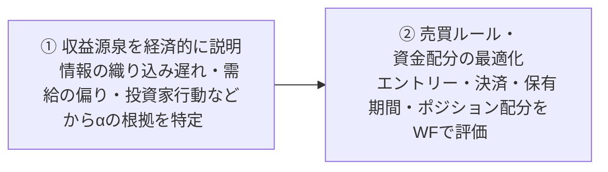

# PEAD01｜日本株の決算発表後ドリフト研究

PEAD（Post-Earnings Announcement Drift）は、決算情報の公表後も株価の調整が続く現象です。PEAD01では、日本株の決算イベントを起点に価格反応、執行条件、資金制約、期間を変えたときの成績を検証しています。

## 研究の基本設計：経済的根拠 → 最適化

PEAD01では、経済的に説明できる収益源泉を起点として、売買ルールと資金配分を検証・最適化する。

**① 収益源泉を経済的に説明**：決算情報の段階的な価格反映など、再現を期待する市場メカニズムを仮説として明確にする。

**② 売買ルール・資金配分の最適化**：仮説を売買条件に落とし、取引コスト・約定制約・資金台帳を反映したWF（逐次期間外評価）で収益性を確認する。探索に使ったWFと独立OOSは区別する。

**[研究全体の総括と資料索引](research/README.md)** から、各Phaseの総括、詳細レポート、実装と再現手順をたどれます。

| 研究系列 | 内容 | 総括 |
| --- | --- | --- |
| Phase 1〜5 | データ整備、決算後の価格形成、売買シミュレーション、分足での執行感応度 | [基礎研究](research/phase1_to_phase5_summary.md) |
| Phase 6 | 日足統一版。864候補、516営業日の共通ウォークフォワード（WF） | [Phase 6総括](research/phase6_daily_rebuild_summary.md) |
| Phase 7 | 現行Phase 6の期間感応度、利益集中、パラメータ持続性 | [Phase 7総括](research/phase7_summary.md) |
| 旧Phase 6・6.1 | 日足・分足混在版と信用・資金配分研究の履歴 | [アーカイブ](archive/legacy_phase6/README.md) |

結果は既観測データによるシミュレーションです。独立OOSと実運用成績は未取得です。生データ、認証情報、ローカルの計算結果ファイルは公開対象外です。

本プロジェクトは調査研究です。投資助言や将来収益の保証を目的とするものではありません。
