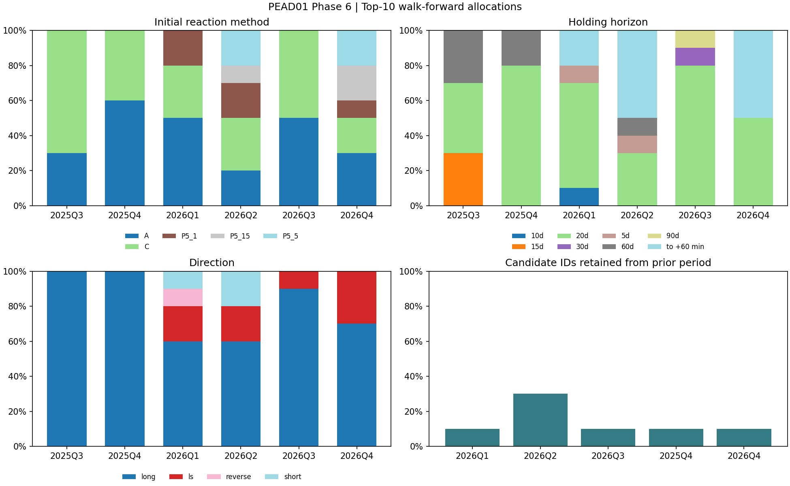

# Phase 6 Top-10のウォークフォワード採用パラメータ

採用履歴と候補定義を候補IDで結合し、保存済みの日次ネット損益を期間別に複利集計した。評価は既観測WF。最終期間は2026年11月13日まで。

## 期間と継続率

| 開始 | 終了 | 採用数 | 前期から継続／今期 | 期間ネット損益 |
| --- | --- | --- | --- | --- |
| 2025-07-01 | 2025-09-30 | 10 | — | 0.87% |
| 2025-10-01 | 2025-12-30 | 10 | 1/10（10%） | 0.57% |
| 2026-01-05 | 2026-03-31 | 10 | 3/10（30%） | -0.05% |
| 2026-04-01 | 2026-06-30 | 10 | 1/10（10%） | 0.06% |
| 2026-07-01 | 2026-09-30 | 10 | 1/10（10%） | -0.25% |
| 2026-10-01 | 2026-11-13 | 10 | 1/10（10%） | -0.01% |

全6期間で各10件、1条件10%。60枠に44種類の候補IDがあり、31種類は1回、10種類は2回、3種類は3回採用。隣接5回の更新では50枠のうち7枠（14%）が継続した。

## 各期間の採用条件

Aは最初の反応セッションの終値で測定し次の営業日寄りで建てる。Cは開示翌営業日寄りで測定し翌々営業日寄りで建てる。P5_1・P5_5・P5_15は初回約定後5分で判定し、それぞれ1・5・15分遅らせ、初回約定後60分の観測点で決済する。日次保有は営業日単位。閾値0%は追加の絶対値フィルターなし。銘柄配分設定は全件等額、βヘッジ設定は全件無効。

### 2025-07-01〜2025-09-30

| 候補ID | 初動 | 方向 | 閾値 | 保有・終点 | 最低ADV | 対象 | 追加条件 | 決済 | 学習順位 | 内部検証順位 | 配分 |
| --- | --- | --- | --- | --- | --- | --- | --- | --- | --- | --- | --- |
| d154b687a79ba276 | C | ロング | 0% | 20営業日 | なし | 全体 | 業種：倉庫･運輸関連業 | 固定 | 46 | 1 | 10.00% |
| e25ef307325acb68 | C | ロング | 7% | 15営業日 | 10億円 | 全体 | なし | 固定 | 35 | 2 | 10.00% |
| 7d36d3a98cdfe774 | C | ロング | 0% | 60営業日 | なし | 全体 | 営業利益予想下方修正 | 固定 | 33 | 3 | 10.00% |
| 98e238256d350f19 | C | ロング | 0% | 60営業日 | なし | 全体 | 予想修正と初動が逆方向 | 固定 | 34 | 4 | 10.00% |
| bd7c6e31495c0a31 | C | ロング | 7% | 15営業日 | 10億円 | TOPIX | なし | 固定 | 27 | 5 | 10.00% |
| 689b520baef83b99 | A | ロング | 0% | 20営業日 | なし | 全体 | 昼休み | 固定 | 16 | 6 | 10.00% |
| 1bf2446bdd2afc14 | C | ロング | 0% | 20営業日 | なし | 全体 | 営業利益予想下方修正 | 固定 | 4 | 7 | 10.00% |
| 56abf43639560d08 | C | ロング | 0% | 20営業日 | なし | 全体 | 予想修正と初動が逆方向 | 固定 | 5 | 8 | 10.00% |
| c4109646fd7bfcb8 | A | ロング | 7% | 15営業日 | 10億円 | TOPIX | なし | 固定 | 19 | 9 | 10.00% |
| cce7326b0b45cd42 | A | ロング | 0% | 60営業日 | なし | 全体 | 営業利益予想下方修正 | 固定 | 50 | 10 | 10.00% |

### 2025-10-01〜2025-12-30

| 候補ID | 初動 | 方向 | 閾値 | 保有・終点 | 最低ADV | 対象 | 追加条件 | 決済 | 学習順位 | 内部検証順位 | 配分 |
| --- | --- | --- | --- | --- | --- | --- | --- | --- | --- | --- | --- |
| bc8fe6e5cead67c2 | C | ロング | 0% | 20営業日 | なし | 全体 | 業種：鉄鋼 | 固定 | 37 | 1 | 10.00% |
| 434f955eb0779b69 | C | ロング | 0% | 20営業日 | なし | 全体 | 業種：非鉄金属 | 固定 | 49 | 2 | 10.00% |
| b3894500a40988b5 | A | ロング | 0% | 20営業日 | なし | 全体 | 業種：鉄鋼 | 固定 | 26 | 3 | 10.00% |
| bead3736a2a3a4ea | A | ロング | 0% | 20営業日 | なし | 全体 | 業種：機械 | 固定 | 38 | 4 | 10.00% |
| c57b8810940f9060 | C | ロング | 0% | 20営業日 | なし | 全体 | 業種：海運業 | 固定 | 2 | 5 | 10.00% |
| d4fd6c571a92a40a | A | ロング | 0% | 20営業日 | なし | 全体 | 業種：卸売業 | 固定 | 35 | 6 | 10.00% |
| d0105d6ab72c06e5 | A | ロング | 0% | 20営業日 | なし | 全体 | 前場 | 固定 | 17 | 7 | 10.00% |
| ccf5e5d3a5c14d5e | C | ロング | 0% | 20営業日 | なし | 全体 | 業種：ガラス･土石製品 | 固定 | 41 | 8 | 10.00% |
| cce7326b0b45cd42 | A | ロング | 0% | 60営業日 | なし | 全体 | 営業利益予想下方修正 | 固定 | 47 | 9 | 10.00% |
| 05ea91e30aefd931 | A | ロング | 0% | 60営業日 | なし | 全体 | 予想修正と初動が逆方向 | 固定 | 48 | 10 | 10.00% |

### 2026-01-05〜2026-03-31

| 候補ID | 初動 | 方向 | 閾値 | 保有・終点 | 最低ADV | 対象 | 追加条件 | 決済 | 学習順位 | 内部検証順位 | 配分 |
| --- | --- | --- | --- | --- | --- | --- | --- | --- | --- | --- | --- |
| efb6f8f881d3a07d | C | 初動追随LS | 0% | 20営業日 | なし | 全体 | 業種：海運業 | 固定 | 39 | 1 | 10.00% |
| 689b520baef83b99 | A | ロング | 0% | 20営業日 | なし | 全体 | 昼休み | 固定 | 30 | 2 | 10.00% |
| 94e5a9cf4ebf6297 | A | ロング | 0% | 20営業日 | なし | 全体 | 業種：ガラス･土石製品 | 固定 | 32 | 3 | 10.00% |
| 1b440fb9aca71f96 | P5_1 | ロング | 0% | 初回約定＋60分 | なし | 全体 | 業種：建設業 | 固定 | 7 | 4 | 10.00% |
| ccf5e5d3a5c14d5e | C | ロング | 0% | 20営業日 | なし | 全体 | 業種：ガラス･土石製品 | 固定 | 27 | 5 | 10.00% |
| 15f7235afc16e4a1 | A | 初動追随LS | 3% | 10営業日 | なし | 非TOPIX | なし | 固定 | 29 | 6 | 10.00% |
| bc8fe6e5cead67c2 | C | ロング | 0% | 20営業日 | なし | 全体 | 業種：鉄鋼 | 固定 | 21 | 7 | 10.00% |
| b3894500a40988b5 | A | ロング | 0% | 20営業日 | なし | 全体 | 業種：鉄鋼 | 固定 | 17 | 8 | 10.00% |
| 1732df485821a392 | A | ショート | 0% | 5営業日 | 10億円 | 非TOPIX | なし | 固定 | 8 | 9 | 10.00% |
| 88ee2eb9c147b90b | P5_1 | 逆張り | 7% | 初回約定＋60分 | 10億円 | 全体 | なし | 固定 | 25 | 10 | 10.00% |

### 2026-04-01〜2026-06-30

| 候補ID | 初動 | 方向 | 閾値 | 保有・終点 | 最低ADV | 対象 | 追加条件 | 決済 | 学習順位 | 内部検証順位 | 配分 |
| --- | --- | --- | --- | --- | --- | --- | --- | --- | --- | --- | --- |
| 1732df485821a392 | A | ショート | 0% | 5営業日 | 10億円 | 非TOPIX | なし | 固定 | 35 | 1 | 10.00% |
| 6dd06d9eefad34a0 | P5_1 | ロング | 0% | 初回約定＋60分 | なし | 全体 | 業種：サービス業 | 固定 | 10 | 2 | 10.00% |
| c57b8810940f9060 | C | ロング | 0% | 20営業日 | なし | 全体 | 業種：海運業 | 固定 | 2 | 3 | 10.00% |
| 7dc1728329701c41 | A | ロング | 0% | 20営業日 | なし | 全体 | 業種：海運業 | 固定 | 1 | 4 | 10.00% |
| 2ff153b7652a298e | P5_1 | 初動追随LS | 0% | 初回約定＋60分 | なし | 全体 | 業種：サービス業 | 固定 | 46 | 5 | 10.00% |
| f3b2382089e9f36c | P5_5 | ショート | 0% | 初回約定＋60分 | なし | 全体 | 業種：食料品 | 固定 | 20 | 6 | 10.00% |
| 654de52e93bb3af5 | P5_5 | ロング | 0% | 初回約定＋60分 | なし | 全体 | 業種：サービス業 | 固定 | 11 | 7 | 10.00% |
| 3a4d2f0bd25a226a | P5_15 | ロング | 3% | 初回約定＋60分 | なし | 非TOPIX | なし | 固定 | 43 | 8 | 10.00% |
| 5ca4a7d6a298450e | C | 初動追随LS | 0% | 60営業日 | なし | 全体 | 寄り前 | 固定 | 19 | 9 | 10.00% |
| 1bf2446bdd2afc14 | C | ロング | 0% | 20営業日 | なし | 全体 | 営業利益予想下方修正 | 固定 | 6 | 10 | 10.00% |

### 2026-07-01〜2026-09-30

| 候補ID | 初動 | 方向 | 閾値 | 保有・終点 | 最低ADV | 対象 | 追加条件 | 決済 | 学習順位 | 内部検証順位 | 配分 |
| --- | --- | --- | --- | --- | --- | --- | --- | --- | --- | --- | --- |
| 11c8f60972eb1f67 | C | ロング | 0% | 20営業日 | なし | 全体 | 前場 | 固定 | 11 | 1 | 10.00% |
| 1bf2446bdd2afc14 | C | ロング | 0% | 20営業日 | なし | 全体 | 営業利益予想下方修正 | 固定 | 7 | 2 | 10.00% |
| 56abf43639560d08 | C | ロング | 0% | 20営業日 | なし | 全体 | 予想修正と初動が逆方向 | 固定 | 8 | 3 | 10.00% |
| dc393799b6b7f6c2 | A | ロング | 0% | 20営業日 | なし | 全体 | 業種：ゴム製品 | 固定 | 36 | 4 | 10.00% |
| 338ce57e5efc9042 | C | ロング | 0% | 20営業日 | なし | 全体 | 業種：ゴム製品 | 固定 | 43 | 5 | 10.00% |
| 94e5a9cf4ebf6297 | A | ロング | 0% | 20営業日 | なし | 全体 | 業種：ガラス･土石製品 | 固定 | 20 | 6 | 10.00% |
| d0105d6ab72c06e5 | A | ロング | 0% | 20営業日 | なし | 全体 | 前場 | 固定 | 21 | 7 | 10.00% |
| 6c604414bb9fdfa7 | A | 初動追随LS | 7% | 90営業日 | 10億円 | TOPIX | なし | 固定 | 32 | 8 | 10.00% |
| ccf5e5d3a5c14d5e | C | ロング | 0% | 20営業日 | なし | 全体 | 業種：ガラス･土石製品 | 固定 | 19 | 9 | 10.00% |
| 94b292034b18db7f | A | ロング | 7% | 30営業日 | 10億円 | TOPIX | なし | 固定 | 44 | 10 | 10.00% |

### 2026-10-01〜2026-11-13

| 候補ID | 初動 | 方向 | 閾値 | 保有・終点 | 最低ADV | 対象 | 追加条件 | 決済 | 学習順位 | 内部検証順位 | 配分 |
| --- | --- | --- | --- | --- | --- | --- | --- | --- | --- | --- | --- |
| 2eee0e6ac8601c4e | A | ロング | 0% | 20営業日 | なし | 全体 | 業種：電気･ガス業 | 固定 | 35 | 1 | 10.00% |
| 860472858213c6ed | P5_15 | ロング | 0% | 初回約定＋60分 | なし | 全体 | 業種：証券･商品先物取引業 | 固定 | 38 | 2 | 10.00% |
| 7dc1728329701c41 | A | ロング | 0% | 20営業日 | なし | 全体 | 業種：海運業 | 固定 | 2 | 3 | 10.00% |
| ce72146abbb9cbcb | P5_5 | ロング | 0% | 初回約定＋60分 | なし | 全体 | 業種：証券･商品先物取引業 | 固定 | 40 | 4 | 10.00% |
| ccb4816ee9ac212e | P5_5 | 初動追随LS | 0% | 初回約定＋60分 | なし | 全体 | 業種：証券･商品先物取引業 | 固定 | 18 | 5 | 10.00% |
| 60251e7e3f3894bc | P5_1 | 初動追随LS | 0% | 初回約定＋60分 | なし | 全体 | 業種：証券･商品先物取引業 | 固定 | 33 | 6 | 10.00% |
| 11c8f60972eb1f67 | C | ロング | 0% | 20営業日 | なし | 全体 | 前場 | 固定 | 19 | 7 | 10.00% |
| c57b8810940f9060 | C | ロング | 0% | 20営業日 | なし | 全体 | 業種：海運業 | 固定 | 4 | 8 | 10.00% |
| 0170a76f84068203 | P5_15 | 初動追随LS | 0% | 初回約定＋60分 | なし | 全体 | 業種：証券･商品先物取引業 | 固定 | 14 | 9 | 10.00% |
| cbb32f7e54f019df | A | ロング | 0% | 20営業日 | なし | 全体 | 業種：輸送用機器 | 固定 | 32 | 10 | 10.00% |

## パラメータ分布

期間別構成比は各期間の設定配分。累積配分比率は6期間を等重みで平均した値で、実際の約定額や建玉を表さない。最終期間も1期間として扱う。

### 初動計測

| 初動計測 | 2025Q3 | 2025Q4 | 2026Q1 | 2026Q2 | 2026Q3 | 2026Q4 | 採用回数 | 累積配分比率 |
| --- | --- | --- | --- | --- | --- | --- | --- | --- |
| A | 30.00% | 60.00% | 50.00% | 20.00% | 50.00% | 30.00% | 24 | 40.00% |
| C | 70.00% | 40.00% | 30.00% | 30.00% | 50.00% | 20.00% | 24 | 40.00% |
| P5_1 | 0.00% | 0.00% | 20.00% | 20.00% | 0.00% | 10.00% | 5 | 8.33% |
| P5_15 | 0.00% | 0.00% | 0.00% | 10.00% | 0.00% | 20.00% | 3 | 5.00% |
| P5_5 | 0.00% | 0.00% | 0.00% | 20.00% | 0.00% | 20.00% | 4 | 6.67% |

### 保有・終点

| 保有・終点 | 2025Q3 | 2025Q4 | 2026Q1 | 2026Q2 | 2026Q3 | 2026Q4 | 採用回数 | 累積配分比率 |
| --- | --- | --- | --- | --- | --- | --- | --- | --- |
| 10営業日 | 0.00% | 0.00% | 10.00% | 0.00% | 0.00% | 0.00% | 1 | 1.67% |
| 15営業日 | 30.00% | 0.00% | 0.00% | 0.00% | 0.00% | 0.00% | 3 | 5.00% |
| 20営業日 | 40.00% | 80.00% | 60.00% | 30.00% | 80.00% | 50.00% | 34 | 56.67% |
| 30営業日 | 0.00% | 0.00% | 0.00% | 0.00% | 10.00% | 0.00% | 1 | 1.67% |
| 5営業日 | 0.00% | 0.00% | 10.00% | 10.00% | 0.00% | 0.00% | 2 | 3.33% |
| 60営業日 | 30.00% | 20.00% | 0.00% | 10.00% | 0.00% | 0.00% | 6 | 10.00% |
| 90営業日 | 0.00% | 0.00% | 0.00% | 0.00% | 10.00% | 0.00% | 1 | 1.67% |
| 初回約定＋60分 | 0.00% | 0.00% | 20.00% | 50.00% | 0.00% | 50.00% | 12 | 20.00% |

### 売買方向

| 売買方向 | 2025Q3 | 2025Q4 | 2026Q1 | 2026Q2 | 2026Q3 | 2026Q4 | 採用回数 | 累積配分比率 |
| --- | --- | --- | --- | --- | --- | --- | --- | --- |
| ショート | 0.00% | 0.00% | 10.00% | 20.00% | 0.00% | 0.00% | 3 | 5.00% |
| ロング | 100.00% | 100.00% | 60.00% | 60.00% | 90.00% | 70.00% | 48 | 80.00% |
| 初動追随LS | 0.00% | 0.00% | 20.00% | 20.00% | 10.00% | 30.00% | 8 | 13.33% |
| 逆張り | 0.00% | 0.00% | 10.00% | 0.00% | 0.00% | 0.00% | 1 | 1.67% |

### 初動閾値

| 初動閾値 | 2025Q3 | 2025Q4 | 2026Q1 | 2026Q2 | 2026Q3 | 2026Q4 | 採用回数 | 累積配分比率 |
| --- | --- | --- | --- | --- | --- | --- | --- | --- |
| 0% | 70.00% | 100.00% | 80.00% | 90.00% | 80.00% | 100.00% | 52 | 86.67% |
| 3% | 0.00% | 0.00% | 10.00% | 10.00% | 0.00% | 0.00% | 2 | 3.33% |
| 7% | 30.00% | 0.00% | 10.00% | 0.00% | 20.00% | 0.00% | 6 | 10.00% |

### 最低ADV

| 最低ADV | 2025Q3 | 2025Q4 | 2026Q1 | 2026Q2 | 2026Q3 | 2026Q4 | 採用回数 | 累積配分比率 |
| --- | --- | --- | --- | --- | --- | --- | --- | --- |
| 10億円 | 30.00% | 0.00% | 20.00% | 10.00% | 20.00% | 0.00% | 8 | 13.33% |
| なし | 70.00% | 100.00% | 80.00% | 90.00% | 80.00% | 100.00% | 52 | 86.67% |

### 対象

| 対象 | 2025Q3 | 2025Q4 | 2026Q1 | 2026Q2 | 2026Q3 | 2026Q4 | 採用回数 | 累積配分比率 |
| --- | --- | --- | --- | --- | --- | --- | --- | --- |
| TOPIX | 20.00% | 0.00% | 0.00% | 0.00% | 20.00% | 0.00% | 4 | 6.67% |
| 全体 | 80.00% | 100.00% | 80.00% | 80.00% | 80.00% | 100.00% | 52 | 86.67% |
| 非TOPIX | 0.00% | 0.00% | 20.00% | 20.00% | 0.00% | 0.00% | 4 | 6.67% |

### 追加条件

| 追加条件 | 2025Q3 | 2025Q4 | 2026Q1 | 2026Q2 | 2026Q3 | 2026Q4 | 採用回数 | 累積配分比率 |
| --- | --- | --- | --- | --- | --- | --- | --- | --- |
| なし | 30.00% | 0.00% | 30.00% | 20.00% | 20.00% | 0.00% | 10 | 16.67% |
| 予想修正と初動が逆方向 | 20.00% | 10.00% | 0.00% | 0.00% | 10.00% | 0.00% | 4 | 6.67% |
| 前場 | 0.00% | 10.00% | 0.00% | 0.00% | 20.00% | 10.00% | 4 | 6.67% |
| 営業利益予想下方修正 | 30.00% | 10.00% | 0.00% | 10.00% | 10.00% | 0.00% | 6 | 10.00% |
| 寄り前 | 0.00% | 0.00% | 0.00% | 10.00% | 0.00% | 0.00% | 1 | 1.67% |
| 昼休み | 10.00% | 0.00% | 10.00% | 0.00% | 0.00% | 0.00% | 2 | 3.33% |
| 業種：ガラス･土石製品 | 0.00% | 10.00% | 20.00% | 0.00% | 20.00% | 0.00% | 5 | 8.33% |
| 業種：ゴム製品 | 0.00% | 0.00% | 0.00% | 0.00% | 20.00% | 0.00% | 2 | 3.33% |
| 業種：サービス業 | 0.00% | 0.00% | 0.00% | 30.00% | 0.00% | 0.00% | 3 | 5.00% |
| 業種：倉庫･運輸関連業 | 10.00% | 0.00% | 0.00% | 0.00% | 0.00% | 0.00% | 1 | 1.67% |
| 業種：卸売業 | 0.00% | 10.00% | 0.00% | 0.00% | 0.00% | 0.00% | 1 | 1.67% |
| 業種：建設業 | 0.00% | 0.00% | 10.00% | 0.00% | 0.00% | 0.00% | 1 | 1.67% |
| 業種：機械 | 0.00% | 10.00% | 0.00% | 0.00% | 0.00% | 0.00% | 1 | 1.67% |
| 業種：海運業 | 0.00% | 10.00% | 10.00% | 20.00% | 0.00% | 20.00% | 6 | 10.00% |
| 業種：証券･商品先物取引業 | 0.00% | 0.00% | 0.00% | 0.00% | 0.00% | 50.00% | 5 | 8.33% |
| 業種：輸送用機器 | 0.00% | 0.00% | 0.00% | 0.00% | 0.00% | 10.00% | 1 | 1.67% |
| 業種：鉄鋼 | 0.00% | 20.00% | 20.00% | 0.00% | 0.00% | 0.00% | 4 | 6.67% |
| 業種：電気･ガス業 | 0.00% | 0.00% | 0.00% | 0.00% | 0.00% | 10.00% | 1 | 1.67% |
| 業種：非鉄金属 | 0.00% | 10.00% | 0.00% | 0.00% | 0.00% | 0.00% | 1 | 1.67% |
| 業種：食料品 | 0.00% | 0.00% | 0.00% | 10.00% | 0.00% | 0.00% | 1 | 1.67% |

### 決済

| 決済 | 2025Q3 | 2025Q4 | 2026Q1 | 2026Q2 | 2026Q3 | 2026Q4 | 採用回数 | 累積配分比率 |
| --- | --- | --- | --- | --- | --- | --- | --- | --- |
| 固定 | 100.00% | 100.00% | 100.00% | 100.00% | 100.00% | 100.00% | 60 | 100.00% |

### 候補ID別

| 候補ID | 採用回数 | 累積配分比率 |
| --- | --- | --- |
| 1bf2446bdd2afc14 | 3.0 | 5.00% |
| c57b8810940f9060 | 3.0 | 5.00% |
| ccf5e5d3a5c14d5e | 3.0 | 5.00% |
| 11c8f60972eb1f67 | 2.0 | 3.33% |
| 1732df485821a392 | 2.0 | 3.33% |
| 56abf43639560d08 | 2.0 | 3.33% |
| 689b520baef83b99 | 2.0 | 3.33% |
| 7dc1728329701c41 | 2.0 | 3.33% |
| 94e5a9cf4ebf6297 | 2.0 | 3.33% |
| b3894500a40988b5 | 2.0 | 3.33% |
| bc8fe6e5cead67c2 | 2.0 | 3.33% |
| cce7326b0b45cd42 | 2.0 | 3.33% |
| d0105d6ab72c06e5 | 2.0 | 3.33% |
| 0170a76f84068203 | 1.0 | 1.67% |
| 05ea91e30aefd931 | 1.0 | 1.67% |
| 15f7235afc16e4a1 | 1.0 | 1.67% |
| 1b440fb9aca71f96 | 1.0 | 1.67% |
| 2eee0e6ac8601c4e | 1.0 | 1.67% |
| 2ff153b7652a298e | 1.0 | 1.67% |
| 338ce57e5efc9042 | 1.0 | 1.67% |
| 3a4d2f0bd25a226a | 1.0 | 1.67% |
| 434f955eb0779b69 | 1.0 | 1.67% |
| 5ca4a7d6a298450e | 1.0 | 1.67% |
| 60251e7e3f3894bc | 1.0 | 1.67% |
| 654de52e93bb3af5 | 1.0 | 1.67% |
| 6c604414bb9fdfa7 | 1.0 | 1.67% |
| 6dd06d9eefad34a0 | 1.0 | 1.67% |
| 7d36d3a98cdfe774 | 1.0 | 1.67% |
| 860472858213c6ed | 1.0 | 1.67% |
| 88ee2eb9c147b90b | 1.0 | 1.67% |
| 94b292034b18db7f | 1.0 | 1.67% |
| 98e238256d350f19 | 1.0 | 1.67% |
| bd7c6e31495c0a31 | 1.0 | 1.67% |
| bead3736a2a3a4ea | 1.0 | 1.67% |
| c4109646fd7bfcb8 | 1.0 | 1.67% |
| cbb32f7e54f019df | 1.0 | 1.67% |
| ccb4816ee9ac212e | 1.0 | 1.67% |
| ce72146abbb9cbcb | 1.0 | 1.67% |
| d154b687a79ba276 | 1.0 | 1.67% |
| d4fd6c571a92a40a | 1.0 | 1.67% |
| dc393799b6b7f6c2 | 1.0 | 1.67% |
| e25ef307325acb68 | 1.0 | 1.67% |
| efb6f8f881d3a07d | 1.0 | 1.67% |
| f3b2382089e9f36c | 1.0 | 1.67% |

## 確認できたことと解釈

- **ロング中心の採用は続いた。** ロング専用は48/60枠（80%）で、全期で過半数。2025年の2期間は全枠ロングだった。Phase 3の方向別結果と整合する傾向だが、この採用表から同条件での収益優位までは確認できない。
- **候補IDが替わっても、入口・保有・方向には集中があった。** AとCは各24/60枠（各40%）、20営業日保有は34/60枠（56.7%）。AまたはCの20営業日ロングだけで33/60枠（55%）だった。
- **IS Sharpe 1.78からWF 0.55への低下の原因は特定できない。** 2025年の両期間はプラス、2026年の4期間のうち3期間はマイナスだった。隣接期継続率14%は選択が変動した事実を示すが、変動が損益を悪化させたかは分からない。入口・保有・方向の共通性は重複リスクを示唆するが、同じ銘柄や建玉が実際に重なったことはこの表から確認できない。
- 保存済み実効独立戦略数はIS 5.57、WF 7.56。WF値は全期間の採用候補の一次損益系列をまとめた指標で、同時稼働の分散を測っていない。既存の建玉重複表もIS上位候補を対象としている。市場環境の変化やISでの候補選択の影響と、入れ替わり・重複の影響を切り分けるには期間別の比較が必要。
