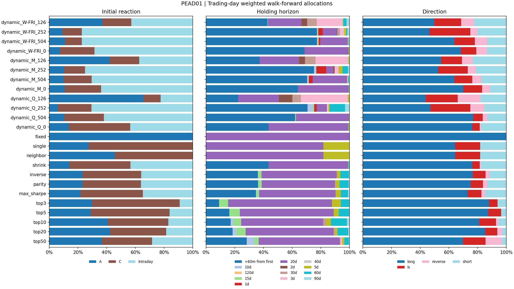
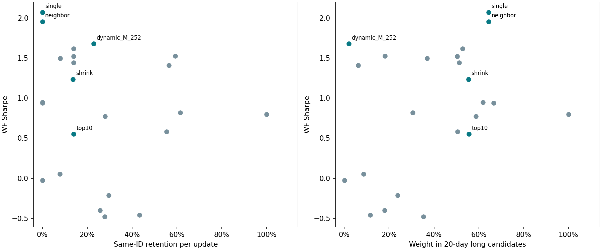

# Phase 6 アンサンブル方式別のWF採用パラメータ

対象は2025年7月1日〜2026年11月13日の既観測WF。採用履歴と候補定義をIDで結合し、保存済み日次ポートフォリオ系列を集計した。
SingleやTop-Kは条件の選択・配分方法。A・C・分足は個々の候補の初動計測方法。Aは最初の反応セッションの終値判定で次営業日寄り、Cは開示翌営業日寄り判定で翌々営業日寄り。I系は数字の分で判定する分足方式、P5系は5分判定後に末尾の分だけ遅延する方式。候補コードと条件の定義は[既存パラメータ資料](parameters_ja.md)、Top-10の全枠は[個別レポート](../reports/phase6_top10_wf_parameters.md)を参照。

## 方式別の傾向

| 方式 | 更新数 | 正配分ID累計 | 平均継続率 | ID配分変化 | 計測変化 | 保有変化 | 方向変化 | WF Sharpe | 最大DD | ロング | 20日 | ロングかつ20日 |
| --- | --- | --- | --- | --- | --- | --- | --- | --- | --- | --- | --- | --- |
| dynamic_W-FRI_126 | 72 | 204 | 43.27% | 61.59% | 26.07% | 30.25% | 33.97% | -0.46 | -5.44% | 49.88% | 23.55% | 11.53% |
| dynamic_W-FRI_252 | 72 | 143 | 56.40% | 55.14% | 23.12% | 25.71% | 32.91% | 1.41 | -0.56% | 46.39% | 9.77% | 6.22% |
| dynamic_W-FRI_504 | 72 | 113 | 59.20% | 43.98% | 17.17% | 14.10% | 28.24% | 1.53 | -0.30% | 63.90% | 19.21% | 18.13% |
| dynamic_W-FRI_0 | 72 | 88 | 61.46% | 45.41% | 18.26% | 15.98% | 26.60% | 0.82 | -0.42% | 68.27% | 30.73% | 30.54% |
| dynamic_M_126 | 17 | 78 | 25.72% | 85.04% | 56.27% | 55.82% | 36.08% | -0.40 | -4.77% | 54.63% | 27.44% | 18.03% |
| dynamic_M_252 | 17 | 88 | 22.81% | 77.54% | 34.30% | 36.65% | 45.14% | 1.68 | -0.20% | 52.30% | 4.93% | 2.04% |
| dynamic_M_504 | 17 | 73 | 29.53% | 75.02% | 29.58% | 29.37% | 38.75% | -0.21 | -0.91% | 63.76% | 24.09% | 23.84% |
| dynamic_M_0 | 17 | 61 | 27.86% | 79.02% | 50.87% | 50.66% | 41.31% | -0.48 | -0.27% | 70.04% | 35.38% | 35.28% |
| dynamic_Q_126 | 6 | 36 | 7.86% | 89.25% | 46.42% | 74.46% | 48.99% | 0.05 | -2.68% | 43.82% | 28.43% | 8.62% |
| dynamic_Q_252 | 6 | 45 | 0.00% | 100.00% | 24.51% | 32.41% | 83.34% | -0.03 | -1.09% | 47.05% | 6.94% | 0.05% |
| dynamic_Q_504 | 6 | 34 | 8.00% | 89.73% | 27.63% | 21.46% | 42.90% | 1.50 | -0.56% | 76.80% | 37.03% | 36.87% |
| dynamic_Q_0 | 6 | 33 | 13.67% | 99.65% | 62.61% | 59.87% | 50.20% | 1.23 | -0.23% | 76.24% | 55.47% | 55.36% |
| fixed | 6 | 1 | 100.00% | 0.00% | 0.00% | 0.00% | 0.00% | 0.80 | -8.41% | 100.00% | 100.00% | 100.00% |
| single | 6 | 6 | 0.00% | 100.00% | 60.00% | 40.00% | 60.00% | 2.07 | -0.48% | 64.37% | 81.74% | 64.37% |
| neighbor | 6 | 8 | 0.00% | 100.00% | 60.00% | 40.00% | 60.00% | 1.95 | -0.26% | 64.37% | 81.74% | 64.37% |
| shrink | 6 | 33 | 13.67% | 99.64% | 62.63% | 59.88% | 49.94% | 1.24 | -0.23% | 76.32% | 55.47% | 55.35% |
| inverse | 6 | 44 | 14.00% | 96.06% | 55.55% | 60.08% | 40.99% | 1.44 | -0.43% | 76.76% | 52.29% | 51.29% |
| parity | 6 | 44 | 14.00% | 96.00% | 55.15% | 59.81% | 42.96% | 1.52 | -0.42% | 75.22% | 51.14% | 50.32% |
| max_sharpe | 6 | 44 | 14.00% | 96.07% | 51.66% | 57.47% | 45.00% | 1.62 | -0.33% | 72.99% | 53.39% | 52.67% |
| top3 | 6 | 18 | 0.00% | 100.00% | 53.33% | 46.67% | 20.00% | 0.94 | -1.61% | 88.12% | 72.46% | 66.67% |
| top5 | 6 | 28 | 0.00% | 100.00% | 44.00% | 52.00% | 20.00% | 0.95 | -1.24% | 87.43% | 65.33% | 61.86% |
| top10 | 6 | 44 | 14.00% | 86.00% | 36.00% | 48.00% | 20.00% | 0.55 | -1.47% | 81.23% | 57.28% | 55.54% |
| top20 | 6 | 74 | 28.00% | 72.00% | 24.00% | 31.00% | 18.00% | 0.77 | -2.73% | 85.28% | 61.39% | 58.73% |
| top50 | 6 | 129 | 55.33% | 45.22% | 17.04% | 22.38% | 20.96% | 0.58 | -2.36% | 69.83% | 56.54% | 50.47% |

継続率は今期の正配分IDのうち前期も正配分だった割合。配分変化は全カテゴリのウェイト差の絶対値合計の半分（0〜100%）。四半期・月次・週次の更新単位は異なる。各期間の比較では初回を除いた単純平均。右端3列は営業日で加重した設定配分。実際の建玉配分や取引数と異なり、既存ポジションは更新後も残り得る。

## 重点5方式の比較

| 方式A | 方式B | 共通ID数 | ID Jaccard | ID配分差 | 計測差 | 保有差 | 方向差 |
| --- | --- | --- | --- | --- | --- | --- | --- |
| single | top10 | 1.00 | 10.00% | 90.00% | 60.00% | 46.67% | 33.33% |
| single | neighbor | 1.00 | 83.33% | 16.67% | 16.67% | 0.00% | 0.00% |
| single | shrink | 0.83 | 13.24% | 83.73% | 61.50% | 49.68% | 26.15% |
| single | dynamic_M_252 | 0.00 | 0.00% | 100.00% | 90.19% | 96.42% | 56.68% |
| top10 | neighbor | 1.33 | 13.33% | 86.67% | 43.33% | 46.67% | 33.33% |
| top10 | shrink | 7.67 | 76.67% | 69.55% | 41.02% | 45.24% | 23.50% |
| top10 | dynamic_M_252 | 2.33 | 9.11% | 89.28% | 56.44% | 70.26% | 35.76% |
| neighbor | shrink | 1.17 | 17.41% | 82.73% | 55.05% | 49.68% | 26.15% |
| neighbor | dynamic_M_252 | 0.00 | 0.00% | 100.00% | 88.10% | 96.42% | 56.68% |
| shrink | dynamic_M_252 | 1.67 | 6.63% | 79.64% | 51.13% | 59.64% | 40.79% |

上表は各四半期の差を等重みで平均。候補IDのJaccardは共通の正配分ID数÷和集合のID数。以下に四半期別の値を示す。

重点方式の期間別ペア比較

| 方式A | 方式B | 四半期 | 共通ID | Jaccard | ID配分差 | 計測差 | 保有差 | 方向差 |
| --- | --- | --- | --- | --- | --- | --- | --- | --- |
| single | top10 | 2025Q3 | 1 | 10.00% | 90.00% | 30.00% | 60.00% | 0.00% |
| single | top10 | 2025Q4 | 1 | 10.00% | 90.00% | 60.00% | 20.00% | 0.00% |
| single | top10 | 2026Q1 | 1 | 10.00% | 90.00% | 70.00% | 40.00% | 80.00% |
| single | top10 | 2026Q2 | 1 | 10.00% | 90.00% | 80.00% | 90.00% | 80.00% |
| single | top10 | 2026Q3 | 1 | 10.00% | 90.00% | 50.00% | 20.00% | 10.00% |
| single | top10 | 2026Q4 | 1 | 10.00% | 90.00% | 70.00% | 50.00% | 30.00% |
| single | neighbor | 2025Q3 | 1 | 100.00% | 0.00% | 0.00% | 0.00% | 0.00% |
| single | neighbor | 2025Q4 | 1 | 50.00% | 50.00% | 50.00% | 0.00% | 0.00% |
| single | neighbor | 2026Q1 | 1 | 100.00% | 0.00% | 0.00% | 0.00% | 0.00% |
| single | neighbor | 2026Q2 | 1 | 100.00% | 0.00% | 0.00% | 0.00% | 0.00% |
| single | neighbor | 2026Q3 | 1 | 50.00% | 50.00% | 50.00% | 0.00% | 0.00% |
| single | neighbor | 2026Q4 | 1 | 100.00% | 0.00% | 0.00% | 0.00% | 0.00% |
| single | shrink | 2025Q3 | 1 | 33.33% | 12.12% | 0.00% | 0.00% | 0.00% |
| single | shrink | 2025Q4 | 1 | 12.50% | 97.99% | 19.33% | 1.07% | 0.00% |
| single | shrink | 2026Q1 | 1 | 11.11% | 99.32% | 99.18% | 98.97% | 99.30% |
| single | shrink | 2026Q2 | 1 | 10.00% | 98.71% | 98.47% | 98.71% | 4.46% |
| single | shrink | 2026Q3 | 1 | 12.50% | 94.23% | 52.33% | 0.62% | 0.62% |
| single | shrink | 2026Q4 | 0 | 0.00% | 100.00% | 99.67% | 98.70% | 52.53% |
| single | dynamic_M_252 | 2025Q3 | 0 | 0.00% | 100.00% | 70.65% | 99.93% | 6.04% |
| single | dynamic_M_252 | 2025Q4 | 0 | 0.00% | 100.00% | 82.15% | 87.10% | 59.35% |
| single | dynamic_M_252 | 2026Q1 | 0 | 0.00% | 100.00% | 99.31% | 97.73% | 92.26% |
| single | dynamic_M_252 | 2026Q2 | 0 | 0.00% | 100.00% | 96.71% | 100.00% | 54.71% |
| single | dynamic_M_252 | 2026Q3 | 0 | 0.00% | 100.00% | 93.00% | 94.68% | 28.66% |
| single | dynamic_M_252 | 2026Q4 | 0 | 0.00% | 100.00% | 99.36% | 99.08% | 99.05% |
| top10 | neighbor | 2025Q3 | 1 | 10.00% | 90.00% | 30.00% | 60.00% | 0.00% |
| top10 | neighbor | 2025Q4 | 2 | 20.00% | 80.00% | 10.00% | 20.00% | 0.00% |
| top10 | neighbor | 2026Q1 | 1 | 10.00% | 90.00% | 70.00% | 40.00% | 80.00% |
| top10 | neighbor | 2026Q2 | 1 | 10.00% | 90.00% | 80.00% | 90.00% | 80.00% |
| top10 | neighbor | 2026Q3 | 2 | 20.00% | 80.00% | 0.00% | 20.00% | 10.00% |
| top10 | neighbor | 2026Q4 | 1 | 10.00% | 90.00% | 70.00% | 50.00% | 30.00% |
| top10 | shrink | 2025Q3 | 3 | 30.00% | 77.88% | 30.00% | 60.00% | 0.00% |
| top10 | shrink | 2025Q4 | 8 | 80.00% | 58.39% | 40.67% | 18.93% | 0.00% |
| top10 | shrink | 2026Q1 | 9 | 90.00% | 83.18% | 77.46% | 77.46% | 33.53% |
| top10 | shrink | 2026Q2 | 10 | 100.00% | 84.25% | 46.95% | 46.95% | 75.54% |
| top10 | shrink | 2026Q3 | 8 | 80.00% | 64.87% | 2.33% | 19.38% | 9.38% |
| top10 | shrink | 2026Q4 | 8 | 80.00% | 48.70% | 48.70% | 48.70% | 22.53% |
| top10 | dynamic_M_252 | 2025Q3 | 2 | 8.00% | 88.42% | 64.44% | 77.64% | 6.04% |
| top10 | dynamic_M_252 | 2025Q4 | 1 | 3.03% | 99.86% | 76.45% | 86.96% | 59.35% |
| top10 | dynamic_M_252 | 2026Q1 | 3 | 10.34% | 89.73% | 44.42% | 69.95% | 36.17% |
| top10 | dynamic_M_252 | 2026Q2 | 3 | 11.54% | 88.89% | 37.81% | 44.10% | 25.29% |
| top10 | dynamic_M_252 | 2026Q3 | 1 | 3.57% | 99.18% | 86.13% | 93.84% | 18.66% |
| top10 | dynamic_M_252 | 2026Q4 | 4 | 18.18% | 69.63% | 29.36% | 49.08% | 69.05% |
| neighbor | shrink | 2025Q3 | 1 | 33.33% | 12.12% | 0.00% | 0.00% | 0.00% |
| neighbor | shrink | 2025Q4 | 2 | 25.00% | 96.39% | 30.67% | 1.07% | 0.00% |
| neighbor | shrink | 2026Q1 | 1 | 11.11% | 99.32% | 99.18% | 98.97% | 99.30% |
| neighbor | shrink | 2026Q2 | 1 | 10.00% | 98.71% | 98.47% | 98.71% | 4.46% |
| neighbor | shrink | 2026Q3 | 2 | 25.00% | 89.87% | 2.33% | 0.62% | 0.62% |
| neighbor | shrink | 2026Q4 | 0 | 0.00% | 100.00% | 99.67% | 98.70% | 52.53% |
| neighbor | dynamic_M_252 | 2025Q3 | 0 | 0.00% | 100.00% | 70.65% | 99.93% | 6.04% |
| neighbor | dynamic_M_252 | 2025Q4 | 0 | 0.00% | 100.00% | 76.45% | 87.10% | 59.35% |
| neighbor | dynamic_M_252 | 2026Q1 | 0 | 0.00% | 100.00% | 99.31% | 97.73% | 92.26% |
| neighbor | dynamic_M_252 | 2026Q2 | 0 | 0.00% | 100.00% | 96.71% | 100.00% | 54.71% |
| neighbor | dynamic_M_252 | 2026Q3 | 0 | 0.00% | 100.00% | 86.13% | 94.68% | 28.66% |
| neighbor | dynamic_M_252 | 2026Q4 | 0 | 0.00% | 100.00% | 99.36% | 99.08% | 99.05% |
| shrink | dynamic_M_252 | 2025Q3 | 0 | 0.00% | 100.00% | 70.65% | 99.93% | 6.04% |
| shrink | dynamic_M_252 | 2025Q4 | 1 | 3.23% | 99.86% | 76.45% | 86.96% | 59.35% |
| shrink | dynamic_M_252 | 2026Q1 | 3 | 10.71% | 76.63% | 33.16% | 33.03% | 54.53% |
| shrink | dynamic_M_252 | 2026Q2 | 3 | 11.54% | 53.87% | 9.13% | 11.64% | 50.25% |
| shrink | dynamic_M_252 | 2026Q3 | 0 | 0.00% | 100.00% | 86.13% | 94.68% | 28.03% |
| shrink | dynamic_M_252 | 2026Q4 | 3 | 14.29% | 47.47% | 31.23% | 31.60% | 46.52% |

## 結論

- SingleとNeighborのID重複率は平均83.33%。集約後の初動計測・保有・方向の配分差は順に16.67%、0.00%、0.00%で、IDとパラメータの類似性を分けて読む。
- Top-10とShrinkの平均ID重複率は76.67%、候補ID上の配分差は69.55%。共通ID内だけで各方式の配分を100%に正規化しても、平均61.35%の差があった。ゼロ配分は正配分の重複に数えない。
- Dynamic_M_252は17回、Top-10は6回更新。更新1回あたりの計測・保有・方向の平均変化はDynamicが34.30%・36.65%・45.14%、Top-10が36.00%・48.00%・20.00%。更新回数と1回あたりの変化は別の指標。
- WF Sharpe上位5方式のロング配分は52.30%〜72.99%、20営業日保有の配分は4.93%〜81.74%。全方式でSharpeと20日ロング配分のSpearman相関は0.28、継続率との相関は-0.27。方式間で候補と評価期間が重なる記述比較であり、因果関係や未観測期間の優位性は判断できない。
- 正配分で複数方式に選ばれた候補は219種類。共通シグナルの存在を示すが、同時保有の重複は採用記録から測れない。

複数方式で採用された候補ID

| ID | 方式数 | 採用枠数 | 方式 |
| --- | --- | --- | --- |
| 6dd06d9eefad34a0 | 21 | 92 | dynamic_M_0, dynamic_M_126, dynamic_M_252, dynamic_M_504, dynamic_Q_0, dynamic_Q_126, dynamic_Q_252, dynamic_Q_504, dynamic_W-FRI_0, dynamic_W-FRI_126, dynamic_W-FRI_252, dynamic_W-FRI_504, inverse, max_sharpe, parity, shrink, top10, top20, top3, top5, top50 |
| 1732df485821a392 | 20 | 82 | dynamic_M_0, dynamic_M_252, dynamic_M_504, dynamic_Q_0, dynamic_Q_252, dynamic_Q_504, dynamic_W-FRI_0, dynamic_W-FRI_252, dynamic_W-FRI_504, inverse, max_sharpe, neighbor, parity, shrink, single, top10, top20, top3, top5, top50 |
| 1b440fb9aca71f96 | 20 | 71 | dynamic_M_0, dynamic_M_126, dynamic_M_252, dynamic_M_504, dynamic_Q_0, dynamic_Q_126, dynamic_Q_252, dynamic_Q_504, dynamic_W-FRI_0, dynamic_W-FRI_126, dynamic_W-FRI_252, dynamic_W-FRI_504, inverse, max_sharpe, parity, shrink, top10, top20, top5, top50 |
| 94e5a9cf4ebf6297 | 19 | 86 | dynamic_M_0, dynamic_M_126, dynamic_M_504, dynamic_Q_0, dynamic_Q_126, dynamic_Q_504, dynamic_W-FRI_0, dynamic_W-FRI_126, dynamic_W-FRI_252, dynamic_W-FRI_504, inverse, max_sharpe, parity, shrink, top10, top20, top3, top5, top50 |
| d154b687a79ba276 | 19 | 45 | dynamic_M_0, dynamic_M_126, dynamic_M_252, dynamic_Q_0, dynamic_W-FRI_0, dynamic_W-FRI_126, dynamic_W-FRI_252, dynamic_W-FRI_504, inverse, max_sharpe, neighbor, parity, shrink, single, top10, top20, top3, top5, top50 |
| 1bf2446bdd2afc14 | 18 | 81 | dynamic_M_0, dynamic_M_126, dynamic_M_504, dynamic_Q_0, dynamic_Q_126, dynamic_Q_504, dynamic_W-FRI_0, dynamic_W-FRI_126, dynamic_W-FRI_504, inverse, max_sharpe, parity, shrink, top10, top20, top3, top5, top50 |
| 56abf43639560d08 | 18 | 69 | dynamic_M_0, dynamic_M_126, dynamic_M_504, dynamic_Q_0, dynamic_Q_126, dynamic_Q_504, dynamic_W-FRI_0, dynamic_W-FRI_126, dynamic_W-FRI_504, inverse, max_sharpe, parity, shrink, top10, top20, top3, top5, top50 |
| f3b2382089e9f36c | 18 | 65 | dynamic_M_0, dynamic_M_126, dynamic_M_252, dynamic_M_504, dynamic_Q_0, dynamic_Q_252, dynamic_Q_504, dynamic_W-FRI_0, dynamic_W-FRI_126, dynamic_W-FRI_252, dynamic_W-FRI_504, inverse, max_sharpe, parity, shrink, top10, top20, top50 |
| ce72146abbb9cbcb | 18 | 64 | dynamic_M_0, dynamic_M_252, dynamic_M_504, dynamic_Q_0, dynamic_Q_252, dynamic_Q_504, dynamic_W-FRI_0, dynamic_W-FRI_126, dynamic_W-FRI_252, dynamic_W-FRI_504, inverse, max_sharpe, parity, shrink, top10, top20, top5, top50 |
| 860472858213c6ed | 18 | 54 | dynamic_M_0, dynamic_M_252, dynamic_M_504, dynamic_Q_0, dynamic_Q_252, dynamic_Q_504, dynamic_W-FRI_0, dynamic_W-FRI_252, dynamic_W-FRI_504, inverse, max_sharpe, parity, shrink, top10, top20, top3, top5, top50 |
| 2ff153b7652a298e | 18 | 31 | dynamic_M_0, dynamic_M_252, dynamic_M_504, dynamic_Q_0, dynamic_Q_252, dynamic_Q_504, dynamic_W-FRI_0, dynamic_W-FRI_126, dynamic_W-FRI_252, dynamic_W-FRI_504, inverse, max_sharpe, parity, shrink, top10, top20, top5, top50 |
| ccb4816ee9ac212e | 17 | 71 | dynamic_M_0, dynamic_M_252, dynamic_M_504, dynamic_Q_0, dynamic_Q_252, dynamic_Q_504, dynamic_W-FRI_0, dynamic_W-FRI_252, dynamic_W-FRI_504, inverse, max_sharpe, parity, shrink, top10, top20, top5, top50 |
| 11c8f60972eb1f67 | 17 | 68 | dynamic_M_0, dynamic_M_504, dynamic_Q_0, dynamic_Q_504, dynamic_W-FRI_0, dynamic_W-FRI_504, inverse, max_sharpe, neighbor, parity, shrink, single, top10, top20, top3, top5, top50 |
| 434f955eb0779b69 | 17 | 39 | dynamic_M_0, dynamic_M_126, dynamic_M_252, dynamic_Q_0, dynamic_W-FRI_0, dynamic_W-FRI_126, dynamic_W-FRI_252, dynamic_W-FRI_504, inverse, max_sharpe, parity, shrink, top10, top20, top3, top5, top50 |
| 88ee2eb9c147b90b | 17 | 37 | dynamic_M_0, dynamic_M_126, dynamic_M_504, dynamic_Q_0, dynamic_Q_126, dynamic_Q_504, dynamic_W-FRI_0, dynamic_W-FRI_126, dynamic_W-FRI_252, dynamic_W-FRI_504, inverse, max_sharpe, parity, shrink, top10, top20, top50 |
| 0170a76f84068203 | 16 | 70 | dynamic_M_0, dynamic_M_252, dynamic_M_504, dynamic_Q_0, dynamic_Q_252, dynamic_Q_504, dynamic_W-FRI_0, dynamic_W-FRI_252, dynamic_W-FRI_504, inverse, max_sharpe, parity, shrink, top10, top20, top50 |
| b3894500a40988b5 | 16 | 59 | dynamic_M_0, dynamic_M_504, dynamic_Q_0, dynamic_Q_504, dynamic_W-FRI_0, dynamic_W-FRI_504, inverse, max_sharpe, neighbor, parity, shrink, top10, top20, top3, top5, top50 |
| bc8fe6e5cead67c2 | 16 | 53 | dynamic_M_0, dynamic_M_504, dynamic_Q_0, dynamic_W-FRI_0, dynamic_W-FRI_504, inverse, max_sharpe, neighbor, parity, shrink, single, top10, top20, top3, top5, top50 |
| 60251e7e3f3894bc | 16 | 45 | dynamic_M_0, dynamic_M_252, dynamic_M_504, dynamic_Q_0, dynamic_Q_252, dynamic_Q_504, dynamic_W-FRI_0, dynamic_W-FRI_252, dynamic_W-FRI_504, inverse, max_sharpe, parity, shrink, top10, top20, top50 |
| 654de52e93bb3af5 | 16 | 45 | dynamic_M_0, dynamic_M_126, dynamic_M_504, dynamic_Q_0, dynamic_Q_504, dynamic_W-FRI_0, dynamic_W-FRI_126, dynamic_W-FRI_252, dynamic_W-FRI_504, inverse, max_sharpe, parity, shrink, top10, top20, top50 |
| 6c604414bb9fdfa7 | 16 | 40 | dynamic_M_0, dynamic_M_252, dynamic_M_504, dynamic_Q_0, dynamic_Q_252, dynamic_Q_504, dynamic_W-FRI_0, dynamic_W-FRI_252, dynamic_W-FRI_504, inverse, max_sharpe, parity, shrink, top10, top20, top50 |
| 689b520baef83b99 | 15 | 58 | dynamic_M_0, dynamic_M_504, dynamic_Q_504, dynamic_W-FRI_0, dynamic_W-FRI_126, dynamic_W-FRI_252, dynamic_W-FRI_504, inverse, max_sharpe, parity, top10, top20, top3, top5, top50 |
| 94b292034b18db7f | 15 | 31 | dynamic_M_126, dynamic_M_252, dynamic_M_504, dynamic_Q_126, dynamic_Q_252, dynamic_W-FRI_0, dynamic_W-FRI_126, dynamic_W-FRI_252, dynamic_W-FRI_504, inverse, max_sharpe, parity, top10, top20, top50 |
| ccf5e5d3a5c14d5e | 14 | 81 | dynamic_M_0, dynamic_M_504, dynamic_Q_0, dynamic_Q_504, dynamic_W-FRI_0, dynamic_W-FRI_504, inverse, max_sharpe, parity, shrink, top10, top20, top5, top50 |
| dc393799b6b7f6c2 | 14 | 36 | dynamic_M_0, dynamic_M_504, dynamic_Q_0, dynamic_Q_504, dynamic_W-FRI_0, dynamic_W-FRI_504, inverse, max_sharpe, parity, shrink, top10, top20, top5, top50 |
| 338ce57e5efc9042 | 14 | 33 | dynamic_M_0, dynamic_M_504, dynamic_Q_0, dynamic_Q_504, dynamic_W-FRI_0, dynamic_W-FRI_504, inverse, max_sharpe, parity, shrink, top10, top20, top5, top50 |
| efb6f8f881d3a07d | 14 | 24 | dynamic_M_0, dynamic_Q_0, dynamic_W-FRI_0, inverse, max_sharpe, neighbor, parity, shrink, single, top10, top20, top3, top5, top50 |
| e25ef307325acb68 | 14 | 20 | dynamic_M_252, dynamic_M_504, dynamic_Q_252, dynamic_Q_504, dynamic_W-FRI_252, dynamic_W-FRI_504, inverse, max_sharpe, parity, top10, top20, top3, top5, top50 |
| 7d36d3a98cdfe774 | 14 | 17 | dynamic_M_252, dynamic_M_504, dynamic_Q_252, dynamic_W-FRI_0, dynamic_W-FRI_252, dynamic_W-FRI_504, inverse, max_sharpe, parity, top10, top20, top3, top5, top50 |
| d0105d6ab72c06e5 | 13 | 57 | dynamic_M_0, dynamic_M_504, dynamic_Q_0, dynamic_W-FRI_0, dynamic_W-FRI_504, inverse, max_sharpe, neighbor, parity, shrink, top10, top20, top50 |
| 15f7235afc16e4a1 | 13 | 29 | dynamic_M_0, dynamic_M_252, dynamic_Q_0, dynamic_W-FRI_0, dynamic_W-FRI_126, dynamic_W-FRI_252, inverse, max_sharpe, parity, shrink, top10, top20, top50 |
| cce7326b0b45cd42 | 13 | 23 | dynamic_M_0, dynamic_M_252, dynamic_Q_0, dynamic_Q_252, dynamic_W-FRI_0, dynamic_W-FRI_252, inverse, max_sharpe, parity, shrink, top10, top20, top50 |
| cbb32f7e54f019df | 13 | 22 | dynamic_M_126, dynamic_M_252, dynamic_Q_126, dynamic_Q_252, dynamic_W-FRI_126, dynamic_W-FRI_252, dynamic_W-FRI_504, inverse, max_sharpe, parity, top10, top20, top50 |
| bd7c6e31495c0a31 | 13 | 19 | dynamic_M_0, dynamic_M_504, dynamic_Q_504, dynamic_W-FRI_0, dynamic_W-FRI_126, dynamic_W-FRI_504, inverse, max_sharpe, parity, top10, top20, top5, top50 |
| c57b8810940f9060 | 12 | 54 | dynamic_M_0, dynamic_Q_0, dynamic_W-FRI_0, inverse, max_sharpe, parity, shrink, top10, top20, top3, top5, top50 |
| 7dc1728329701c41 | 12 | 42 | dynamic_M_0, dynamic_Q_0, dynamic_W-FRI_0, inverse, max_sharpe, parity, shrink, top10, top20, top3, top5, top50 |
| 2eee0e6ac8601c4e | 12 | 18 | dynamic_M_0, dynamic_W-FRI_0, inverse, max_sharpe, neighbor, parity, single, top10, top20, top3, top5, top50 |
| b5b2d2a8770128c8 | 11 | 25 | dynamic_M_0, dynamic_M_126, dynamic_M_252, dynamic_M_504, dynamic_Q_126, dynamic_Q_252, dynamic_Q_504, dynamic_W-FRI_0, dynamic_W-FRI_126, dynamic_W-FRI_252, dynamic_W-FRI_504 |
| c4109646fd7bfcb8 | 11 | 25 | dynamic_M_0, dynamic_M_504, dynamic_W-FRI_0, dynamic_W-FRI_252, dynamic_W-FRI_504, inverse, max_sharpe, parity, top10, top20, top50 |
| 05ea91e30aefd931 | 11 | 15 | dynamic_M_0, dynamic_Q_0, dynamic_W-FRI_0, dynamic_W-FRI_252, inverse, max_sharpe, parity, shrink, top10, top20, top50 |
| 5ca4a7d6a298450e | 11 | 15 | dynamic_M_0, dynamic_Q_0, dynamic_W-FRI_0, dynamic_W-FRI_504, inverse, max_sharpe, parity, shrink, top10, top20, top50 |
| 64fb683bf5b79661 | 10 | 33 | dynamic_M_126, dynamic_M_252, dynamic_Q_126, dynamic_Q_252, dynamic_W-FRI_0, dynamic_W-FRI_126, dynamic_W-FRI_252, dynamic_W-FRI_504, top20, top50 |
| 7f178ced171bcd14 | 10 | 26 | dynamic_M_0, dynamic_M_126, dynamic_M_252, dynamic_M_504, dynamic_Q_252, dynamic_W-FRI_0, dynamic_W-FRI_126, dynamic_W-FRI_252, dynamic_W-FRI_504, top50 |
| 98e238256d350f19 | 10 | 13 | dynamic_M_504, dynamic_W-FRI_0, dynamic_W-FRI_504, inverse, max_sharpe, parity, top10, top20, top5, top50 |
| 3a4d2f0bd25a226a | 10 | 10 | dynamic_M_0, dynamic_Q_0, dynamic_W-FRI_0, inverse, max_sharpe, parity, shrink, top10, top20, top50 |
| 96c5ed45adbca50f | 9 | 118 | dynamic_M_126, dynamic_M_252, dynamic_M_504, dynamic_Q_126, dynamic_Q_252, dynamic_Q_504, dynamic_W-FRI_126, dynamic_W-FRI_252, dynamic_W-FRI_504 |
| 257d3e8072ea76e0 | 9 | 35 | dynamic_M_126, dynamic_M_252, dynamic_M_504, dynamic_Q_126, dynamic_Q_252, dynamic_Q_504, dynamic_W-FRI_126, dynamic_W-FRI_252, dynamic_W-FRI_504 |
| d47c1dbd97eae0d3 | 9 | 21 | dynamic_M_0, dynamic_M_504, dynamic_Q_504, dynamic_W-FRI_0, dynamic_W-FRI_126, dynamic_W-FRI_252, dynamic_W-FRI_504, top20, top50 |
| bead3736a2a3a4ea | 9 | 20 | dynamic_M_0, dynamic_W-FRI_0, inverse, max_sharpe, parity, top10, top20, top5, top50 |
| 7b65809f0fa4b1bc | 9 | 19 | dynamic_M_126, dynamic_M_252, dynamic_Q_126, dynamic_Q_252, dynamic_W-FRI_0, dynamic_W-FRI_126, dynamic_W-FRI_252, dynamic_W-FRI_504, top50 |
| 15ddb6dfe3efcaec | 8 | 30 | dynamic_M_126, dynamic_M_252, dynamic_M_504, dynamic_Q_126, dynamic_Q_252, dynamic_W-FRI_126, dynamic_W-FRI_252, dynamic_W-FRI_504 |
| a4bec343349636e1 | 8 | 21 | dynamic_M_126, dynamic_M_252, dynamic_M_504, dynamic_W-FRI_126, dynamic_W-FRI_252, dynamic_W-FRI_504, top20, top50 |
| 05b0e237d92f9ea6 | 8 | 20 | dynamic_M_0, dynamic_M_126, dynamic_M_252, dynamic_M_504, dynamic_W-FRI_0, dynamic_W-FRI_126, dynamic_W-FRI_252, dynamic_W-FRI_504 |
| 64f0b4be4666f9ae | 8 | 20 | dynamic_M_0, dynamic_M_252, dynamic_M_504, dynamic_W-FRI_0, dynamic_W-FRI_126, dynamic_W-FRI_252, dynamic_W-FRI_504, top50 |
| 1da0421c7045669d | 8 | 19 | dynamic_M_0, dynamic_M_252, dynamic_M_504, dynamic_W-FRI_0, dynamic_W-FRI_252, dynamic_W-FRI_504, top20, top50 |
| d4fd6c571a92a40a | 8 | 19 | dynamic_M_0, dynamic_W-FRI_0, inverse, max_sharpe, parity, top10, top20, top50 |
| 70c6674bee709e45 | 8 | 18 | dynamic_M_126, dynamic_M_252, dynamic_W-FRI_0, dynamic_W-FRI_126, dynamic_W-FRI_252, dynamic_W-FRI_504, top20, top50 |
| 6008957fe016d1fc | 7 | 46 | dynamic_M_252, dynamic_M_504, dynamic_Q_504, dynamic_W-FRI_0, dynamic_W-FRI_126, dynamic_W-FRI_252, dynamic_W-FRI_504 |
| 855aabe9a7942891 | 7 | 22 | dynamic_M_252, dynamic_M_504, dynamic_Q_252, dynamic_Q_504, dynamic_W-FRI_126, dynamic_W-FRI_252, dynamic_W-FRI_504 |
| 7a297c6b99372fb6 | 7 | 19 | dynamic_M_126, dynamic_M_252, dynamic_W-FRI_0, dynamic_W-FRI_126, dynamic_W-FRI_252, dynamic_W-FRI_504, top50 |
| 44e75e8d71ba8a96 | 7 | 17 | dynamic_M_0, dynamic_M_504, dynamic_W-FRI_0, dynamic_W-FRI_252, dynamic_W-FRI_504, top20, top50 |
| 04436716b7b275a2 | 7 | 16 | dynamic_M_126, dynamic_M_504, dynamic_W-FRI_126, dynamic_W-FRI_252, dynamic_W-FRI_504, top20, top50 |
| 9ed88fec4f3cc98d | 7 | 16 | dynamic_M_252, dynamic_Q_252, dynamic_W-FRI_0, dynamic_W-FRI_126, dynamic_W-FRI_252, dynamic_W-FRI_504, top50 |
| ed34c4e29913c739 | 7 | 16 | dynamic_M_126, dynamic_M_252, dynamic_M_504, dynamic_W-FRI_126, dynamic_W-FRI_252, dynamic_W-FRI_504, top50 |
| 5a8c01df980175e3 | 7 | 13 | dynamic_M_0, dynamic_M_504, dynamic_Q_504, dynamic_W-FRI_0, dynamic_W-FRI_504, top20, top50 |
| ba5b3ec71699cdfc | 7 | 12 | dynamic_M_126, dynamic_M_252, dynamic_M_504, dynamic_Q_252, dynamic_W-FRI_126, dynamic_W-FRI_252, dynamic_W-FRI_504 |
| 786e9f6a8b59cff3 | 7 | 11 | dynamic_M_126, dynamic_M_252, dynamic_Q_126, dynamic_Q_252, dynamic_W-FRI_126, dynamic_W-FRI_252, dynamic_W-FRI_504 |
| debbf47715e6b7a3 | 7 | 9 | dynamic_M_0, dynamic_M_126, dynamic_M_504, dynamic_W-FRI_0, dynamic_W-FRI_126, dynamic_W-FRI_504, top50 |
| 2dd8963342bbd1ac | 7 | 8 | dynamic_M_126, dynamic_M_252, dynamic_M_504, dynamic_Q_126, dynamic_W-FRI_126, dynamic_W-FRI_252, dynamic_W-FRI_504 |
| 1927daf014ac5878 | 7 | 7 | dynamic_M_0, dynamic_M_126, dynamic_M_252, dynamic_W-FRI_0, dynamic_W-FRI_126, dynamic_W-FRI_252, top50 |
| 2cbcdb3f85eda2ac | 7 | 7 | dynamic_M_0, dynamic_M_126, dynamic_M_504, dynamic_W-FRI_0, dynamic_W-FRI_126, dynamic_W-FRI_252, dynamic_W-FRI_504 |
| 57ec03cd99659a3c | 7 | 7 | dynamic_M_126, dynamic_M_252, dynamic_M_504, dynamic_Q_126, dynamic_Q_252, dynamic_W-FRI_252, dynamic_W-FRI_504 |
| 408868790beb06d2 | 6 | 30 | dynamic_M_126, dynamic_M_252, dynamic_Q_126, dynamic_Q_252, dynamic_W-FRI_126, dynamic_W-FRI_252 |
| cb12132683f32fb4 | 6 | 13 | dynamic_M_126, dynamic_M_252, dynamic_M_504, dynamic_W-FRI_126, dynamic_W-FRI_252, dynamic_W-FRI_504 |
| 7f5d560ecaa5f33d | 6 | 12 | dynamic_M_0, dynamic_M_504, dynamic_W-FRI_0, dynamic_W-FRI_504, top20, top50 |
| 8389b489f3444db0 | 6 | 12 | dynamic_M_126, dynamic_M_252, dynamic_W-FRI_126, dynamic_W-FRI_252, top20, top50 |
| 9d23805952617716 | 6 | 11 | dynamic_M_0, dynamic_M_126, dynamic_W-FRI_0, dynamic_W-FRI_126, top20, top50 |
| a4eaba0bb27bdc2a | 6 | 10 | dynamic_M_0, dynamic_M_504, dynamic_W-FRI_0, dynamic_W-FRI_504, top20, top50 |
| 955d5d7eb8b5ea27 | 5 | 23 | dynamic_M_252, dynamic_M_504, dynamic_Q_252, dynamic_W-FRI_252, dynamic_W-FRI_504 |
| a246e7a9bf691791 | 5 | 19 | dynamic_M_252, dynamic_M_504, dynamic_Q_252, dynamic_W-FRI_252, dynamic_W-FRI_504 |
| 6fc965fb62347fda | 5 | 13 | dynamic_M_0, dynamic_W-FRI_0, dynamic_W-FRI_504, top20, top50 |
| 690335a29337431b | 5 | 12 | dynamic_M_504, dynamic_W-FRI_0, dynamic_W-FRI_126, dynamic_W-FRI_252, dynamic_W-FRI_504 |
| 894f7daf87385989 | 5 | 12 | dynamic_M_252, dynamic_Q_252, dynamic_W-FRI_126, dynamic_W-FRI_252, dynamic_W-FRI_504 |
| a44dbb6696951084 | 5 | 11 | dynamic_M_126, dynamic_M_252, dynamic_Q_252, dynamic_W-FRI_126, dynamic_W-FRI_252 |
| 00351dbd14cc827e | 5 | 9 | dynamic_M_0, dynamic_W-FRI_0, dynamic_W-FRI_126, dynamic_W-FRI_252, dynamic_W-FRI_504 |
| 49b38710e71937a7 | 5 | 8 | dynamic_M_0, dynamic_W-FRI_0, dynamic_W-FRI_504, top20, top50 |
| 7b6784046d799b9b | 5 | 8 | dynamic_M_0, dynamic_W-FRI_0, dynamic_W-FRI_504, top20, top50 |
| e01b1963962fff3a | 5 | 8 | dynamic_M_252, dynamic_M_504, dynamic_W-FRI_126, dynamic_W-FRI_252, dynamic_W-FRI_504 |
| 83ad1efffc7719c9 | 5 | 6 | dynamic_W-FRI_0, dynamic_W-FRI_252, dynamic_W-FRI_504, top20, top50 |
| fcf973a58201a427 | 5 | 6 | dynamic_M_126, dynamic_M_252, dynamic_W-FRI_126, dynamic_W-FRI_252, top50 |
| d42ef605d3ee0aa3 | 5 | 5 | dynamic_W-FRI_0, dynamic_W-FRI_126, dynamic_W-FRI_252, dynamic_W-FRI_504, top50 |
| d6236b071bd7991a | 5 | 5 | dynamic_M_126, dynamic_M_252, dynamic_Q_126, dynamic_W-FRI_126, dynamic_W-FRI_252 |
| 3c234d1fd7a83f85 | 4 | 23 | dynamic_M_504, dynamic_Q_504, dynamic_W-FRI_252, dynamic_W-FRI_504 |
| 2c32c89ab0c64a71 | 4 | 13 | dynamic_M_504, dynamic_Q_504, dynamic_W-FRI_252, dynamic_W-FRI_504 |
| 63bff39ee72a186c | 4 | 11 | dynamic_M_504, dynamic_Q_504, dynamic_W-FRI_252, dynamic_W-FRI_504 |
| 3f438912333d6fbd | 4 | 10 | dynamic_M_252, dynamic_W-FRI_126, dynamic_W-FRI_252, dynamic_W-FRI_504 |
| 5811233a72b26d00 | 4 | 9 | dynamic_W-FRI_0, dynamic_W-FRI_126, dynamic_W-FRI_252, dynamic_W-FRI_504 |
| 3d616915cb4344ba | 4 | 8 | dynamic_M_0, dynamic_W-FRI_0, top20, top50 |
| 5cc0c41159710542 | 4 | 8 | dynamic_M_252, dynamic_Q_252, dynamic_W-FRI_126, dynamic_W-FRI_252 |
| 6238b9d8be9ecce5 | 4 | 8 | dynamic_W-FRI_0, dynamic_W-FRI_126, dynamic_W-FRI_252, dynamic_W-FRI_504 |
| 70f56f6eb682fcc4 | 4 | 8 | dynamic_M_252, dynamic_Q_252, dynamic_W-FRI_126, dynamic_W-FRI_252 |
| ef467fd6a08d32f7 | 4 | 8 | dynamic_M_252, dynamic_Q_252, dynamic_W-FRI_252, dynamic_W-FRI_504 |
| 4ad7302fbad52a5a | 4 | 7 | dynamic_M_504, dynamic_W-FRI_126, dynamic_W-FRI_252, dynamic_W-FRI_504 |
| 62bf7ee1e232d63e | 4 | 7 | dynamic_M_252, dynamic_M_504, dynamic_W-FRI_252, dynamic_W-FRI_504 |
| b650d5abed130a48 | 4 | 7 | dynamic_M_504, dynamic_W-FRI_504, top20, top50 |
| 53461cbce13f5cd8 | 4 | 6 | dynamic_W-FRI_126, dynamic_W-FRI_252, dynamic_W-FRI_504, top50 |
| 5d79570f01877057 | 4 | 6 | dynamic_M_252, dynamic_W-FRI_126, dynamic_W-FRI_252, dynamic_W-FRI_504 |
| 8596aecd46774b93 | 4 | 6 | dynamic_W-FRI_126, dynamic_W-FRI_252, top20, top50 |
| 89cf1ae453032027 | 4 | 6 | dynamic_M_126, dynamic_W-FRI_126, top20, top50 |
| a00e36f8c512573d | 4 | 6 | dynamic_M_0, dynamic_M_504, dynamic_W-FRI_0, dynamic_W-FRI_126 |
| c478c154b251a28f | 4 | 6 | dynamic_M_0, dynamic_W-FRI_0, top20, top50 |
| 065bb0040261311d | 4 | 5 | dynamic_M_252, dynamic_M_504, dynamic_W-FRI_252, dynamic_W-FRI_504 |
| f57c130157ee1565 | 4 | 5 | dynamic_M_252, dynamic_Q_252, dynamic_W-FRI_252, dynamic_W-FRI_504 |
| 112b501b9ff8b7d4 | 4 | 4 | dynamic_W-FRI_0, dynamic_W-FRI_126, dynamic_W-FRI_252, dynamic_W-FRI_504 |
| 7e931a1732bfade2 | 4 | 4 | dynamic_W-FRI_0, dynamic_W-FRI_126, dynamic_W-FRI_252, dynamic_W-FRI_504 |
| a080d66143c0033e | 4 | 4 | dynamic_M_504, dynamic_W-FRI_126, dynamic_W-FRI_252, dynamic_W-FRI_504 |
| a36e553f181d002f | 3 | 21 | dynamic_M_126, dynamic_Q_126, dynamic_W-FRI_126 |
| 4a12c6c292423609 | 3 | 19 | dynamic_M_126, dynamic_Q_126, dynamic_W-FRI_126 |
| 3933b05201c30baa | 3 | 15 | dynamic_M_252, dynamic_Q_252, dynamic_W-FRI_252 |
| a976590347527b0e | 3 | 14 | dynamic_M_126, dynamic_Q_126, dynamic_W-FRI_126 |
| 9f85740f3b3d4fd7 | 3 | 13 | dynamic_M_126, dynamic_Q_126, dynamic_W-FRI_126 |
| e90f06ca10feada8 | 3 | 11 | dynamic_M_252, dynamic_Q_252, dynamic_W-FRI_252 |
| 0cb0a9a387000852 | 3 | 10 | dynamic_M_126, dynamic_Q_126, dynamic_W-FRI_126 |
| 38c20b49c4b8d66a | 3 | 9 | dynamic_M_126, dynamic_Q_126, dynamic_W-FRI_126 |
| 5d3e055e68474d4d | 3 | 9 | dynamic_W-FRI_0, top20, top50 |
| 948da30989f7f621 | 3 | 9 | dynamic_M_252, dynamic_W-FRI_126, dynamic_W-FRI_252 |
| 26b8e66d768452d4 | 3 | 8 | dynamic_M_252, dynamic_Q_252, dynamic_W-FRI_252 |
| 3615b08b74c4593b | 3 | 8 | dynamic_M_126, dynamic_Q_126, dynamic_W-FRI_126 |
| e6dab2bb0bc2583e | 3 | 8 | dynamic_M_252, dynamic_Q_252, dynamic_W-FRI_252 |
| 36be10b5ceff0b49 | 3 | 7 | dynamic_M_504, dynamic_W-FRI_252, dynamic_W-FRI_504 |
| 662eb9e0ea2b3598 | 3 | 6 | dynamic_M_252, dynamic_Q_252, dynamic_W-FRI_252 |
| 68b950dac62bbaee | 3 | 6 | dynamic_M_126, dynamic_Q_126, dynamic_W-FRI_126 |
| 83f7b4ed3fb11b07 | 3 | 6 | dynamic_M_504, dynamic_W-FRI_504, top50 |
| c0abb6d61925ddf7 | 3 | 6 | dynamic_M_252, dynamic_Q_252, dynamic_W-FRI_252 |
| 1b1329ce407f9713 | 3 | 5 | dynamic_M_504, dynamic_W-FRI_126, dynamic_W-FRI_504 |
| 34123298f577833a | 3 | 5 | dynamic_W-FRI_126, dynamic_W-FRI_252, top50 |
| 46eb4b9aece98c17 | 3 | 5 | dynamic_M_126, dynamic_Q_126, dynamic_W-FRI_126 |
| ac56cf895aba22fe | 3 | 5 | dynamic_W-FRI_0, top20, top50 |
| 034265a1d2455dd1 | 3 | 4 | dynamic_M_126, dynamic_Q_126, dynamic_W-FRI_126 |
| 1c1d2a60e7f4eb3f | 3 | 4 | dynamic_W-FRI_0, top20, top50 |
| 56860e534d79d09b | 3 | 4 | dynamic_M_126, dynamic_Q_126, dynamic_W-FRI_126 |
| 5d8652bcedcf42fe | 3 | 4 | dynamic_M_252, dynamic_Q_252, dynamic_W-FRI_252 |
| 694bad76c4018270 | 3 | 4 | dynamic_M_126, dynamic_Q_126, dynamic_W-FRI_126 |
| 7574c59daf66544a | 3 | 4 | dynamic_M_126, dynamic_Q_126, dynamic_W-FRI_126 |
| 83ba0f96d259a587 | 3 | 4 | dynamic_M_252, dynamic_W-FRI_126, dynamic_W-FRI_252 |
| f10a436863d3d843 | 3 | 4 | dynamic_M_126, dynamic_Q_126, dynamic_W-FRI_126 |
| fa3ba8ba1cbacf6b | 3 | 4 | dynamic_M_252, dynamic_W-FRI_126, dynamic_W-FRI_252 |
| 058326cdd6b857c8 | 3 | 3 | dynamic_W-FRI_126, dynamic_W-FRI_252, dynamic_W-FRI_504 |
| 27095dc879af9dc4 | 3 | 3 | dynamic_M_126, dynamic_W-FRI_126, dynamic_W-FRI_504 |
| 2ad2e1bf7155a633 | 3 | 3 | dynamic_M_252, dynamic_W-FRI_126, dynamic_W-FRI_252 |
| 444a2ae763dc941e | 3 | 3 | dynamic_M_0, dynamic_W-FRI_0, top50 |
| 6d0773b419a779bb | 3 | 3 | dynamic_M_126, dynamic_W-FRI_126, dynamic_W-FRI_504 |
| 9b05fc7c9dafca54 | 3 | 3 | dynamic_M_252, dynamic_W-FRI_126, dynamic_W-FRI_252 |
| 9d712234485d62ba | 3 | 3 | dynamic_M_252, dynamic_W-FRI_126, dynamic_W-FRI_252 |
| abff5a046b1b12be | 3 | 3 | dynamic_W-FRI_0, top20, top50 |
| b5ebc9ace92a85b0 | 3 | 3 | dynamic_M_126, dynamic_M_252, top50 |
| ba2f9b2fb82c15cd | 3 | 3 | dynamic_M_126, dynamic_Q_126, dynamic_W-FRI_252 |
| bfa63e24d1cb7439 | 3 | 3 | dynamic_W-FRI_0, dynamic_W-FRI_126, dynamic_W-FRI_252 |
| da2da72643e98955 | 3 | 3 | dynamic_M_252, dynamic_Q_252, dynamic_W-FRI_252 |
| fc3cb363f13c17de | 3 | 3 | dynamic_M_504, top20, top50 |
| 45540b9318beafd3 | 2 | 8 | dynamic_W-FRI_126, dynamic_W-FRI_252 |
| 9969e8eac4db2e2c | 2 | 7 | dynamic_M_126, dynamic_W-FRI_126 |
| 2209c3c80fa8446f | 2 | 6 | dynamic_M_126, dynamic_W-FRI_126 |
| 5f755d10f315ac68 | 2 | 6 | dynamic_M_126, dynamic_W-FRI_126 |
| 167b0462965902d8 | 2 | 5 | dynamic_M_126, dynamic_W-FRI_126 |
| 414f7748a1ced354 | 2 | 5 | dynamic_M_252, dynamic_W-FRI_252 |
| e89800319063b506 | 2 | 5 | dynamic_M_252, dynamic_W-FRI_252 |
| 0e08e3e8cf148d36 | 2 | 4 | dynamic_W-FRI_126, dynamic_W-FRI_252 |
| 2f8bbe044e296280 | 2 | 4 | dynamic_W-FRI_126, top50 |
| 3d18883216d6e6bc | 2 | 4 | top20, top50 |
| 58ed1e8080b9b6c8 | 2 | 4 | dynamic_M_126, dynamic_W-FRI_126 |
| 62a3f3b4ad74dc13 | 2 | 4 | dynamic_W-FRI_504, top50 |
| 68800c6bf2542164 | 2 | 4 | dynamic_M_126, dynamic_W-FRI_126 |
| 7e91967bc251f9d0 | 2 | 4 | dynamic_W-FRI_126, dynamic_W-FRI_252 |
| 9c1d699476d8f364 | 2 | 4 | dynamic_W-FRI_504, top50 |
| 9e9b5843eae012c2 | 2 | 4 | dynamic_M_126, dynamic_W-FRI_126 |
| ccb6cb19d5ef6203 | 2 | 4 | dynamic_W-FRI_0, top50 |
| d44493b53eef3b2d | 2 | 4 | dynamic_M_252, dynamic_W-FRI_252 |
| e117c1112641fe32 | 2 | 4 | dynamic_M_126, dynamic_W-FRI_126 |
| ef5bf45d9be3b53e | 2 | 4 | dynamic_W-FRI_0, top50 |
| 3dad3de843ab48a8 | 2 | 3 | dynamic_W-FRI_0, top50 |
| 93450afc1f66580d | 2 | 3 | dynamic_M_126, dynamic_W-FRI_126 |
| bf24e8103dcc10d6 | 2 | 3 | dynamic_M_126, dynamic_W-FRI_126 |
| d73879f730c555fe | 2 | 3 | dynamic_W-FRI_0, dynamic_W-FRI_504 |
| e54ebeaeebedd907 | 2 | 3 | dynamic_W-FRI_126, dynamic_W-FRI_252 |
| e7f7f3fa65bb52b8 | 2 | 3 | dynamic_W-FRI_126, dynamic_W-FRI_252 |
| f73da53fb01a137b | 2 | 3 | top20, top50 |
| fbb963a29ff7e1a5 | 2 | 3 | dynamic_W-FRI_126, dynamic_W-FRI_252 |
| 084799c9ef19dccc | 2 | 2 | dynamic_W-FRI_252, top50 |
| 0fc1a716aad9ace7 | 2 | 2 | dynamic_W-FRI_252, top50 |
| 104d09ddc783407b | 2 | 2 | dynamic_W-FRI_126, dynamic_W-FRI_252 |
| 2de27e0a66502ff6 | 2 | 2 | dynamic_M_504, dynamic_W-FRI_504 |
| 44620e21a9279221 | 2 | 2 | top20, top50 |
| 4e074e04bc259478 | 2 | 2 | dynamic_M_126, dynamic_W-FRI_126 |
| 544ca1d3f2df9a06 | 2 | 2 | dynamic_M_126, dynamic_W-FRI_126 |
| 584f6185cb8fa1ae | 2 | 2 | dynamic_M_126, dynamic_W-FRI_126 |
| 5ac394365cf1a738 | 2 | 2 | dynamic_M_252, dynamic_W-FRI_252 |
| 5c789dc2f8030359 | 2 | 2 | dynamic_W-FRI_126, dynamic_W-FRI_504 |
| 6611077410a4d71d | 2 | 2 | dynamic_M_252, dynamic_W-FRI_252 |
| 67d6e799ed153326 | 2 | 2 | dynamic_W-FRI_126, dynamic_W-FRI_252 |
| 83f7bfd117ed2725 | 2 | 2 | dynamic_M_252, dynamic_W-FRI_252 |
| 843e1f92843191b2 | 2 | 2 | dynamic_M_252, dynamic_W-FRI_252 |
| 8b45983361bf9bc3 | 2 | 2 | dynamic_W-FRI_252, dynamic_W-FRI_504 |
| 8b89ec58c3cbc5ac | 2 | 2 | dynamic_M_126, dynamic_Q_126 |
| 9dcfdaf8a647ccd3 | 2 | 2 | dynamic_W-FRI_252, dynamic_W-FRI_504 |
| 9e2ad651883ca1f1 | 2 | 2 | dynamic_M_126, dynamic_M_252 |
| a2a659f6f3ec4047 | 2 | 2 | dynamic_M_252, dynamic_W-FRI_252 |
| a6e42d2f967f21d0 | 2 | 2 | dynamic_M_252, dynamic_W-FRI_252 |
| aa1e8e148f8f78d0 | 2 | 2 | top20, top50 |
| b85808248cfd5f2b | 2 | 2 | dynamic_M_504, dynamic_W-FRI_504 |
| c7abef519001726a | 2 | 2 | dynamic_W-FRI_126, dynamic_W-FRI_252 |
| c91b6f20f93485dd | 2 | 2 | dynamic_M_252, dynamic_W-FRI_252 |
| caded142053934ab | 2 | 2 | dynamic_W-FRI_126, dynamic_W-FRI_252 |
| cc6106227315695c | 2 | 2 | dynamic_M_126, dynamic_W-FRI_126 |
| d855d9e28201c375 | 2 | 2 | dynamic_M_126, dynamic_M_252 |
| e04fd4658a13eca3 | 2 | 2 | dynamic_M_126, dynamic_Q_126 |
| ef547e6d4e5e9d80 | 2 | 2 | dynamic_M_126, dynamic_W-FRI_126 |
| f4ace0397d1b72d1 | 2 | 2 | dynamic_M_126, dynamic_W-FRI_126 |
| fef6e216f31cc16d | 2 | 2 | dynamic_W-FRI_126, dynamic_W-FRI_252 |

## 全方式の分布と四半期比較

件数比は更新記録の全採用枠（ゼロを含む）、全期間配分比は各更新の適用営業日で加重。四半期構成比も適用営業日で加重し、更新が四半期をまたぐ場合は営業日を各期に割り当てる。期間損益・最大DDは各窓の初期NAVを1として計算。Sharpeは日次平均÷標本標準偏差×√252。短い期間は推定が不安定。稼働率は保存済みの日次値の平均。

dynamic_W-FRI_126

**初動計測方式**

| 初動計測方式 | 件数 | 件数比 | 全期間配分 | 2025Q3 | 2025Q4 | 2026Q1 | 2026Q2 | 2026Q3 | 2026Q4 |
| --- | --- | --- | --- | --- | --- | --- | --- | --- | --- |
| A | 237 | 32.92% | 36.96% | 36.82% | 11.07% | 7.40% | 39.02% | 67.26% | 82.11% |
| C | 289 | 40.14% | 20.21% | 21.33% | 4.60% | 23.77% | 20.16% | 32.74% | 17.89% |
| Intraday | 194 | 26.94% | 42.83% | 41.86% | 84.33% | 68.83% | 40.82% | 0.00% | 0.00% |

**詳細計測コード**

| 詳細計測コード | 件数 | 件数比 | 全期間配分 | 2025Q3 | 2025Q4 | 2026Q1 | 2026Q2 | 2026Q3 | 2026Q4 |
| --- | --- | --- | --- | --- | --- | --- | --- | --- | --- |
| A | 237 | 32.92% | 36.96% | 36.82% | 11.07% | 7.40% | 39.02% | 67.26% | 82.11% |
| C | 289 | 40.14% | 20.21% | 21.33% | 4.60% | 23.77% | 20.16% | 32.74% | 17.89% |
| P5_1 | 66 | 9.17% | 19.42% | 13.72% | 59.22% | 17.82% | 15.26% | 0.00% | 0.00% |
| P5_15 | 52 | 7.22% | 7.66% | 20.48% | 20.80% | 0.00% | 0.00% | 0.00% | 0.00% |
| P5_5 | 76 | 10.56% | 15.75% | 7.65% | 4.31% | 51.01% | 25.56% | 0.00% | 0.00% |

**方向**

| 方向 | 件数 | 件数比 | 全期間配分 | 2025Q3 | 2025Q4 | 2026Q1 | 2026Q2 | 2026Q3 | 2026Q4 |
| --- | --- | --- | --- | --- | --- | --- | --- | --- | --- |
| long | 398 | 55.28% | 49.88% | 51.59% | 70.68% | 14.57% | 44.53% | 64.55% | 52.70% |
| ls | 110 | 15.28% | 18.54% | 14.71% | 5.48% | 3.48% | 18.94% | 35.45% | 47.30% |
| reverse | 72 | 10.00% | 9.01% | 21.37% | 22.32% | 5.17% | 0.00% | 0.00% | 0.00% |
| short | 140 | 19.44% | 22.57% | 12.33% | 1.52% | 76.78% | 36.53% | 0.00% | 0.00% |

**初動閾値**

| 初動閾値 | 件数 | 件数比 | 全期間配分 | 2025Q3 | 2025Q4 | 2026Q1 | 2026Q2 | 2026Q3 | 2026Q4 |
| --- | --- | --- | --- | --- | --- | --- | --- | --- | --- |
| 0% | 380 | 52.78% | 76.06% | 76.94% | 81.78% | 73.12% | 85.52% | 55.86% | 89.94% |
| 1% | 117 | 16.25% | 2.98% | 3.19% | 4.10% | 3.16% | 0.96% | 1.43% | 7.17% |
| 3% | 120 | 16.67% | 7.47% | 12.01% | 10.62% | 14.21% | 3.38% | 0.73% | 0.56% |
| 7% | 103 | 14.31% | 13.49% | 7.86% | 3.50% | 9.51% | 10.13% | 41.98% | 2.34% |

**保有・決済時点**

| 保有・決済時点 | 件数 | 件数比 | 全期間配分 | 2025Q3 | 2025Q4 | 2026Q1 | 2026Q2 | 2026Q3 | 2026Q4 |
| --- | --- | --- | --- | --- | --- | --- | --- | --- | --- |
| +60m from first | 194 | 26.94% | 42.83% | 41.86% | 84.33% | 68.83% | 40.82% | 0.00% | 0.00% |
| 10d | 55 | 7.64% | 0.09% | 0.12% | 0.36% | 0.00% | 0.00% | 0.00% | 0.00% |
| 120d | 4 | 0.56% | 0.00% | 0.00% | 0.00% | 0.00% | 0.00% | 0.00% | 0.00% |
| 15d | 9 | 1.25% | 0.11% | 0.00% | 0.02% | 0.00% | 0.34% | 0.24% | 0.00% |
| 20d | 111 | 15.42% | 23.55% | 7.78% | 0.24% | 0.02% | 30.70% | 52.80% | 75.82% |
| 2d | 8 | 1.11% | 3.89% | 15.82% | 0.00% | 5.49% | 0.00% | 0.00% | 0.00% |
| 30d | 67 | 9.31% | 6.74% | 0.00% | 0.00% | 0.00% | 5.92% | 28.55% | 4.89% |
| 3d | 117 | 16.25% | 17.39% | 34.42% | 15.01% | 24.77% | 21.42% | 0.00% | 0.00% |
| 40d | 35 | 4.86% | 0.73% | 0.00% | 0.00% | 0.00% | 0.00% | 1.27% | 5.53% |
| 5d | 46 | 6.39% | 0.30% | 0.00% | 0.05% | 0.89% | 0.72% | 0.00% | 0.00% |
| 60d | 60 | 8.33% | 2.35% | 0.00% | 0.00% | 0.00% | 0.08% | 6.01% | 13.75% |
| 90d | 14 | 1.94% | 2.03% | 0.00% | 0.00% | 0.00% | 0.00% | 11.12% | 0.00% |

**対象**

| 対象 | 件数 | 件数比 | 全期間配分 | 2025Q3 | 2025Q4 | 2026Q1 | 2026Q2 | 2026Q3 | 2026Q4 |
| --- | --- | --- | --- | --- | --- | --- | --- | --- | --- |
| all | 333 | 46.25% | 73.29% | 70.21% | 74.43% | 72.51% | 85.40% | 56.43% | 88.41% |
| non_topix | 249 | 34.58% | 15.99% | 29.48% | 23.17% | 27.49% | 7.90% | 0.00% | 0.00% |
| topix | 138 | 19.17% | 10.73% | 0.32% | 2.40% | 0.00% | 6.70% | 43.57% | 11.59% |

**最低売買代金**

| 最低売買代金 | 件数 | 件数比 | 全期間配分 | 2025Q3 | 2025Q4 | 2026Q1 | 2026Q2 | 2026Q3 | 2026Q4 |
| --- | --- | --- | --- | --- | --- | --- | --- | --- | --- |
| 10億円 | 149 | 20.69% | 14.41% | 19.61% | 8.96% | 5.17% | 7.17% | 35.97% | 3.70% |
| 1億円 | 187 | 25.97% | 8.94% | 6.26% | 4.93% | 22.91% | 8.65% | 3.66% | 7.09% |
| なし | 384 | 53.33% | 76.65% | 74.13% | 86.11% | 71.92% | 84.18% | 60.37% | 89.21% |

**追加条件**

| 追加条件 | 件数 | 件数比 | 全期間配分 | 2025Q3 | 2025Q4 | 2026Q1 | 2026Q2 | 2026Q3 | 2026Q4 |
| --- | --- | --- | --- | --- | --- | --- | --- | --- | --- |
| after_close | 4 | 0.56% | 0.00% | 0.00% | 0.00% | 0.00% | 0.00% | 0.00% | 0.00% |
| afternoon | 36 | 5.00% | 1.38% | 0.41% | 0.61% | 0.00% | 0.00% | 0.98% | 11.31% |
| any | 447 | 62.08% | 27.89% | 31.55% | 25.81% | 28.12% | 16.93% | 44.94% | 11.82% |
| busy_known | 5 | 0.69% | 0.01% | 0.00% | 0.02% | 0.02% | 0.00% | 0.00% | 0.00% |
| eps_agree | 10 | 1.39% | 0.09% | 0.00% | 0.40% | 0.09% | 0.00% | 0.00% | 0.00% |
| eps_rev_agree | 6 | 0.83% | 0.26% | 0.00% | 0.00% | 0.00% | 0.00% | 0.00% | 2.92% |
| financial | 1 | 0.14% | 0.03% | 0.00% | 0.00% | 0.00% | 0.00% | 0.00% | 0.39% |
| lunch | 2 | 0.28% | 0.34% | 0.00% | 0.01% | 0.00% | 0.00% | 1.83% | 0.00% |
| op_agree | 3 | 0.42% | 0.00% | 0.00% | 0.00% | 0.00% | 0.00% | 0.00% | 0.00% |
| op_yoy_agree | 1 | 0.14% | 0.42% | 0.00% | 0.00% | 0.00% | 0.00% | 2.31% | 0.00% |
| past_size_high | 6 | 0.83% | 0.21% | 0.00% | 0.00% | 0.00% | 0.50% | 0.03% | 1.31% |
| prints_high | 1 | 0.14% | 0.00% | 0.00% | 0.00% | 0.01% | 0.00% | 0.00% | 0.00% |
| progress_agree | 1 | 0.14% | 0.04% | 0.00% | 0.00% | 0.00% | 0.23% | 0.00% | 0.00% |
| rev_conflict | 3 | 0.42% | 0.12% | 0.65% | 0.00% | 0.00% | 0.00% | 0.00% | 0.00% |
| rev_down | 3 | 0.42% | 0.12% | 0.65% | 0.00% | 0.00% | 0.00% | 0.00% | 0.00% |
| rev_flat | 1 | 0.14% | 0.00% | 0.00% | 0.00% | 0.00% | 0.00% | 0.00% | 0.00% |
| rev_up | 6 | 0.83% | 1.74% | 0.00% | 0.00% | 0.00% | 4.28% | 0.00% | 10.66% |
| sector:その他製品 | 2 | 0.28% | 0.21% | 1.14% | 0.00% | 0.00% | 0.00% | 0.00% | 0.00% |
| sector:その他金融業 | 1 | 0.14% | 1.20% | 0.00% | 0.00% | 0.00% | 0.00% | 6.59% | 0.00% |
| sector:ガラス･土石製品 | 2 | 0.28% | 0.12% | 0.62% | 0.00% | 0.00% | 0.00% | 0.00% | 0.00% |
| sector:サービス業 | 19 | 2.64% | 0.68% | 0.12% | 0.00% | 0.78% | 2.85% | 0.00% | 0.00% |
| sector:保険業 | 8 | 1.11% | 7.87% | 31.73% | 10.69% | 0.00% | 0.00% | 0.00% | 0.00% |
| sector:倉庫･運輸関連業 | 5 | 0.69% | 3.11% | 0.00% | 0.00% | 0.00% | 17.01% | 0.00% | 0.00% |
| sector:化学 | 17 | 2.36% | 5.51% | 0.00% | 26.61% | 3.27% | 0.00% | 0.00% | 0.00% |
| sector:医薬品 | 8 | 1.11% | 0.16% | 0.89% | 0.00% | 0.00% | 0.00% | 0.00% | 0.00% |
| sector:卸売業 | 1 | 0.14% | 1.00% | 0.00% | 0.00% | 0.00% | 5.48% | 0.00% | 0.00% |
| sector:建設業 | 13 | 1.81% | 10.46% | 12.83% | 30.88% | 6.75% | 0.00% | 0.00% | 13.07% |
| sector:情報･通信業 | 6 | 0.83% | 2.36% | 0.00% | 0.00% | 0.00% | 12.90% | 0.00% | 0.00% |
| sector:精密機器 | 29 | 4.03% | 6.00% | 6.26% | 0.80% | 8.16% | 17.93% | 0.00% | 0.00% |
| sector:繊維製品 | 1 | 0.14% | 1.22% | 0.00% | 0.00% | 7.04% | 0.00% | 0.00% | 0.00% |
| sector:証券･商品先物取引業 | 9 | 1.25% | 0.75% | 0.00% | 4.01% | 0.00% | 0.00% | 0.00% | 0.00% |
| sector:輸送用機器 | 4 | 0.56% | 0.37% | 1.38% | 0.00% | 0.00% | 0.00% | 0.62% | 0.00% |
| sector:陸運業 | 2 | 0.28% | 0.13% | 0.73% | 0.00% | 0.00% | 0.00% | 0.00% | 0.00% |
| sector:電気･ガス業 | 2 | 0.28% | 0.00% | 0.02% | 0.00% | 0.00% | 0.00% | 0.00% | 0.00% |
| sector:非鉄金属 | 33 | 4.58% | 14.44% | 5.02% | 0.04% | 0.00% | 7.37% | 42.70% | 48.52% |
| sector:食料品 | 11 | 1.53% | 10.60% | 0.00% | 0.11% | 45.76% | 14.44% | 0.00% | 0.00% |
| size_large | 4 | 0.56% | 1.11% | 5.99% | 0.00% | 0.00% | 0.00% | 0.00% | 0.00% |
| size_small | 1 | 0.14% | 0.00% | 0.00% | 0.00% | 0.00% | 0.00% | 0.00% | 0.00% |
| vol_high | 5 | 0.69% | 0.01% | 0.00% | 0.00% | 0.00% | 0.08% | 0.00% | 0.00% |
| volume_high | 1 | 0.14% | 0.00% | 0.00% | 0.00% | 0.01% | 0.00% | 0.00% | 0.00% |

**決済ルール**

| 決済ルール | 件数 | 件数比 | 全期間配分 | 2025Q3 | 2025Q4 | 2026Q1 | 2026Q2 | 2026Q3 | 2026Q4 |
| --- | --- | --- | --- | --- | --- | --- | --- | --- | --- |
| fixed | 720 | 100.00% | 100.00% | 100.00% | 100.00% | 100.00% | 100.00% | 100.00% | 100.00% |

| 四半期 | 日数 | 損益 | Sharpe | 最大DD | 稼働率 |
| --- | --- | --- | --- | --- | --- |
| 2025Q3 | 62 | 0.10% | 2.72 | -0.03% | 0.85% |
| 2025Q4 | 62 | 0.12% | 1.65 | -0.10% | 1.68% |
| 2026Q1 | 58 | 0.15% | 2.39 | -0.06% | 0.83% |
| 2026Q2 | 61 | -0.21% | -1.53 | -0.28% | 1.81% |
| 2026Q3 | 61 | -2.42% | -0.97 | -5.44% | 41.85% |
| 2026Q4 | 30 | -0.43% | -2.50 | -0.48% | 16.67% |

dynamic_W-FRI_252

**初動計測方式**

| 初動計測方式 | 件数 | 件数比 | 全期間配分 | 2025Q3 | 2025Q4 | 2026Q1 | 2026Q2 | 2026Q3 | 2026Q4 |
| --- | --- | --- | --- | --- | --- | --- | --- | --- | --- |
| A | 233 | 32.36% | 9.20% | 15.04% | 8.10% | 12.11% | 6.02% | 4.76% | 9.23% |
| C | 166 | 23.06% | 13.44% | 26.95% | 4.77% | 0.24% | 5.86% | 21.19% | 28.58% |
| Intraday | 321 | 44.58% | 77.37% | 58.01% | 87.13% | 87.65% | 88.11% | 74.05% | 62.19% |

**詳細計測コード**

| 詳細計測コード | 件数 | 件数比 | 全期間配分 | 2025Q3 | 2025Q4 | 2026Q1 | 2026Q2 | 2026Q3 | 2026Q4 |
| --- | --- | --- | --- | --- | --- | --- | --- | --- | --- |
| A | 233 | 32.36% | 9.20% | 15.04% | 8.10% | 12.11% | 6.02% | 4.76% | 9.23% |
| C | 166 | 23.06% | 13.44% | 26.95% | 4.77% | 0.24% | 5.86% | 21.19% | 28.58% |
| P5_1 | 119 | 16.53% | 38.43% | 31.57% | 62.34% | 39.80% | 40.60% | 27.41% | 18.59% |
| P5_15 | 102 | 14.17% | 17.19% | 17.01% | 23.68% | 6.85% | 20.07% | 15.85% | 20.96% |
| P5_5 | 100 | 13.89% | 21.74% | 9.42% | 1.11% | 41.00% | 27.44% | 30.79% | 22.64% |

**方向**

| 方向 | 件数 | 件数比 | 全期間配分 | 2025Q3 | 2025Q4 | 2026Q1 | 2026Q2 | 2026Q3 | 2026Q4 |
| --- | --- | --- | --- | --- | --- | --- | --- | --- | --- |
| long | 310 | 43.06% | 46.39% | 41.49% | 51.91% | 40.11% | 68.37% | 42.03% | 21.40% |
| ls | 190 | 26.39% | 28.51% | 45.55% | 19.60% | 14.52% | 10.28% | 34.66% | 63.30% |
| reverse | 106 | 14.72% | 5.14% | 8.09% | 11.85% | 6.99% | 0.68% | 0.54% | 0.00% |
| short | 114 | 15.83% | 19.96% | 4.87% | 16.64% | 38.38% | 20.67% | 22.76% | 15.29% |

**初動閾値**

| 初動閾値 | 件数 | 件数比 | 全期間配分 | 2025Q3 | 2025Q4 | 2026Q1 | 2026Q2 | 2026Q3 | 2026Q4 |
| --- | --- | --- | --- | --- | --- | --- | --- | --- | --- |
| 0% | 402 | 55.83% | 84.71% | 66.10% | 82.97% | 88.62% | 97.77% | 88.63% | 84.70% |
| 1% | 71 | 9.86% | 1.64% | 0.79% | 3.34% | 4.63% | 0.05% | 0.34% | 0.01% |
| 3% | 108 | 15.00% | 4.47% | 3.04% | 5.97% | 6.55% | 0.76% | 3.39% | 10.02% |
| 7% | 139 | 19.31% | 9.18% | 30.07% | 7.72% | 0.21% | 1.42% | 7.65% | 5.27% |

**保有・決済時点**

| 保有・決済時点 | 件数 | 件数比 | 全期間配分 | 2025Q3 | 2025Q4 | 2026Q1 | 2026Q2 | 2026Q3 | 2026Q4 |
| --- | --- | --- | --- | --- | --- | --- | --- | --- | --- |
| +60m from first | 321 | 44.58% | 77.37% | 58.01% | 87.13% | 87.65% | 88.11% | 74.05% | 62.19% |
| 10d | 5 | 0.69% | 0.25% | 1.32% | 0.00% | 0.02% | 0.00% | 0.00% | 0.00% |
| 15d | 7 | 0.97% | 0.62% | 3.34% | 0.00% | 0.00% | 0.00% | 0.00% | 0.00% |
| 1d | 20 | 2.78% | 3.11% | 0.00% | 5.10% | 8.30% | 0.00% | 0.13% | 7.79% |
| 20d | 122 | 16.94% | 9.77% | 12.01% | 3.57% | 0.87% | 10.88% | 14.86% | 22.50% |
| 2d | 7 | 0.97% | 0.38% | 0.00% | 1.11% | 0.00% | 0.00% | 0.09% | 1.75% |
| 30d | 55 | 7.64% | 1.77% | 9.11% | 0.01% | 0.00% | 0.01% | 0.41% | 0.01% |
| 3d | 39 | 5.42% | 2.46% | 0.36% | 0.53% | 0.03% | 0.88% | 8.81% | 5.75% |
| 40d | 41 | 5.69% | 0.74% | 3.98% | 0.00% | 0.00% | 0.00% | 0.00% | 0.00% |
| 5d | 59 | 8.19% | 1.32% | 0.00% | 2.50% | 3.13% | 0.11% | 1.61% | 0.00% |
| 60d | 35 | 4.86% | 0.72% | 3.81% | 0.03% | 0.00% | 0.01% | 0.04% | 0.01% |
| 90d | 9 | 1.25% | 1.50% | 8.06% | 0.01% | 0.00% | 0.00% | 0.00% | 0.00% |

**対象**

| 対象 | 件数 | 件数比 | 全期間配分 | 2025Q3 | 2025Q4 | 2026Q1 | 2026Q2 | 2026Q3 | 2026Q4 |
| --- | --- | --- | --- | --- | --- | --- | --- | --- | --- |
| all | 386 | 53.61% | 82.76% | 68.72% | 75.09% | 81.63% | 97.99% | 89.72% | 84.70% |
| non_topix | 229 | 31.81% | 12.13% | 8.09% | 21.00% | 18.37% | 2.01% | 9.87% | 15.29% |
| topix | 105 | 14.58% | 5.11% | 23.19% | 3.91% | 0.00% | 0.01% | 0.41% | 0.00% |

**最低売買代金**

| 最低売買代金 | 件数 | 件数比 | 全期間配分 | 2025Q3 | 2025Q4 | 2026Q1 | 2026Q2 | 2026Q3 | 2026Q4 |
| --- | --- | --- | --- | --- | --- | --- | --- | --- | --- |
| 10億円 | 220 | 30.56% | 11.42% | 26.72% | 15.39% | 18.30% | 0.09% | 2.26% | 0.01% |
| 1億円 | 79 | 10.97% | 4.80% | 5.49% | 3.71% | 0.11% | 1.77% | 8.81% | 12.66% |
| なし | 421 | 58.47% | 83.78% | 67.79% | 80.91% | 81.59% | 98.14% | 88.93% | 87.33% |

**追加条件**

| 追加条件 | 件数 | 件数比 | 全期間配分 | 2025Q3 | 2025Q4 | 2026Q1 | 2026Q2 | 2026Q3 | 2026Q4 |
| --- | --- | --- | --- | --- | --- | --- | --- | --- | --- |
| afternoon | 18 | 2.50% | 1.11% | 3.64% | 1.64% | 0.37% | 0.30% | 0.00% | 0.15% |
| any | 388 | 53.89% | 18.22% | 34.81% | 25.01% | 18.45% | 2.33% | 11.60% | 15.31% |
| busy_known | 4 | 0.56% | 0.00% | 0.00% | 0.00% | 0.00% | 0.00% | 0.00% | 0.00% |
| lunch | 5 | 0.69% | 0.03% | 0.00% | 0.00% | 0.00% | 0.00% | 0.15% | 0.00% |
| other | 1 | 0.14% | 0.00% | 0.00% | 0.00% | 0.00% | 0.00% | 0.00% | 0.00% |
| past_size_high | 4 | 0.56% | 0.01% | 0.00% | 0.00% | 0.00% | 0.00% | 0.00% | 0.10% |
| past_size_low | 1 | 0.14% | 0.05% | 0.00% | 0.00% | 0.28% | 0.00% | 0.00% | 0.00% |
| rev_conflict | 3 | 0.42% | 0.01% | 0.04% | 0.01% | 0.00% | 0.00% | 0.00% | 0.00% |
| rev_down | 4 | 0.56% | 0.70% | 3.77% | 0.01% | 0.00% | 0.00% | 0.00% | 0.00% |
| rev_up | 1 | 0.14% | 0.00% | 0.00% | 0.00% | 0.00% | 0.00% | 0.00% | 0.00% |
| sector:ガラス･土石製品 | 5 | 0.69% | 0.04% | 0.02% | 0.00% | 0.19% | 0.00% | 0.00% | 0.00% |
| sector:サービス業 | 30 | 4.17% | 1.59% | 0.00% | 0.00% | 0.88% | 1.04% | 6.84% | 0.00% |
| sector:保険業 | 1 | 0.14% | 0.07% | 0.36% | 0.00% | 0.00% | 0.00% | 0.00% | 0.00% |
| sector:倉庫･運輸関連業 | 13 | 1.81% | 4.53% | 0.00% | 0.00% | 0.00% | 10.01% | 4.58% | 20.83% |
| sector:化学 | 7 | 0.97% | 1.85% | 0.00% | 8.90% | 1.13% | 0.00% | 0.00% | 0.00% |
| sector:医薬品 | 1 | 0.14% | 0.00% | 0.00% | 0.00% | 0.02% | 0.00% | 0.00% | 0.00% |
| sector:卸売業 | 6 | 0.83% | 2.92% | 0.00% | 0.00% | 0.99% | 10.84% | 4.20% | 0.00% |
| sector:建設業 | 16 | 2.22% | 16.67% | 27.40% | 46.32% | 17.20% | 0.00% | 0.00% | 0.00% |
| sector:情報･通信業 | 1 | 0.14% | 0.03% | 0.00% | 0.00% | 0.00% | 0.19% | 0.00% | 0.00% |
| sector:水産・農林業 | 6 | 0.83% | 1.40% | 4.14% | 3.40% | 0.00% | 0.00% | 0.00% | 0.00% |
| sector:精密機器 | 4 | 0.56% | 2.63% | 7.01% | 7.14% | 0.00% | 0.00% | 0.00% | 0.00% |
| sector:繊維製品 | 11 | 1.53% | 9.54% | 0.00% | 0.00% | 14.28% | 28.53% | 10.11% | 0.00% |
| sector:証券･商品先物取引業 | 72 | 10.00% | 21.95% | 0.00% | 0.00% | 18.95% | 26.95% | 44.61% | 62.19% |
| sector:輸送用機器 | 12 | 1.67% | 0.74% | 3.80% | 0.00% | 0.00% | 0.05% | 0.02% | 0.23% |
| sector:鉱業 | 2 | 0.28% | 0.22% | 0.00% | 0.00% | 0.00% | 0.00% | 0.85% | 0.74% |
| sector:陸運業 | 1 | 0.14% | 0.01% | 0.00% | 0.00% | 0.04% | 0.00% | 0.00% | 0.00% |
| sector:非鉄金属 | 51 | 7.08% | 2.23% | 7.86% | 0.17% | 0.65% | 0.15% | 3.05% | 0.45% |
| sector:食料品 | 16 | 2.22% | 12.12% | 0.00% | 7.39% | 26.58% | 19.61% | 13.95% | 0.00% |
| size_large | 2 | 0.28% | 1.33% | 7.16% | 0.00% | 0.00% | 0.00% | 0.00% | 0.00% |
| size_small | 4 | 0.56% | 0.00% | 0.00% | 0.00% | 0.00% | 0.00% | 0.00% | 0.00% |
| trend_up | 1 | 0.14% | 0.00% | 0.00% | 0.00% | 0.00% | 0.00% | 0.00% | 0.00% |
| vol_high | 28 | 3.89% | 0.01% | 0.00% | 0.00% | 0.00% | 0.01% | 0.04% | 0.01% |
| vol_low | 1 | 0.14% | 0.00% | 0.00% | 0.00% | 0.00% | 0.00% | 0.00% | 0.00% |

**決済ルール**

| 決済ルール | 件数 | 件数比 | 全期間配分 | 2025Q3 | 2025Q4 | 2026Q1 | 2026Q2 | 2026Q3 | 2026Q4 |
| --- | --- | --- | --- | --- | --- | --- | --- | --- | --- |
| fixed | 720 | 100.00% | 100.00% | 100.00% | 100.00% | 100.00% | 100.00% | 100.00% | 100.00% |

| 四半期 | 日数 | 損益 | Sharpe | 最大DD | 稼働率 |
| --- | --- | --- | --- | --- | --- |
| 2025Q3 | 62 | 1.00% | 4.61 | -0.24% | 8.61% |
| 2025Q4 | 62 | 0.10% | 0.33 | -0.56% | 4.73% |
| 2026Q1 | 58 | 0.01% | 0.89 | -0.03% | 0.44% |
| 2026Q2 | 61 | -0.04% | -1.38 | -0.05% | 0.30% |
| 2026Q3 | 61 | 0.17% | 1.45 | -0.14% | 1.31% |
| 2026Q4 | 30 | 0.06% | 2.59 | -0.01% | 0.38% |

dynamic_W-FRI_504

**初動計測方式**

| 初動計測方式 | 件数 | 件数比 | 全期間配分 | 2025Q3 | 2025Q4 | 2026Q1 | 2026Q2 | 2026Q3 | 2026Q4 |
| --- | --- | --- | --- | --- | --- | --- | --- | --- | --- |
| A | 274 | 38.06% | 10.92% | 36.73% | 16.40% | 5.10% | 0.48% | 0.26% | 0.36% |
| C | 165 | 22.92% | 11.76% | 41.42% | 16.59% | 0.51% | 0.36% | 0.24% | 8.88% |
| Intraday | 281 | 39.03% | 77.32% | 21.85% | 67.01% | 94.39% | 99.16% | 99.50% | 90.76% |

**詳細計測コード**

| 詳細計測コード | 件数 | 件数比 | 全期間配分 | 2025Q3 | 2025Q4 | 2026Q1 | 2026Q2 | 2026Q3 | 2026Q4 |
| --- | --- | --- | --- | --- | --- | --- | --- | --- | --- |
| A | 274 | 38.06% | 10.92% | 36.73% | 16.40% | 5.10% | 0.48% | 0.26% | 0.36% |
| C | 165 | 22.92% | 11.76% | 41.42% | 16.59% | 0.51% | 0.36% | 0.24% | 8.88% |
| P5_1 | 120 | 16.67% | 43.49% | 0.00% | 47.02% | 43.34% | 58.38% | 62.30% | 57.84% |
| P5_15 | 54 | 7.50% | 13.84% | 15.41% | 19.99% | 10.43% | 9.99% | 12.40% | 15.26% |
| P5_5 | 107 | 14.86% | 19.98% | 6.43% | 0.00% | 40.62% | 30.78% | 24.80% | 17.67% |

**方向**

| 方向 | 件数 | 件数比 | 全期間配分 | 2025Q3 | 2025Q4 | 2026Q1 | 2026Q2 | 2026Q3 | 2026Q4 |
| --- | --- | --- | --- | --- | --- | --- | --- | --- | --- |
| long | 483 | 67.08% | 63.90% | 71.29% | 68.49% | 44.75% | 65.65% | 70.69% | 58.80% |
| ls | 151 | 20.97% | 14.15% | 18.29% | 3.43% | 16.06% | 8.56% | 15.07% | 33.55% |
| reverse | 41 | 5.69% | 8.71% | 7.36% | 24.43% | 11.28% | 0.00% | 4.65% | 0.00% |
| short | 45 | 6.25% | 13.24% | 3.07% | 3.65% | 27.91% | 25.79% | 9.60% | 7.65% |

**初動閾値**

| 初動閾値 | 件数 | 件数比 | 全期間配分 | 2025Q3 | 2025Q4 | 2026Q1 | 2026Q2 | 2026Q3 | 2026Q4 |
| --- | --- | --- | --- | --- | --- | --- | --- | --- | --- |
| 0% | 553 | 76.81% | 90.20% | 86.52% | 77.41% | 89.91% | 99.46% | 96.91% | 92.35% |
| 1% | 29 | 4.03% | 1.28% | 0.00% | 2.26% | 1.69% | 0.05% | 3.06% | 0.00% |
| 3% | 67 | 9.31% | 4.51% | 2.49% | 12.82% | 8.34% | 0.47% | 0.01% | 1.43% |
| 7% | 71 | 9.86% | 4.01% | 10.99% | 7.52% | 0.06% | 0.02% | 0.03% | 6.22% |

**保有・決済時点**

| 保有・決済時点 | 件数 | 件数比 | 全期間配分 | 2025Q3 | 2025Q4 | 2026Q1 | 2026Q2 | 2026Q3 | 2026Q4 |
| --- | --- | --- | --- | --- | --- | --- | --- | --- | --- |
| +60m from first | 281 | 39.03% | 77.32% | 21.85% | 67.01% | 94.39% | 99.16% | 99.50% | 90.76% |
| 10d | 1 | 0.14% | 0.40% | 0.00% | 0.00% | 0.00% | 0.00% | 0.00% | 4.49% |
| 120d | 2 | 0.28% | 0.00% | 0.00% | 0.00% | 0.00% | 0.00% | 0.00% | 0.00% |
| 15d | 50 | 6.94% | 0.76% | 4.07% | 0.00% | 0.00% | 0.00% | 0.01% | 0.00% |
| 1d | 9 | 1.25% | 1.10% | 0.00% | 2.10% | 3.35% | 0.00% | 0.00% | 1.43% |
| 20d | 298 | 41.39% | 19.21% | 72.03% | 28.17% | 1.57% | 0.74% | 0.46% | 1.38% |
| 30d | 15 | 2.08% | 0.00% | 0.00% | 0.00% | 0.00% | 0.00% | 0.00% | 0.00% |
| 3d | 3 | 0.42% | 0.16% | 0.00% | 0.03% | 0.00% | 0.01% | 0.00% | 1.73% |
| 40d | 12 | 1.67% | 0.00% | 0.00% | 0.01% | 0.00% | 0.00% | 0.00% | 0.00% |
| 5d | 17 | 2.36% | 0.42% | 0.00% | 1.54% | 0.69% | 0.07% | 0.02% | 0.00% |
| 60d | 13 | 1.81% | 0.14% | 0.00% | 0.63% | 0.00% | 0.00% | 0.00% | 0.21% |
| 90d | 19 | 2.64% | 0.48% | 2.06% | 0.51% | 0.00% | 0.02% | 0.01% | 0.00% |

**対象**

| 対象 | 件数 | 件数比 | 全期間配分 | 2025Q3 | 2025Q4 | 2026Q1 | 2026Q2 | 2026Q3 | 2026Q4 |
| --- | --- | --- | --- | --- | --- | --- | --- | --- | --- |
| all | 569 | 79.03% | 88.18% | 87.89% | 71.51% | 84.74% | 99.51% | 95.32% | 92.35% |
| non_topix | 74 | 10.28% | 10.83% | 7.36% | 27.97% | 15.26% | 0.48% | 4.66% | 7.65% |
| topix | 77 | 10.69% | 0.98% | 4.75% | 0.52% | 0.00% | 0.02% | 0.02% | 0.00% |

**最低売買代金**

| 最低売買代金 | 件数 | 件数比 | 全期間配分 | 2025Q3 | 2025Q4 | 2026Q1 | 2026Q2 | 2026Q3 | 2026Q4 |
| --- | --- | --- | --- | --- | --- | --- | --- | --- | --- |
| 10億円 | 151 | 20.97% | 6.67% | 6.13% | 8.60% | 15.32% | 0.08% | 4.67% | 4.49% |
| 1億円 | 18 | 2.50% | 2.68% | 4.86% | 8.32% | 0.00% | 0.43% | 0.00% | 1.73% |
| なし | 551 | 76.53% | 90.65% | 89.01% | 83.08% | 84.68% | 99.49% | 95.33% | 93.78% |

**追加条件**

| 追加条件 | 件数 | 件数比 | 全期間配分 | 2025Q3 | 2025Q4 | 2026Q1 | 2026Q2 | 2026Q3 | 2026Q4 |
| --- | --- | --- | --- | --- | --- | --- | --- | --- | --- |
| afternoon | 18 | 2.50% | 0.62% | 0.00% | 0.00% | 0.00% | 0.96% | 2.44% | 0.02% |
| any | 204 | 28.33% | 12.14% | 13.48% | 28.59% | 15.32% | 0.66% | 4.68% | 7.65% |
| before_open | 1 | 0.14% | 0.02% | 0.00% | 0.00% | 0.00% | 0.00% | 0.00% | 0.21% |
| eps_agree | 2 | 0.28% | 0.15% | 0.79% | 0.00% | 0.00% | 0.00% | 0.00% | 0.00% |
| lunch | 35 | 4.86% | 3.09% | 16.46% | 0.03% | 0.00% | 0.00% | 0.01% | 0.25% |
| morning | 6 | 0.83% | 1.09% | 5.85% | 0.00% | 0.00% | 0.00% | 0.00% | 0.00% |
| op_agree | 2 | 0.28% | 0.20% | 1.06% | 0.00% | 0.00% | 0.00% | 0.00% | 0.00% |
| other | 1 | 0.14% | 0.00% | 0.00% | 0.00% | 0.00% | 0.00% | 0.00% | 0.00% |
| past_size_low | 2 | 0.28% | 0.55% | 2.96% | 0.00% | 0.00% | 0.00% | 0.00% | 0.00% |
| prints_high | 2 | 0.28% | 0.00% | 0.00% | 0.00% | 0.00% | 0.00% | 0.00% | 0.00% |
| rev_conflict | 26 | 3.61% | 1.42% | 7.24% | 0.36% | 0.03% | 0.00% | 0.03% | 0.00% |
| rev_down | 32 | 4.44% | 2.42% | 7.24% | 5.72% | 0.03% | 0.00% | 0.03% | 0.00% |
| rev_up | 6 | 0.83% | 0.00% | 0.00% | 0.00% | 0.00% | 0.00% | 0.00% | 0.00% |
| sector:その他金融業 | 1 | 0.14% | 0.01% | 0.00% | 0.00% | 0.00% | 0.00% | 0.03% | 0.00% |
| sector:ガラス･土石製品 | 69 | 9.58% | 0.60% | 1.50% | 0.98% | 0.44% | 0.26% | 0.10% | 0.00% |
| sector:ゴム製品 | 24 | 3.33% | 7.64% | 20.05% | 20.24% | 0.71% | 0.20% | 0.00% | 0.00% |
| sector:サービス業 | 44 | 6.11% | 1.13% | 0.00% | 0.00% | 0.94% | 0.87% | 1.39% | 6.16% |
| sector:倉庫･運輸関連業 | 2 | 0.28% | 0.09% | 0.00% | 0.00% | 0.00% | 0.14% | 0.00% | 0.66% |
| sector:化学 | 5 | 0.69% | 1.21% | 0.00% | 5.02% | 1.59% | 0.00% | 0.00% | 0.00% |
| sector:医薬品 | 2 | 0.28% | 0.01% | 0.00% | 0.03% | 0.00% | 0.01% | 0.00% | 0.00% |
| sector:卸売業 | 21 | 2.92% | 0.73% | 0.00% | 0.09% | 0.00% | 3.92% | 0.00% | 0.00% |
| sector:建設業 | 20 | 2.78% | 11.35% | 0.00% | 37.56% | 18.99% | 0.00% | 5.75% | 0.32% |
| sector:情報･通信業 | 4 | 0.56% | 0.10% | 0.00% | 0.00% | 0.00% | 0.53% | 0.00% | 0.00% |
| sector:精密機器 | 1 | 0.14% | 0.62% | 3.36% | 0.00% | 0.00% | 0.00% | 0.00% | 0.00% |
| sector:繊維製品 | 27 | 3.75% | 24.68% | 3.32% | 0.00% | 12.14% | 52.84% | 46.00% | 43.48% |
| sector:証券･商品先物取引業 | 81 | 11.25% | 16.65% | 0.00% | 0.00% | 25.58% | 14.67% | 31.97% | 41.12% |
| sector:輸送用機器 | 3 | 0.42% | 0.57% | 3.07% | 0.00% | 0.00% | 0.00% | 0.00% | 0.00% |
| sector:鉄鋼 | 15 | 2.08% | 1.28% | 5.57% | 1.35% | 0.00% | 0.00% | 0.00% | 0.00% |
| sector:電気機器 | 3 | 0.42% | 0.00% | 0.00% | 0.00% | 0.00% | 0.00% | 0.00% | 0.00% |
| sector:非鉄金属 | 34 | 4.72% | 0.13% | 0.00% | 0.01% | 0.31% | 0.13% | 0.25% | 0.12% |
| sector:食料品 | 16 | 2.22% | 10.02% | 0.00% | 0.01% | 23.92% | 24.79% | 7.31% | 0.00% |
| size_large | 9 | 1.25% | 1.50% | 8.06% | 0.00% | 0.00% | 0.00% | 0.00% | 0.00% |
| size_small | 1 | 0.14% | 0.00% | 0.00% | 0.00% | 0.00% | 0.00% | 0.00% | 0.00% |
| trend_up | 1 | 0.14% | 0.00% | 0.00% | 0.00% | 0.00% | 0.00% | 0.00% | 0.00% |

**決済ルール**

| 決済ルール | 件数 | 件数比 | 全期間配分 | 2025Q3 | 2025Q4 | 2026Q1 | 2026Q2 | 2026Q3 | 2026Q4 |
| --- | --- | --- | --- | --- | --- | --- | --- | --- | --- |
| fixed | 720 | 100.00% | 100.00% | 100.00% | 100.00% | 100.00% | 100.00% | 100.00% | 100.00% |

| 四半期 | 日数 | 損益 | Sharpe | 最大DD | 稼働率 |
| --- | --- | --- | --- | --- | --- |
| 2025Q3 | 62 | 0.61% | 4.35 | -0.12% | 7.42% |
| 2025Q4 | 62 | 0.13% | 0.78 | -0.30% | 5.98% |
| 2026Q1 | 58 | -0.05% | -0.99 | -0.13% | 2.93% |
| 2026Q2 | 61 | 0.01% | 0.19 | -0.04% | 0.30% |
| 2026Q3 | 61 | 0.08% | 1.54 | -0.05% | 0.47% |
| 2026Q4 | 30 | 0.06% | 5.08 | -0.01% | 0.24% |

dynamic_W-FRI_0

**初動計測方式**

| 初動計測方式 | 件数 | 件数比 | 全期間配分 | 2025Q3 | 2025Q4 | 2026Q1 | 2026Q2 | 2026Q3 | 2026Q4 |
| --- | --- | --- | --- | --- | --- | --- | --- | --- | --- |
| A | 293 | 40.69% | 7.31% | 6.06% | 4.97% | 9.86% | 1.79% | 8.89% | 17.85% |
| C | 261 | 36.25% | 24.09% | 72.13% | 17.77% | 15.90% | 1.72% | 9.25% | 29.33% |
| Intraday | 166 | 23.06% | 68.60% | 21.81% | 77.26% | 74.24% | 96.49% | 81.86% | 52.81% |

**詳細計測コード**

| 詳細計測コード | 件数 | 件数比 | 全期間配分 | 2025Q3 | 2025Q4 | 2026Q1 | 2026Q2 | 2026Q3 | 2026Q4 |
| --- | --- | --- | --- | --- | --- | --- | --- | --- | --- |
| A | 293 | 40.69% | 7.31% | 6.06% | 4.97% | 9.86% | 1.79% | 8.89% | 17.85% |
| C | 261 | 36.25% | 24.09% | 72.13% | 17.77% | 15.90% | 1.72% | 9.25% | 29.33% |
| P5_1 | 52 | 7.22% | 25.67% | 0.00% | 48.44% | 38.12% | 33.91% | 17.02% | 8.46% |
| P5_15 | 42 | 5.83% | 19.84% | 15.37% | 28.82% | 13.53% | 19.51% | 26.80% | 9.28% |
| P5_5 | 72 | 10.00% | 23.08% | 6.44% | 0.00% | 22.59% | 43.07% | 38.04% | 35.07% |

**方向**

| 方向 | 件数 | 件数比 | 全期間配分 | 2025Q3 | 2025Q4 | 2026Q1 | 2026Q2 | 2026Q3 | 2026Q4 |
| --- | --- | --- | --- | --- | --- | --- | --- | --- | --- |
| long | 584 | 81.11% | 68.27% | 80.53% | 72.61% | 74.24% | 60.14% | 55.39% | 65.18% |
| ls | 86 | 11.94% | 10.89% | 9.09% | 2.96% | 5.59% | 1.95% | 22.97% | 34.82% |
| reverse | 18 | 2.50% | 7.40% | 7.31% | 23.16% | 0.64% | 1.63% | 7.32% | 0.00% |
| short | 32 | 4.44% | 13.44% | 3.07% | 1.27% | 19.52% | 36.28% | 14.33% | 0.00% |

**初動閾値**

| 初動閾値 | 件数 | 件数比 | 全期間配分 | 2025Q3 | 2025Q4 | 2026Q1 | 2026Q2 | 2026Q3 | 2026Q4 |
| --- | --- | --- | --- | --- | --- | --- | --- | --- | --- |
| 0% | 617 | 85.69% | 90.06% | 92.54% | 70.42% | 99.32% | 90.59% | 93.27% | 99.99% |
| 1% | 10 | 1.39% | 0.60% | 0.00% | 2.89% | 0.00% | 0.35% | 0.00% | 0.00% |
| 3% | 36 | 5.00% | 4.92% | 7.31% | 11.84% | 0.04% | 7.41% | 0.00% | 0.00% |
| 7% | 57 | 7.92% | 4.42% | 0.15% | 14.85% | 0.64% | 1.64% | 6.73% | 0.01% |

**保有・決済時点**

| 保有・決済時点 | 件数 | 件数比 | 全期間配分 | 2025Q3 | 2025Q4 | 2026Q1 | 2026Q2 | 2026Q3 | 2026Q4 |
| --- | --- | --- | --- | --- | --- | --- | --- | --- | --- |
| +60m from first | 166 | 23.06% | 68.60% | 21.81% | 77.26% | 74.24% | 96.49% | 81.86% | 52.81% |
| 10d | 16 | 2.22% | 0.00% | 0.00% | 0.01% | 0.01% | 0.00% | 0.00% | 0.00% |
| 15d | 29 | 4.03% | 0.00% | 0.00% | 0.00% | 0.00% | 0.00% | 0.01% | 0.01% |
| 20d | 450 | 62.50% | 30.73% | 78.01% | 21.05% | 24.78% | 2.94% | 17.86% | 47.18% |
| 30d | 5 | 0.69% | 0.00% | 0.00% | 0.00% | 0.00% | 0.00% | 0.00% | 0.00% |
| 3d | 1 | 0.14% | 0.06% | 0.00% | 0.34% | 0.00% | 0.00% | 0.00% | 0.00% |
| 5d | 20 | 2.78% | 0.47% | 0.00% | 1.27% | 0.92% | 0.41% | 0.00% | 0.00% |
| 60d | 20 | 2.78% | 0.08% | 0.03% | 0.06% | 0.04% | 0.15% | 0.15% | 0.00% |
| 90d | 13 | 1.81% | 0.05% | 0.15% | 0.00% | 0.00% | 0.01% | 0.12% | 0.00% |

**対象**

| 対象 | 件数 | 件数比 | 全期間配分 | 2025Q3 | 2025Q4 | 2026Q1 | 2026Q2 | 2026Q3 | 2026Q4 |
| --- | --- | --- | --- | --- | --- | --- | --- | --- | --- |
| all | 618 | 85.83% | 89.82% | 92.54% | 69.90% | 99.04% | 90.80% | 92.55% | 99.99% |
| non_topix | 59 | 8.19% | 8.94% | 7.31% | 23.69% | 0.96% | 9.19% | 7.32% | 0.00% |
| topix | 43 | 5.97% | 1.24% | 0.15% | 6.41% | 0.00% | 0.01% | 0.13% | 0.01% |

**最低売買代金**

| 最低売買代金 | 件数 | 件数比 | 全期間配分 | 2025Q3 | 2025Q4 | 2026Q1 | 2026Q2 | 2026Q3 | 2026Q4 |
| --- | --- | --- | --- | --- | --- | --- | --- | --- | --- |
| 10億円 | 73 | 10.14% | 0.91% | 0.15% | 2.02% | 1.56% | 0.42% | 0.86% | 0.01% |
| 1億円 | 10 | 1.39% | 4.66% | 0.00% | 13.30% | 0.00% | 5.39% | 6.59% | 0.00% |
| なし | 637 | 88.47% | 94.43% | 99.85% | 84.68% | 98.44% | 94.19% | 92.55% | 99.99% |

**追加条件**

| 追加条件 | 件数 | 件数比 | 全期間配分 | 2025Q3 | 2025Q4 | 2026Q1 | 2026Q2 | 2026Q3 | 2026Q4 |
| --- | --- | --- | --- | --- | --- | --- | --- | --- | --- |
| afternoon | 19 | 2.64% | 0.00% | 0.00% | 0.00% | 0.00% | 0.00% | 0.00% | 0.00% |
| any | 131 | 18.19% | 10.63% | 7.46% | 30.85% | 1.60% | 10.26% | 7.45% | 0.01% |
| before_open | 3 | 0.42% | 0.06% | 0.00% | 0.00% | 0.04% | 0.15% | 0.15% | 0.00% |
| lunch | 38 | 5.28% | 2.03% | 0.06% | 0.04% | 8.26% | 0.00% | 0.00% | 6.42% |
| morning | 57 | 7.92% | 3.83% | 7.88% | 5.29% | 3.05% | 0.35% | 1.66% | 5.48% |
| other | 2 | 0.28% | 0.01% | 0.00% | 0.00% | 0.00% | 0.04% | 0.00% | 0.00% |
| past_size_low | 9 | 1.25% | 0.10% | 0.53% | 0.00% | 0.00% | 0.00% | 0.00% | 0.00% |
| rev_conflict | 28 | 3.89% | 0.59% | 2.41% | 0.14% | 0.23% | 0.04% | 0.35% | 0.00% |
| rev_down | 32 | 4.44% | 0.63% | 2.41% | 0.14% | 0.23% | 0.28% | 0.35% | 0.00% |
| sector:ガラス･土石製品 | 54 | 7.50% | 1.08% | 2.49% | 0.87% | 2.47% | 0.04% | 0.14% | 0.00% |
| sector:ゴム製品 | 15 | 2.08% | 2.99% | 0.00% | 0.00% | 0.00% | 1.65% | 14.73% | 0.00% |
| sector:サービス業 | 25 | 3.47% | 0.61% | 0.00% | 0.00% | 0.36% | 1.24% | 1.77% | 0.00% |
| sector:倉庫･運輸関連業 | 11 | 1.53% | 8.27% | 32.95% | 0.00% | 5.19% | 0.41% | 0.17% | 12.73% |
| sector:化学 | 2 | 0.28% | 0.44% | 0.00% | 2.36% | 0.00% | 0.00% | 0.00% | 0.00% |
| sector:卸売業 | 36 | 5.00% | 6.76% | 0.00% | 0.34% | 0.00% | 31.66% | 4.55% | 0.87% |
| sector:小売業 | 6 | 0.83% | 0.07% | 0.00% | 0.00% | 0.00% | 0.00% | 0.01% | 0.71% |
| sector:建設業 | 17 | 2.36% | 12.88% | 0.00% | 45.33% | 22.91% | 0.00% | 0.00% | 5.38% |
| sector:機械 | 20 | 2.78% | 0.00% | 0.00% | 0.01% | 0.00% | 0.00% | 0.01% | 0.00% |
| sector:海運業 | 47 | 6.53% | 6.71% | 13.14% | 8.46% | 9.09% | 0.17% | 0.35% | 11.43% |
| sector:精密機器 | 1 | 0.14% | 0.62% | 3.37% | 0.00% | 0.00% | 0.00% | 0.00% | 0.00% |
| sector:繊維製品 | 9 | 1.25% | 3.52% | 2.28% | 0.03% | 16.51% | 0.00% | 0.04% | 2.44% |
| sector:証券･商品先物取引業 | 50 | 6.94% | 19.41% | 0.00% | 0.00% | 9.06% | 17.82% | 53.89% | 52.81% |
| sector:輸送用機器 | 8 | 1.11% | 0.57% | 3.07% | 0.00% | 0.00% | 0.00% | 0.00% | 0.00% |
| sector:鉄鋼 | 41 | 5.69% | 0.61% | 2.29% | 0.98% | 0.04% | 0.00% | 0.00% | 0.00% |
| sector:電気機器 | 3 | 0.42% | 0.00% | 0.00% | 0.00% | 0.00% | 0.00% | 0.00% | 0.00% |
| sector:電気･ガス業 | 13 | 1.81% | 0.16% | 0.00% | 0.05% | 0.00% | 0.00% | 0.00% | 1.71% |
| sector:非鉄金属 | 15 | 2.08% | 3.51% | 11.59% | 5.11% | 2.30% | 0.00% | 0.04% | 0.00% |
| sector:食料品 | 11 | 1.53% | 12.40% | 0.00% | 0.00% | 18.60% | 35.87% | 14.33% | 0.00% |
| size_large | 13 | 1.81% | 1.50% | 8.06% | 0.00% | 0.00% | 0.00% | 0.01% | 0.00% |
| size_small | 3 | 0.42% | 0.01% | 0.00% | 0.00% | 0.04% | 0.02% | 0.00% | 0.00% |
| trend_up | 1 | 0.14% | 0.00% | 0.00% | 0.00% | 0.00% | 0.00% | 0.00% | 0.00% |

**決済ルール**

| 決済ルール | 件数 | 件数比 | 全期間配分 | 2025Q3 | 2025Q4 | 2026Q1 | 2026Q2 | 2026Q3 | 2026Q4 |
| --- | --- | --- | --- | --- | --- | --- | --- | --- | --- |
| fixed | 720 | 100.00% | 100.00% | 100.00% | 100.00% | 100.00% | 100.00% | 100.00% | 100.00% |

| 四半期 | 日数 | 損益 | Sharpe | 最大DD | 稼働率 |
| --- | --- | --- | --- | --- | --- |
| 2025Q3 | 62 | 0.69% | 2.85 | -0.30% | 2.46% |
| 2025Q4 | 62 | -0.09% | -0.99 | -0.24% | 1.24% |
| 2026Q1 | 58 | -0.02% | -0.72 | -0.06% | 0.44% |
| 2026Q2 | 61 | -0.16% | -2.56 | -0.20% | 0.75% |
| 2026Q3 | 61 | 0.11% | 2.46 | -0.02% | 0.28% |
| 2026Q4 | 30 | -0.01% | -2.95 | -0.01% | 0.04% |

dynamic_M_126

**初動計測方式**

| 初動計測方式 | 件数 | 件数比 | 全期間配分 | 2025Q3 | 2025Q4 | 2026Q1 | 2026Q2 | 2026Q3 | 2026Q4 |
| --- | --- | --- | --- | --- | --- | --- | --- | --- | --- |
| A | 68 | 40.00% | 42.02% | 54.29% | 26.90% | 5.69% | 35.46% | 57.63% | 99.71% |
| C | 60 | 35.29% | 20.70% | 6.18% | 3.60% | 32.09% | 30.36% | 42.37% | 0.29% |
| Intraday | 42 | 24.71% | 37.28% | 39.53% | 69.49% | 62.22% | 34.18% | 0.00% | 0.00% |

**詳細計測コード**

| 詳細計測コード | 件数 | 件数比 | 全期間配分 | 2025Q3 | 2025Q4 | 2026Q1 | 2026Q2 | 2026Q3 | 2026Q4 |
| --- | --- | --- | --- | --- | --- | --- | --- | --- | --- |
| A | 68 | 40.00% | 42.02% | 54.29% | 26.90% | 5.69% | 35.46% | 57.63% | 99.71% |
| C | 60 | 35.29% | 20.70% | 6.18% | 3.60% | 32.09% | 30.36% | 42.37% | 0.29% |
| P5_1 | 14 | 8.24% | 15.87% | 0.00% | 54.45% | 30.49% | 2.54% | 0.00% | 0.00% |
| P5_15 | 13 | 7.65% | 10.13% | 39.53% | 15.05% | 0.00% | 0.00% | 0.00% | 0.00% |
| P5_5 | 15 | 8.82% | 11.29% | 0.00% | 0.00% | 31.72% | 31.64% | 0.00% | 0.00% |

**方向**

| 方向 | 件数 | 件数比 | 全期間配分 | 2025Q3 | 2025Q4 | 2026Q1 | 2026Q2 | 2026Q3 | 2026Q4 |
| --- | --- | --- | --- | --- | --- | --- | --- | --- | --- |
| long | 98 | 57.65% | 54.63% | 51.46% | 81.19% | 26.21% | 33.69% | 76.32% | 59.68% |
| ls | 23 | 13.53% | 14.48% | 19.50% | 9.95% | 0.11% | 5.72% | 23.68% | 40.32% |
| reverse | 12 | 7.06% | 7.55% | 29.04% | 7.38% | 4.53% | 0.00% | 0.00% | 0.00% |
| short | 37 | 21.76% | 23.35% | 0.00% | 1.48% | 69.15% | 60.60% | 0.00% | 0.00% |

**初動閾値**

| 初動閾値 | 件数 | 件数比 | 全期間配分 | 2025Q3 | 2025Q4 | 2026Q1 | 2026Q2 | 2026Q3 | 2026Q4 |
| --- | --- | --- | --- | --- | --- | --- | --- | --- | --- |
| 0% | 85 | 50.00% | 75.08% | 52.74% | 81.69% | 77.46% | 96.42% | 55.33% | 99.78% |
| 1% | 29 | 17.06% | 1.39% | 4.40% | 0.04% | 2.77% | 0.41% | 0.00% | 0.10% |
| 3% | 36 | 21.18% | 11.14% | 36.59% | 7.38% | 12.55% | 3.17% | 1.16% | 0.12% |
| 7% | 20 | 11.76% | 12.38% | 6.27% | 10.88% | 7.22% | 0.00% | 43.52% | 0.00% |

**保有・決済時点**

| 保有・決済時点 | 件数 | 件数比 | 全期間配分 | 2025Q3 | 2025Q4 | 2026Q1 | 2026Q2 | 2026Q3 | 2026Q4 |
| --- | --- | --- | --- | --- | --- | --- | --- | --- | --- |
| +60m from first | 42 | 24.71% | 37.28% | 39.53% | 69.49% | 62.22% | 34.18% | 0.00% | 0.00% |
| 10d | 16 | 9.41% | 0.02% | 0.00% | 0.13% | 0.00% | 0.00% | 0.00% | 0.00% |
| 20d | 33 | 19.41% | 27.44% | 14.56% | 0.29% | 0.07% | 30.73% | 55.33% | 99.72% |
| 2d | 2 | 1.18% | 4.25% | 17.88% | 0.00% | 5.35% | 0.00% | 0.00% | 0.00% |
| 30d | 18 | 10.59% | 7.31% | 0.00% | 0.00% | 0.00% | 0.00% | 40.01% | 0.00% |
| 3d | 28 | 16.47% | 22.21% | 28.03% | 30.09% | 31.53% | 32.58% | 0.00% | 0.00% |
| 40d | 11 | 6.47% | 0.87% | 0.00% | 0.00% | 0.00% | 0.00% | 4.66% | 0.23% |
| 5d | 12 | 7.06% | 0.60% | 0.00% | 0.00% | 0.83% | 2.51% | 0.00% | 0.00% |
| 60d | 7 | 4.12% | 0.00% | 0.00% | 0.00% | 0.00% | 0.00% | 0.00% | 0.05% |
| 90d | 1 | 0.59% | 0.00% | 0.00% | 0.00% | 0.00% | 0.00% | 0.00% | 0.00% |

**対象**

| 対象 | 件数 | 件数比 | 全期間配分 | 2025Q3 | 2025Q4 | 2026Q1 | 2026Q2 | 2026Q3 | 2026Q4 |
| --- | --- | --- | --- | --- | --- | --- | --- | --- | --- |
| all | 78 | 45.88% | 75.39% | 50.68% | 81.70% | 77.46% | 97.16% | 58.40% | 99.72% |
| non_topix | 53 | 31.18% | 11.22% | 29.04% | 7.50% | 22.54% | 2.84% | 0.00% | 0.00% |
| topix | 39 | 22.94% | 13.39% | 20.28% | 10.80% | 0.00% | 0.00% | 41.60% | 0.28% |

**最低売買代金**

| 最低売買代金 | 件数 | 件数比 | 全期間配分 | 2025Q3 | 2025Q4 | 2026Q1 | 2026Q2 | 2026Q3 | 2026Q4 |
| --- | --- | --- | --- | --- | --- | --- | --- | --- | --- |
| 10億円 | 33 | 19.41% | 13.46% | 21.77% | 3.13% | 4.53% | 0.00% | 43.96% | 0.23% |
| 1億円 | 48 | 28.24% | 9.72% | 22.81% | 8.56% | 18.53% | 2.96% | 0.71% | 0.05% |
| なし | 89 | 52.35% | 76.83% | 55.42% | 88.31% | 76.94% | 97.04% | 55.33% | 99.72% |

**追加条件**

| 追加条件 | 件数 | 件数比 | 全期間配分 | 2025Q3 | 2025Q4 | 2026Q1 | 2026Q2 | 2026Q3 | 2026Q4 |
| --- | --- | --- | --- | --- | --- | --- | --- | --- | --- |
| after_close | 1 | 0.59% | 0.00% | 0.00% | 0.00% | 0.00% | 0.00% | 0.00% | 0.00% |
| afternoon | 10 | 5.88% | 0.90% | 0.00% | 4.67% | 0.00% | 0.00% | 0.00% | 0.37% |
| any | 107 | 62.94% | 25.41% | 49.32% | 18.31% | 23.06% | 3.63% | 44.67% | 0.28% |
| busy_known | 1 | 0.59% | 0.01% | 0.00% | 0.00% | 0.07% | 0.00% | 0.00% | 0.00% |
| eps_agree | 1 | 0.59% | 0.00% | 0.00% | 0.00% | 0.00% | 0.00% | 0.00% | 0.00% |
| past_size_high | 2 | 1.18% | 0.37% | 0.00% | 0.00% | 0.00% | 0.00% | 2.04% | 0.00% |
| rev_conflict | 1 | 0.59% | 0.57% | 3.09% | 0.00% | 0.00% | 0.00% | 0.00% | 0.00% |
| rev_down | 1 | 0.59% | 0.57% | 3.09% | 0.00% | 0.00% | 0.00% | 0.00% | 0.00% |
| rev_flat | 1 | 0.59% | 0.00% | 0.00% | 0.00% | 0.00% | 0.00% | 0.00% | 0.00% |
| rev_up | 1 | 0.59% | 0.25% | 0.00% | 0.00% | 0.00% | 0.00% | 0.00% | 2.78% |
| sector:その他金融業 | 1 | 0.59% | 4.50% | 0.00% | 0.00% | 0.00% | 0.00% | 24.66% | 0.00% |
| sector:ガラス･土石製品 | 1 | 0.59% | 0.20% | 1.06% | 0.00% | 0.00% | 0.00% | 0.00% | 0.00% |
| sector:サービス業 | 4 | 2.35% | 0.60% | 0.19% | 0.00% | 0.58% | 2.54% | 0.00% | 0.00% |
| sector:保険業 | 2 | 1.18% | 9.38% | 23.95% | 26.56% | 0.00% | 0.00% | 0.00% | 0.00% |
| sector:倉庫･運輸関連業 | 2 | 1.18% | 5.57% | 0.00% | 0.00% | 0.00% | 30.49% | 0.00% | 0.00% |
| sector:化学 | 3 | 1.76% | 5.38% | 0.00% | 28.97% | 0.00% | 0.00% | 0.00% | 0.00% |
| sector:医薬品 | 1 | 0.59% | 0.00% | 0.00% | 0.00% | 0.00% | 0.00% | 0.00% | 0.00% |
| sector:建設業 | 3 | 1.76% | 10.37% | 0.00% | 17.67% | 25.63% | 0.00% | 0.00% | 29.40% |
| sector:情報･通信業 | 1 | 0.59% | 0.97% | 0.00% | 0.00% | 0.00% | 5.34% | 0.00% | 0.00% |
| sector:精密機器 | 10 | 5.88% | 9.50% | 0.00% | 1.48% | 19.18% | 32.25% | 0.00% | 0.00% |
| sector:証券･商品先物取引業 | 1 | 0.59% | 0.43% | 0.00% | 2.33% | 0.00% | 0.00% | 0.00% | 0.00% |
| sector:輸送用機器 | 2 | 1.18% | 3.16% | 0.00% | 0.00% | 0.00% | 0.00% | 2.74% | 29.62% |
| sector:非鉄金属 | 8 | 4.71% | 9.50% | 7.33% | 0.00% | 0.00% | 0.24% | 25.88% | 37.54% |
| sector:食料品 | 2 | 1.18% | 10.12% | 0.00% | 0.00% | 31.47% | 25.51% | 0.00% | 0.00% |
| size_large | 1 | 0.59% | 2.22% | 11.98% | 0.00% | 0.00% | 0.00% | 0.00% | 0.00% |
| vol_high | 2 | 1.18% | 0.00% | 0.00% | 0.00% | 0.00% | 0.00% | 0.00% | 0.00% |

**決済ルール**

| 決済ルール | 件数 | 件数比 | 全期間配分 | 2025Q3 | 2025Q4 | 2026Q1 | 2026Q2 | 2026Q3 | 2026Q4 |
| --- | --- | --- | --- | --- | --- | --- | --- | --- | --- |
| fixed | 170 | 100.00% | 100.00% | 100.00% | 100.00% | 100.00% | 100.00% | 100.00% | 100.00% |

| 四半期 | 日数 | 損益 | Sharpe | 最大DD | 稼働率 |
| --- | --- | --- | --- | --- | --- |
| 2025Q3 | 62 | -0.06% | -0.76 | -0.10% | 2.57% |
| 2025Q4 | 62 | -0.06% | -1.03 | -0.18% | 1.32% |
| 2026Q1 | 58 | 0.27% | 2.54 | -0.05% | 1.01% |
| 2026Q2 | 61 | -0.16% | -2.77 | -0.17% | 0.61% |
| 2026Q3 | 61 | -1.95% | -0.90 | -4.77% | 30.51% |
| 2026Q4 | 30 | -0.07% | -4.41 | -0.10% | 0.57% |

dynamic_M_252

**初動計測方式**

| 初動計測方式 | 件数 | 件数比 | 全期間配分 | 2025Q3 | 2025Q4 | 2026Q1 | 2026Q2 | 2026Q3 | 2026Q4 |
| --- | --- | --- | --- | --- | --- | --- | --- | --- | --- |
| A | 61 | 35.88% | 10.18% | 6.21% | 5.70% | 34.89% | 3.29% | 6.87% | 0.64% |
| C | 44 | 25.88% | 14.65% | 29.35% | 17.85% | 0.69% | 8.89% | 7.00% | 31.88% |
| Intraday | 65 | 38.24% | 75.17% | 64.44% | 76.45% | 64.42% | 87.81% | 86.13% | 67.48% |

**詳細計測コード**

| 詳細計測コード | 件数 | 件数比 | 全期間配分 | 2025Q3 | 2025Q4 | 2026Q1 | 2026Q2 | 2026Q3 | 2026Q4 |
| --- | --- | --- | --- | --- | --- | --- | --- | --- | --- |
| A | 61 | 35.88% | 10.18% | 6.21% | 5.70% | 34.89% | 3.29% | 6.87% | 0.64% |
| C | 44 | 25.88% | 14.65% | 29.35% | 17.85% | 0.69% | 8.89% | 7.00% | 31.88% |
| P5_1 | 23 | 13.53% | 31.60% | 32.59% | 39.68% | 42.68% | 11.95% | 35.55% | 23.34% |
| P5_15 | 21 | 12.35% | 25.68% | 31.85% | 32.24% | 3.11% | 23.67% | 40.27% | 17.41% |
| P5_5 | 21 | 12.35% | 17.89% | 0.00% | 4.53% | 18.63% | 52.19% | 10.31% | 26.73% |

**方向**

| 方向 | 件数 | 件数比 | 全期間配分 | 2025Q3 | 2025Q4 | 2026Q1 | 2026Q2 | 2026Q3 | 2026Q4 |
| --- | --- | --- | --- | --- | --- | --- | --- | --- | --- |
| long | 77 | 45.29% | 52.30% | 93.96% | 40.65% | 39.00% | 40.68% | 71.34% | 0.95% |
| ls | 41 | 24.12% | 20.89% | 5.96% | 26.34% | 7.74% | 14.03% | 26.97% | 67.48% |
| reverse | 18 | 10.59% | 5.44% | 0.08% | 22.61% | 7.09% | 0.00% | 0.00% | 0.00% |
| short | 34 | 20.00% | 21.36% | 0.00% | 10.40% | 46.17% | 45.29% | 1.68% | 31.57% |

**初動閾値**

| 初動閾値 | 件数 | 件数比 | 全期間配分 | 2025Q3 | 2025Q4 | 2026Q1 | 2026Q2 | 2026Q3 | 2026Q4 |
| --- | --- | --- | --- | --- | --- | --- | --- | --- | --- |
| 0% | 78 | 45.88% | 74.09% | 52.64% | 54.35% | 75.93% | 99.65% | 91.45% | 68.43% |
| 1% | 20 | 11.76% | 4.24% | 5.06% | 5.20% | 13.24% | 0.18% | 0.02% | 0.00% |
| 3% | 31 | 18.24% | 10.00% | 27.20% | 6.51% | 10.42% | 0.03% | 0.55% | 20.35% |
| 7% | 41 | 24.12% | 11.67% | 15.10% | 33.94% | 0.40% | 0.14% | 7.98% | 11.22% |

**保有・決済時点**

| 保有・決済時点 | 件数 | 件数比 | 全期間配分 | 2025Q3 | 2025Q4 | 2026Q1 | 2026Q2 | 2026Q3 | 2026Q4 |
| --- | --- | --- | --- | --- | --- | --- | --- | --- | --- |
| +60m from first | 65 | 38.24% | 75.17% | 64.44% | 76.45% | 64.42% | 87.81% | 86.13% | 67.48% |
| 10d | 2 | 1.18% | 1.36% | 7.26% | 0.00% | 0.06% | 0.00% | 0.00% | 0.00% |
| 15d | 3 | 1.76% | 0.34% | 1.83% | 0.00% | 0.00% | 0.00% | 0.00% | 0.00% |
| 1d | 9 | 5.29% | 6.80% | 0.00% | 3.73% | 25.45% | 0.00% | 0.00% | 18.84% |
| 20d | 28 | 16.47% | 4.93% | 0.07% | 12.90% | 2.27% | 5.90% | 5.32% | 0.92% |
| 2d | 3 | 1.76% | 0.97% | 0.00% | 4.98% | 0.00% | 0.00% | 0.00% | 0.49% |
| 30d | 18 | 10.59% | 0.18% | 0.04% | 0.09% | 0.00% | 0.00% | 0.84% | 0.00% |
| 3d | 11 | 6.47% | 2.64% | 0.00% | 0.00% | 0.08% | 6.28% | 2.09% | 12.24% |
| 40d | 8 | 4.71% | 0.00% | 0.00% | 0.02% | 0.00% | 0.00% | 0.00% | 0.00% |
| 5d | 17 | 10.00% | 2.68% | 0.00% | 1.69% | 7.72% | 0.00% | 5.62% | 0.00% |
| 60d | 5 | 2.94% | 3.83% | 20.46% | 0.14% | 0.00% | 0.00% | 0.00% | 0.03% |
| 90d | 1 | 0.59% | 1.09% | 5.89% | 0.00% | 0.00% | 0.00% | 0.00% | 0.00% |

**対象**

| 対象 | 件数 | 件数比 | 全期間配分 | 2025Q3 | 2025Q4 | 2026Q1 | 2026Q2 | 2026Q3 | 2026Q4 |
| --- | --- | --- | --- | --- | --- | --- | --- | --- | --- |
| all | 78 | 45.88% | 71.67% | 54.47% | 49.40% | 59.68% | 99.74% | 96.70% | 68.43% |
| non_topix | 57 | 33.53% | 16.48% | 0.08% | 33.01% | 40.32% | 0.26% | 2.46% | 31.57% |
| topix | 35 | 20.59% | 11.85% | 45.45% | 17.58% | 0.00% | 0.00% | 0.84% | 0.00% |

**最低売買代金**

| 最低売買代金 | 件数 | 件数比 | 全期間配分 | 2025Q3 | 2025Q4 | 2026Q1 | 2026Q2 | 2026Q3 | 2026Q4 |
| --- | --- | --- | --- | --- | --- | --- | --- | --- | --- |
| 10億円 | 54 | 31.76% | 13.40% | 15.02% | 13.86% | 39.86% | 0.00% | 6.09% | 0.00% |
| 1億円 | 25 | 14.71% | 12.20% | 30.69% | 20.05% | 0.36% | 0.45% | 1.69% | 25.98% |
| なし | 91 | 53.53% | 74.40% | 54.29% | 66.09% | 59.78% | 99.55% | 92.23% | 74.02% |

**追加条件**

| 追加条件 | 件数 | 件数比 | 全期間配分 | 2025Q3 | 2025Q4 | 2026Q1 | 2026Q2 | 2026Q3 | 2026Q4 |
| --- | --- | --- | --- | --- | --- | --- | --- | --- | --- |
| afternoon | 4 | 2.35% | 1.74% | 0.00% | 9.20% | 0.00% | 0.00% | 0.00% | 0.33% |
| any | 108 | 63.53% | 29.68% | 47.36% | 50.63% | 40.32% | 0.47% | 8.55% | 31.57% |
| busy_known | 1 | 0.59% | 0.00% | 0.00% | 0.00% | 0.00% | 0.00% | 0.00% | 0.00% |
| lunch | 1 | 0.59% | 0.00% | 0.00% | 0.00% | 0.00% | 0.00% | 0.00% | 0.00% |
| past_size_high | 2 | 1.18% | 0.02% | 0.00% | 0.00% | 0.00% | 0.00% | 0.00% | 0.23% |
| rev_down | 2 | 1.18% | 3.83% | 20.46% | 0.14% | 0.00% | 0.00% | 0.00% | 0.00% |
| sector:ガラス･土石製品 | 2 | 1.18% | 0.12% | 0.01% | 0.00% | 0.67% | 0.00% | 0.00% | 0.00% |
| sector:サービス業 | 5 | 2.94% | 5.06% | 0.00% | 0.00% | 0.12% | 1.11% | 26.49% | 0.00% |
| sector:倉庫･運輸関連業 | 3 | 1.76% | 1.90% | 0.00% | 0.00% | 0.00% | 5.57% | 4.82% | 0.00% |
| sector:化学 | 1 | 0.59% | 0.77% | 0.00% | 4.13% | 0.00% | 0.00% | 0.00% | 0.00% |
| sector:医薬品 | 1 | 0.59% | 0.01% | 0.00% | 0.00% | 0.08% | 0.00% | 0.00% | 0.00% |
| sector:卸売業 | 1 | 0.59% | 1.98% | 0.00% | 0.00% | 0.00% | 10.85% | 0.00% | 0.00% |
| sector:建設業 | 3 | 1.76% | 14.25% | 32.11% | 22.99% | 23.14% | 0.00% | 0.00% | 0.00% |
| sector:水産・農林業 | 1 | 0.59% | 2.37% | 0.00% | 12.77% | 0.00% | 0.00% | 0.00% | 0.00% |
| sector:石油･石炭製品 | 1 | 0.59% | 1.11% | 0.00% | 0.00% | 0.00% | 6.07% | 0.00% | 0.00% |
| sector:繊維製品 | 1 | 0.59% | 2.14% | 0.00% | 0.00% | 12.33% | 0.00% | 0.00% | 0.00% |
| sector:証券･商品先物取引業 | 15 | 8.82% | 24.06% | 0.00% | 0.00% | 8.72% | 30.62% | 59.64% | 67.48% |
| sector:輸送用機器 | 1 | 0.59% | 0.03% | 0.00% | 0.00% | 0.00% | 0.00% | 0.00% | 0.37% |
| sector:非鉄金属 | 11 | 6.47% | 0.43% | 0.06% | 0.13% | 1.60% | 0.15% | 0.49% | 0.00% |
| sector:食料品 | 3 | 1.76% | 10.51% | 0.00% | 0.00% | 13.03% | 45.15% | 0.00% | 0.00% |
| vol_high | 3 | 1.76% | 0.00% | 0.00% | 0.00% | 0.00% | 0.00% | 0.00% | 0.03% |

**決済ルール**

| 決済ルール | 件数 | 件数比 | 全期間配分 | 2025Q3 | 2025Q4 | 2026Q1 | 2026Q2 | 2026Q3 | 2026Q4 |
| --- | --- | --- | --- | --- | --- | --- | --- | --- | --- |
| fixed | 170 | 100.00% | 100.00% | 100.00% | 100.00% | 100.00% | 100.00% | 100.00% | 100.00% |

| 四半期 | 日数 | 損益 | Sharpe | 最大DD | 稼働率 |
| --- | --- | --- | --- | --- | --- |
| 2025Q3 | 62 | 0.41% | 4.69 | -0.07% | 4.82% |
| 2025Q4 | 62 | 0.08% | 0.83 | -0.13% | 4.11% |
| 2026Q1 | 58 | 0.02% | 0.35 | -0.10% | 0.98% |
| 2026Q2 | 61 | -0.08% | -1.61 | -0.11% | 0.53% |
| 2026Q3 | 61 | 0.32% | 2.49 | -0.13% | 1.59% |
| 2026Q4 | 30 | 0.06% | 1.47 | -0.09% | 0.59% |

dynamic_M_504

**初動計測方式**

| 初動計測方式 | 件数 | 件数比 | 全期間配分 | 2025Q3 | 2025Q4 | 2026Q1 | 2026Q2 | 2026Q3 | 2026Q4 |
| --- | --- | --- | --- | --- | --- | --- | --- | --- | --- |
| A | 69 | 40.59% | 9.99% | 13.58% | 25.34% | 15.09% | 0.15% | 0.31% | 0.62% |
| C | 41 | 24.12% | 19.52% | 54.19% | 41.47% | 0.64% | 0.09% | 0.20% | 17.82% |
| Intraday | 60 | 35.29% | 70.49% | 32.23% | 33.19% | 84.26% | 99.76% | 99.49% | 81.55% |

**詳細計測コード**

| 詳細計測コード | 件数 | 件数比 | 全期間配分 | 2025Q3 | 2025Q4 | 2026Q1 | 2026Q2 | 2026Q3 | 2026Q4 |
| --- | --- | --- | --- | --- | --- | --- | --- | --- | --- |
| A | 69 | 40.59% | 9.99% | 13.58% | 25.34% | 15.09% | 0.15% | 0.31% | 0.62% |
| C | 41 | 24.12% | 19.52% | 54.19% | 41.47% | 0.64% | 0.09% | 0.20% | 17.82% |
| P5_1 | 27 | 15.88% | 39.28% | 0.00% | 33.19% | 49.19% | 27.62% | 79.51% | 55.80% |
| P5_15 | 11 | 6.47% | 12.95% | 32.23% | 0.00% | 6.03% | 15.27% | 12.40% | 9.68% |
| P5_5 | 22 | 12.94% | 18.26% | 0.00% | 0.00% | 29.05% | 56.87% | 7.57% | 16.07% |

**方向**

| 方向 | 件数 | 件数比 | 全期間配分 | 2025Q3 | 2025Q4 | 2026Q1 | 2026Q2 | 2026Q3 | 2026Q4 |
| --- | --- | --- | --- | --- | --- | --- | --- | --- | --- |
| long | 116 | 68.24% | 63.76% | 67.77% | 92.66% | 34.61% | 40.81% | 81.03% | 63.62% |
| ls | 31 | 18.24% | 12.50% | 32.23% | 4.75% | 6.90% | 7.90% | 6.94% | 19.16% |
| reverse | 9 | 5.29% | 6.28% | 0.00% | 0.46% | 23.05% | 2.07% | 9.93% | 0.00% |
| short | 14 | 8.24% | 17.47% | 0.00% | 2.13% | 35.43% | 49.23% | 2.11% | 17.21% |

**初動閾値**

| 初動閾値 | 件数 | 件数比 | 全期間配分 | 2025Q3 | 2025Q4 | 2026Q1 | 2026Q2 | 2026Q3 | 2026Q4 |
| --- | --- | --- | --- | --- | --- | --- | --- | --- | --- |
| 0% | 122 | 71.76% | 90.95% | 98.74% | 96.92% | 73.65% | 97.53% | 90.83% | 82.79% |
| 1% | 11 | 6.47% | 2.84% | 0.00% | 0.32% | 6.08% | 0.36% | 9.11% | 0.00% |
| 3% | 17 | 10.00% | 3.79% | 0.00% | 0.00% | 20.14% | 0.02% | 0.01% | 3.23% |
| 7% | 20 | 11.76% | 2.41% | 1.26% | 2.76% | 0.12% | 2.09% | 0.05% | 13.99% |

**保有・決済時点**

| 保有・決済時点 | 件数 | 件数比 | 全期間配分 | 2025Q3 | 2025Q4 | 2026Q1 | 2026Q2 | 2026Q3 | 2026Q4 |
| --- | --- | --- | --- | --- | --- | --- | --- | --- | --- |
| +60m from first | 60 | 35.29% | 70.49% | 32.23% | 33.19% | 84.26% | 99.76% | 99.49% | 81.55% |
| 10d | 1 | 0.59% | 0.91% | 0.00% | 0.00% | 0.00% | 0.00% | 0.00% | 10.09% |
| 15d | 15 | 8.82% | 0.24% | 1.26% | 0.00% | 0.00% | 0.00% | 0.03% | 0.00% |
| 1d | 4 | 2.35% | 2.69% | 0.00% | 1.65% | 12.07% | 0.00% | 0.00% | 3.23% |
| 20d | 67 | 39.41% | 24.09% | 66.51% | 59.67% | 2.48% | 0.22% | 0.45% | 1.23% |
| 30d | 5 | 2.94% | 0.00% | 0.00% | 0.00% | 0.00% | 0.00% | 0.01% | 0.00% |
| 3d | 1 | 0.59% | 0.35% | 0.00% | 0.00% | 0.00% | 0.00% | 0.00% | 3.89% |
| 40d | 3 | 1.76% | 0.00% | 0.00% | 0.00% | 0.00% | 0.00% | 0.00% | 0.00% |
| 5d | 4 | 2.35% | 0.29% | 0.00% | 0.48% | 1.19% | 0.00% | 0.00% | 0.00% |
| 60d | 6 | 3.53% | 0.50% | 0.00% | 2.72% | 0.00% | 0.00% | 0.00% | 0.00% |
| 90d | 4 | 2.35% | 0.43% | 0.00% | 2.30% | 0.00% | 0.02% | 0.02% | 0.00% |

**対象**

| 対象 | 件数 | 件数比 | 全期間配分 | 2025Q3 | 2025Q4 | 2026Q1 | 2026Q2 | 2026Q3 | 2026Q4 |
| --- | --- | --- | --- | --- | --- | --- | --- | --- | --- |
| all | 130 | 76.47% | 88.97% | 99.12% | 95.57% | 63.82% | 97.84% | 90.01% | 82.79% |
| non_topix | 19 | 11.18% | 10.43% | 0.00% | 2.13% | 36.18% | 2.15% | 9.93% | 17.21% |
| topix | 21 | 12.35% | 0.60% | 0.88% | 2.30% | 0.00% | 0.02% | 0.06% | 0.00% |

**最低売買代金**

| 最低売買代金 | 件数 | 件数比 | 全期間配分 | 2025Q3 | 2025Q4 | 2026Q1 | 2026Q2 | 2026Q3 | 2026Q4 |
| --- | --- | --- | --- | --- | --- | --- | --- | --- | --- |
| 10億円 | 43 | 25.29% | 10.18% | 1.26% | 4.89% | 36.31% | 0.02% | 9.99% | 10.09% |
| 1億円 | 6 | 3.53% | 0.78% | 0.00% | 0.00% | 0.00% | 2.37% | 0.00% | 3.89% |
| なし | 121 | 71.18% | 89.04% | 98.74% | 95.11% | 63.69% | 97.61% | 90.01% | 86.01% |

**追加条件**

| 追加条件 | 件数 | 件数比 | 全期間配分 | 2025Q3 | 2025Q4 | 2026Q1 | 2026Q2 | 2026Q3 | 2026Q4 |
| --- | --- | --- | --- | --- | --- | --- | --- | --- | --- |
| afternoon | 4 | 2.35% | 0.39% | 0.00% | 0.00% | 0.00% | 0.00% | 2.11% | 0.04% |
| any | 57 | 33.53% | 11.28% | 1.26% | 4.89% | 36.31% | 2.54% | 9.99% | 17.21% |
| lunch | 8 | 4.71% | 1.16% | 6.03% | 0.00% | 0.00% | 0.00% | 0.00% | 0.49% |
| morning | 3 | 1.76% | 4.13% | 17.00% | 5.22% | 0.00% | 0.00% | 0.00% | 0.00% |
| past_size_low | 1 | 0.59% | 0.00% | 0.00% | 0.00% | 0.00% | 0.02% | 0.00% | 0.00% |
| rev_conflict | 6 | 3.53% | 2.89% | 14.22% | 1.36% | 0.00% | 0.00% | 0.01% | 0.00% |
| rev_down | 8 | 4.71% | 7.27% | 14.22% | 24.96% | 0.00% | 0.00% | 0.01% | 0.00% |
| rev_up | 1 | 0.59% | 0.00% | 0.00% | 0.00% | 0.00% | 0.00% | 0.00% | 0.00% |
| sector:ガラス･土石製品 | 13 | 7.65% | 0.38% | 0.00% | 1.01% | 0.80% | 0.10% | 0.17% | 0.00% |
| sector:ゴム製品 | 4 | 2.35% | 5.32% | 0.00% | 27.83% | 0.87% | 0.00% | 0.00% | 0.00% |
| sector:サービス業 | 9 | 5.29% | 1.77% | 0.00% | 0.00% | 0.50% | 0.97% | 2.15% | 12.44% |
| sector:化学 | 2 | 1.18% | 2.23% | 0.00% | 12.00% | 0.00% | 0.00% | 0.00% | 0.00% |
| sector:卸売業 | 6 | 3.53% | 1.06% | 0.00% | 0.41% | 0.00% | 5.36% | 0.00% | 0.00% |
| sector:建設業 | 6 | 3.53% | 12.56% | 0.00% | 20.73% | 25.64% | 0.00% | 23.01% | 0.61% |
| sector:情報･通信業 | 1 | 0.59% | 0.06% | 0.00% | 0.00% | 0.00% | 0.32% | 0.00% | 0.00% |
| sector:繊維製品 | 5 | 2.94% | 18.14% | 12.11% | 0.00% | 0.00% | 21.32% | 48.59% | 34.79% |
| sector:証券･商品先物取引業 | 15 | 8.82% | 11.49% | 0.00% | 0.00% | 12.90% | 20.04% | 13.72% | 34.32% |
| sector:鉄鋼 | 3 | 1.76% | 0.84% | 2.94% | 1.60% | 0.00% | 0.00% | 0.00% | 0.00% |
| sector:電気機器 | 1 | 0.59% | 0.00% | 0.00% | 0.00% | 0.00% | 0.00% | 0.00% | 0.00% |
| sector:非鉄金属 | 10 | 5.88% | 0.19% | 0.00% | 0.00% | 0.64% | 0.11% | 0.26% | 0.09% |
| sector:食料品 | 5 | 2.94% | 12.87% | 0.00% | 0.00% | 22.34% | 49.23% | 0.00% | 0.00% |
| size_large | 2 | 1.18% | 5.98% | 32.23% | 0.00% | 0.00% | 0.00% | 0.00% | 0.00% |

**決済ルール**

| 決済ルール | 件数 | 件数比 | 全期間配分 | 2025Q3 | 2025Q4 | 2026Q1 | 2026Q2 | 2026Q3 | 2026Q4 |
| --- | --- | --- | --- | --- | --- | --- | --- | --- | --- |
| fixed | 170 | 100.00% | 100.00% | 100.00% | 100.00% | 100.00% | 100.00% | 100.00% | 100.00% |

| 四半期 | 日数 | 損益 | Sharpe | 最大DD | 稼働率 |
| --- | --- | --- | --- | --- | --- |
| 2025Q3 | 62 | 0.23% | 2.14 | -0.08% | 3.33% |
| 2025Q4 | 62 | 0.23% | 0.61 | -0.65% | 10.21% |
| 2026Q1 | 58 | -0.64% | -5.16 | -0.80% | 8.30% |
| 2026Q2 | 61 | -0.12% | -2.25 | -0.13% | 0.61% |
| 2026Q3 | 61 | 0.08% | 1.39 | -0.05% | 0.46% |
| 2026Q4 | 30 | 0.03% | 1.19 | -0.08% | 0.68% |

dynamic_M_0

**初動計測方式**

| 初動計測方式 | 件数 | 件数比 | 全期間配分 | 2025Q3 | 2025Q4 | 2026Q1 | 2026Q2 | 2026Q3 | 2026Q4 |
| --- | --- | --- | --- | --- | --- | --- | --- | --- | --- |
| A | 74 | 43.53% | 10.57% | 2.97% | 7.26% | 21.75% | 0.68% | 19.02% | 14.41% |
| C | 62 | 36.47% | 25.50% | 64.79% | 29.18% | 16.59% | 1.58% | 18.63% | 16.48% |
| Intraday | 34 | 20.00% | 63.94% | 32.24% | 63.56% | 61.66% | 97.75% | 62.35% | 69.11% |

**詳細計測コード**

| 詳細計測コード | 件数 | 件数比 | 全期間配分 | 2025Q3 | 2025Q4 | 2026Q1 | 2026Q2 | 2026Q3 | 2026Q4 |
| --- | --- | --- | --- | --- | --- | --- | --- | --- | --- |
| A | 74 | 43.53% | 10.57% | 2.97% | 7.26% | 21.75% | 0.68% | 19.02% | 14.41% |
| C | 62 | 36.47% | 25.50% | 64.79% | 29.18% | 16.59% | 1.58% | 18.63% | 16.48% |
| P5_1 | 12 | 7.06% | 18.26% | 0.00% | 34.72% | 31.96% | 13.28% | 13.57% | 15.16% |
| P5_15 | 9 | 5.29% | 28.42% | 32.24% | 28.84% | 29.70% | 22.49% | 32.75% | 20.46% |
| P5_5 | 13 | 7.65% | 17.25% | 0.00% | 0.00% | 0.00% | 61.98% | 16.02% | 33.49% |

**方向**

| 方向 | 件数 | 件数比 | 全期間配分 | 2025Q3 | 2025Q4 | 2026Q1 | 2026Q2 | 2026Q3 | 2026Q4 |
| --- | --- | --- | --- | --- | --- | --- | --- | --- | --- |
| long | 140 | 82.35% | 70.04% | 67.76% | 92.76% | 96.87% | 37.93% | 59.29% | 63.08% |
| ls | 21 | 12.35% | 13.16% | 32.24% | 5.86% | 0.37% | 0.48% | 14.33% | 36.92% |
| reverse | 3 | 1.76% | 5.23% | 0.00% | 0.95% | 1.37% | 0.00% | 26.38% | 0.00% |
| short | 6 | 3.53% | 11.57% | 0.00% | 0.43% | 1.39% | 61.60% | 0.00% | 0.00% |

**初動閾値**

| 初動閾値 | 件数 | 件数比 | 全期間配分 | 2025Q3 | 2025Q4 | 2026Q1 | 2026Q2 | 2026Q3 | 2026Q4 |
| --- | --- | --- | --- | --- | --- | --- | --- | --- | --- |
| 0% | 143 | 84.12% | 89.27% | 100.00% | 70.20% | 98.62% | 99.50% | 73.37% | 100.00% |
| 1% | 2 | 1.18% | 0.01% | 0.00% | 0.00% | 0.00% | 0.07% | 0.00% | 0.00% |
| 3% | 9 | 5.29% | 0.08% | 0.00% | 0.00% | 0.02% | 0.42% | 0.00% | 0.00% |
| 7% | 16 | 9.41% | 10.63% | 0.00% | 29.80% | 1.37% | 0.01% | 26.62% | 0.00% |

**保有・決済時点**

| 保有・決済時点 | 件数 | 件数比 | 全期間配分 | 2025Q3 | 2025Q4 | 2026Q1 | 2026Q2 | 2026Q3 | 2026Q4 |
| --- | --- | --- | --- | --- | --- | --- | --- | --- | --- |
| +60m from first | 34 | 20.00% | 63.94% | 32.24% | 63.56% | 61.66% | 97.75% | 62.35% | 69.11% |
| 10d | 4 | 2.35% | 0.00% | 0.00% | 0.01% | 0.02% | 0.00% | 0.00% | 0.00% |
| 15d | 10 | 5.88% | 0.01% | 0.00% | 0.00% | 0.00% | 0.00% | 0.05% | 0.00% |
| 20d | 103 | 60.59% | 35.38% | 67.76% | 35.64% | 36.93% | 1.43% | 36.88% | 30.89% |
| 30d | 2 | 1.18% | 0.00% | 0.00% | 0.00% | 0.00% | 0.00% | 0.00% | 0.00% |
| 5d | 4 | 2.35% | 0.40% | 0.00% | 0.43% | 1.39% | 0.44% | 0.00% | 0.00% |
| 60d | 11 | 6.47% | 0.23% | 0.00% | 0.36% | 0.00% | 0.37% | 0.53% | 0.00% |
| 90d | 2 | 1.18% | 0.04% | 0.00% | 0.00% | 0.00% | 0.01% | 0.20% | 0.00% |

**対象**

| 対象 | 件数 | 件数比 | 全期間配分 | 2025Q3 | 2025Q4 | 2026Q1 | 2026Q2 | 2026Q3 | 2026Q4 |
| --- | --- | --- | --- | --- | --- | --- | --- | --- | --- |
| all | 145 | 85.29% | 89.32% | 100.00% | 70.72% | 98.59% | 99.26% | 73.37% | 100.00% |
| non_topix | 11 | 6.47% | 5.28% | 0.00% | 0.44% | 1.41% | 0.73% | 26.38% | 0.00% |
| topix | 14 | 8.24% | 5.40% | 0.00% | 28.84% | 0.00% | 0.01% | 0.25% | 0.00% |

**最低売買代金**

| 最低売買代金 | 件数 | 件数比 | 全期間配分 | 2025Q3 | 2025Q4 | 2026Q1 | 2026Q2 | 2026Q3 | 2026Q4 |
| --- | --- | --- | --- | --- | --- | --- | --- | --- | --- |
| 10億円 | 20 | 11.76% | 0.86% | 0.00% | 1.38% | 2.76% | 0.45% | 0.25% | 0.00% |
| 1億円 | 3 | 1.76% | 10.17% | 0.00% | 28.84% | 0.00% | 0.00% | 26.38% | 0.00% |
| なし | 147 | 86.47% | 88.97% | 100.00% | 69.78% | 97.24% | 99.55% | 73.37% | 100.00% |

**追加条件**

| 追加条件 | 件数 | 件数比 | 全期間配分 | 2025Q3 | 2025Q4 | 2026Q1 | 2026Q2 | 2026Q3 | 2026Q4 |
| --- | --- | --- | --- | --- | --- | --- | --- | --- | --- |
| afternoon | 8 | 4.71% | 0.00% | 0.00% | 0.00% | 0.00% | 0.00% | 0.00% | 0.00% |
| any | 32 | 18.82% | 11.15% | 0.00% | 30.23% | 2.78% | 1.05% | 26.63% | 0.00% |
| before_open | 2 | 1.18% | 0.16% | 0.00% | 0.00% | 0.00% | 0.37% | 0.53% | 0.00% |
| lunch | 10 | 5.88% | 6.46% | 0.01% | 0.00% | 29.72% | 0.00% | 0.00% | 14.43% |
| morning | 11 | 6.47% | 4.45% | 6.15% | 5.85% | 8.72% | 0.17% | 3.64% | 0.12% |
| past_size_low | 2 | 1.18% | 0.00% | 0.01% | 0.00% | 0.00% | 0.00% | 0.00% | 0.00% |
| rev_conflict | 8 | 4.71% | 0.58% | 2.15% | 0.27% | 0.00% | 0.03% | 0.70% | 0.00% |
| rev_down | 10 | 5.88% | 0.59% | 2.15% | 0.27% | 0.00% | 0.06% | 0.70% | 0.00% |
| sector:ガラス･土石製品 | 11 | 6.47% | 1.35% | 0.00% | 2.42% | 4.95% | 0.09% | 0.14% | 0.00% |
| sector:ゴム製品 | 2 | 1.18% | 5.61% | 0.00% | 0.00% | 0.00% | 0.00% | 30.69% | 0.00% |
| sector:サービス業 | 6 | 3.53% | 1.35% | 0.00% | 0.00% | 0.00% | 1.15% | 6.25% | 0.00% |
| sector:倉庫･運輸関連業 | 3 | 1.76% | 6.08% | 31.19% | 0.00% | 0.00% | 0.95% | 0.62% | 0.00% |
| sector:化学 | 1 | 0.59% | 1.05% | 0.00% | 5.64% | 0.00% | 0.00% | 0.00% | 0.00% |
| sector:卸売業 | 7 | 4.12% | 2.48% | 0.00% | 0.00% | 0.00% | 12.65% | 0.00% | 1.94% |
| sector:小売業 | 3 | 1.76% | 0.15% | 0.00% | 0.00% | 0.00% | 0.00% | 0.04% | 1.59% |
| sector:建設業 | 4 | 2.35% | 11.62% | 0.00% | 28.14% | 30.59% | 0.00% | 0.00% | 12.04% |
| sector:機械 | 6 | 3.53% | 0.01% | 0.00% | 0.00% | 0.00% | 0.00% | 0.04% | 0.00% |
| sector:海運業 | 11 | 6.47% | 7.89% | 11.94% | 16.59% | 14.14% | 0.12% | 0.26% | 0.77% |
| sector:繊維製品 | 2 | 1.18% | 3.02% | 7.77% | 0.00% | 9.06% | 0.00% | 0.00% | 0.00% |
| sector:証券･商品先物取引業 | 10 | 5.88% | 15.69% | 0.00% | 0.00% | 0.00% | 22.19% | 29.72% | 69.11% |
| sector:輸送用機器 | 1 | 0.59% | 0.00% | 0.00% | 0.00% | 0.00% | 0.00% | 0.00% | 0.00% |
| sector:鉄鋼 | 7 | 4.12% | 0.38% | 0.70% | 1.29% | 0.05% | 0.00% | 0.00% | 0.00% |
| sector:電気機器 | 1 | 0.59% | 0.00% | 0.00% | 0.00% | 0.00% | 0.00% | 0.00% | 0.00% |
| sector:電気･ガス業 | 3 | 1.76% | 0.01% | 0.00% | 0.06% | 0.00% | 0.00% | 0.00% | 0.00% |
| sector:非鉄金属 | 2 | 1.18% | 2.77% | 5.70% | 9.24% | 0.00% | 0.00% | 0.00% | 0.00% |
| sector:食料品 | 2 | 1.18% | 11.17% | 0.00% | 0.00% | 0.00% | 61.16% | 0.00% | 0.00% |
| size_large | 5 | 2.94% | 5.99% | 32.24% | 0.00% | 0.00% | 0.00% | 0.03% | 0.00% |

**決済ルール**

| 決済ルール | 件数 | 件数比 | 全期間配分 | 2025Q3 | 2025Q4 | 2026Q1 | 2026Q2 | 2026Q3 | 2026Q4 |
| --- | --- | --- | --- | --- | --- | --- | --- | --- | --- |
| fixed | 170 | 100.00% | 100.00% | 100.00% | 100.00% | 100.00% | 100.00% | 100.00% | 100.00% |

| 四半期 | 日数 | 損益 | Sharpe | 最大DD | 稼働率 |
| --- | --- | --- | --- | --- | --- |
| 2025Q3 | 62 | -0.04% | -0.48 | -0.09% | 2.02% |
| 2025Q4 | 62 | -0.02% | -0.27 | -0.18% | 1.63% |
| 2026Q1 | 58 | -0.10% | -1.95 | -0.11% | 0.72% |
| 2026Q2 | 61 | -0.08% | -1.22 | -0.13% | 0.58% |
| 2026Q3 | 61 | 0.07% | 1.77 | -0.04% | 0.61% |
| 2026Q4 | 30 | 0.00% | 1.23 | -0.00% | 0.10% |

dynamic_Q_126

**初動計測方式**

| 初動計測方式 | 件数 | 件数比 | 全期間配分 | 2025Q3 | 2025Q4 | 2026Q1 | 2026Q2 | 2026Q3 | 2026Q4 |
| --- | --- | --- | --- | --- | --- | --- | --- | --- | --- |
| A | 29 | 48.33% | 65.46% | 82.59% | 74.86% | 3.18% | 47.47% | 98.76% | 99.93% |
| C | 20 | 33.33% | 12.19% | 17.41% | 0.00% | 4.74% | 43.26% | 1.24% | 0.07% |
| Intraday | 11 | 18.33% | 22.35% | 0.00% | 25.14% | 92.08% | 9.28% | 0.00% | 0.00% |

**詳細計測コード**

| 詳細計測コード | 件数 | 件数比 | 全期間配分 | 2025Q3 | 2025Q4 | 2026Q1 | 2026Q2 | 2026Q3 | 2026Q4 |
| --- | --- | --- | --- | --- | --- | --- | --- | --- | --- |
| A | 29 | 48.33% | 65.46% | 82.59% | 74.86% | 3.18% | 47.47% | 98.76% | 99.93% |
| C | 20 | 33.33% | 12.19% | 17.41% | 0.00% | 4.74% | 43.26% | 1.24% | 0.07% |
| P5_1 | 5 | 8.33% | 19.78% | 0.00% | 13.16% | 92.08% | 7.39% | 0.00% | 0.00% |
| P5_15 | 2 | 3.33% | 2.22% | 0.00% | 11.98% | 0.00% | 0.00% | 0.00% | 0.00% |
| P5_5 | 4 | 6.67% | 0.34% | 0.00% | 0.00% | 0.00% | 1.89% | 0.00% | 0.00% |

**方向**

| 方向 | 件数 | 件数比 | 全期間配分 | 2025Q3 | 2025Q4 | 2026Q1 | 2026Q2 | 2026Q3 | 2026Q4 |
| --- | --- | --- | --- | --- | --- | --- | --- | --- | --- |
| long | 35 | 58.33% | 43.82% | 20.39% | 74.86% | 78.25% | 9.28% | 38.61% | 42.39% |
| ls | 7 | 11.67% | 22.26% | 18.26% | 13.16% | 0.21% | 0.00% | 61.39% | 57.61% |
| reverse | 7 | 11.67% | 16.01% | 61.35% | 11.98% | 13.83% | 0.00% | 0.00% | 0.00% |
| short | 11 | 18.33% | 17.91% | 0.00% | 0.00% | 7.71% | 90.72% | 0.00% | 0.00% |

**初動閾値**

| 初動閾値 | 件数 | 件数比 | 全期間配分 | 2025Q3 | 2025Q4 | 2026Q1 | 2026Q2 | 2026Q3 | 2026Q4 |
| --- | --- | --- | --- | --- | --- | --- | --- | --- | --- |
| 0% | 32 | 53.33% | 76.35% | 44.48% | 88.02% | 79.39% | 91.69% | 67.04% | 99.93% |
| 1% | 10 | 16.67% | 1.55% | 5.14% | 0.00% | 2.15% | 1.20% | 0.00% | 0.07% |
| 3% | 12 | 20.00% | 15.84% | 50.39% | 11.98% | 13.72% | 7.12% | 3.21% | 0.00% |
| 7% | 6 | 10.00% | 6.26% | 0.00% | 0.00% | 4.75% | 0.00% | 29.75% | 0.00% |

**保有・決済時点**

| 保有・決済時点 | 件数 | 件数比 | 全期間配分 | 2025Q3 | 2025Q4 | 2026Q1 | 2026Q2 | 2026Q3 | 2026Q4 |
| --- | --- | --- | --- | --- | --- | --- | --- | --- | --- |
| +60m from first | 11 | 18.33% | 22.35% | 0.00% | 25.14% | 92.08% | 9.28% | 0.00% | 0.00% |
| 10d | 6 | 10.00% | 0.00% | 0.00% | 0.00% | 0.00% | 0.00% | 0.00% | 0.00% |
| 20d | 13 | 21.67% | 28.43% | 38.65% | 0.00% | 0.21% | 0.00% | 67.04% | 99.93% |
| 2d | 1 | 1.67% | 9.35% | 50.39% | 0.00% | 0.00% | 0.00% | 0.00% | 0.00% |
| 30d | 11 | 18.33% | 6.02% | 0.00% | 0.00% | 0.00% | 0.00% | 32.96% | 0.00% |
| 3d | 10 | 16.67% | 32.64% | 10.96% | 74.86% | 7.57% | 84.30% | 0.00% | 0.00% |
| 40d | 1 | 1.67% | 0.00% | 0.00% | 0.00% | 0.00% | 0.00% | 0.00% | 0.00% |
| 5d | 4 | 6.67% | 1.20% | 0.00% | 0.00% | 0.14% | 6.43% | 0.00% | 0.00% |
| 60d | 3 | 5.00% | 0.01% | 0.00% | 0.00% | 0.00% | 0.00% | 0.00% | 0.07% |

**対象**

| 対象 | 件数 | 件数比 | 全期間配分 | 2025Q3 | 2025Q4 | 2026Q1 | 2026Q2 | 2026Q3 | 2026Q4 |
| --- | --- | --- | --- | --- | --- | --- | --- | --- | --- |
| all | 28 | 46.67% | 75.89% | 38.65% | 88.02% | 80.05% | 93.57% | 67.96% | 99.93% |
| non_topix | 22 | 36.67% | 18.25% | 61.35% | 11.98% | 19.95% | 6.43% | 0.00% | 0.00% |
| topix | 10 | 16.67% | 5.86% | 0.00% | 0.00% | 0.00% | 0.00% | 32.04% | 0.07% |

**最低売買代金**

| 最低売買代金 | 件数 | 件数比 | 全期間配分 | 2025Q3 | 2025Q4 | 2026Q1 | 2026Q2 | 2026Q3 | 2026Q4 |
| --- | --- | --- | --- | --- | --- | --- | --- | --- | --- |
| 10億円 | 12 | 20.00% | 19.45% | 61.35% | 0.00% | 13.83% | 0.00% | 30.98% | 0.00% |
| 1億円 | 19 | 31.67% | 3.88% | 0.00% | 5.31% | 7.71% | 6.49% | 1.98% | 0.07% |
| なし | 29 | 48.33% | 76.67% | 38.65% | 94.69% | 78.46% | 93.51% | 67.04% | 99.93% |

**追加条件**

| 追加条件 | 件数 | 件数比 | 全期間配分 | 2025Q3 | 2025Q4 | 2026Q1 | 2026Q2 | 2026Q3 | 2026Q4 |
| --- | --- | --- | --- | --- | --- | --- | --- | --- | --- |
| after_close | 1 | 1.67% | 0.00% | 0.00% | 0.00% | 0.00% | 0.00% | 0.00% | 0.00% |
| afternoon | 5 | 8.33% | 2.44% | 0.00% | 13.16% | 0.00% | 0.00% | 0.00% | 0.00% |
| any | 38 | 63.33% | 24.90% | 61.35% | 11.98% | 21.54% | 8.31% | 32.96% | 0.07% |
| busy_known | 1 | 1.67% | 0.04% | 0.00% | 0.00% | 0.21% | 0.00% | 0.00% | 0.00% |
| past_size_high | 1 | 1.67% | 1.03% | 0.00% | 0.00% | 0.00% | 0.00% | 5.65% | 0.00% |
| rev_conflict | 1 | 1.67% | 1.62% | 8.71% | 0.00% | 0.00% | 0.00% | 0.00% | 0.00% |
| rev_down | 1 | 1.67% | 1.62% | 8.71% | 0.00% | 0.00% | 0.00% | 0.00% | 0.00% |
| rev_up | 1 | 1.67% | 0.36% | 0.00% | 0.00% | 0.00% | 0.00% | 0.00% | 3.98% |
| sector:ガラス･土石製品 | 1 | 1.67% | 0.55% | 2.97% | 0.00% | 0.00% | 0.00% | 0.00% | 0.00% |
| sector:サービス業 | 1 | 1.67% | 1.35% | 0.00% | 0.00% | 0.00% | 7.39% | 0.00% | 0.00% |
| sector:保険業 | 1 | 1.67% | 13.90% | 0.00% | 74.86% | 0.00% | 0.00% | 0.00% | 0.00% |
| sector:医薬品 | 1 | 1.67% | 0.00% | 0.00% | 0.00% | 0.00% | 0.00% | 0.00% | 0.00% |
| sector:建設業 | 1 | 1.67% | 13.59% | 0.00% | 0.00% | 78.25% | 0.00% | 0.00% | 0.00% |
| sector:精密機器 | 2 | 3.33% | 15.40% | 0.00% | 0.00% | 0.00% | 84.30% | 0.00% | 0.00% |
| sector:輸送用機器 | 1 | 1.67% | 3.80% | 0.00% | 0.00% | 0.00% | 0.00% | 0.00% | 42.32% |
| sector:非鉄金属 | 3 | 5.00% | 19.42% | 18.26% | 0.00% | 0.00% | 0.00% | 61.39% | 53.63% |

**決済ルール**

| 決済ルール | 件数 | 件数比 | 全期間配分 | 2025Q3 | 2025Q4 | 2026Q1 | 2026Q2 | 2026Q3 | 2026Q4 |
| --- | --- | --- | --- | --- | --- | --- | --- | --- | --- |
| fixed | 60 | 100.00% | 100.00% | 100.00% | 100.00% | 100.00% | 100.00% | 100.00% | 100.00% |

| 四半期 | 日数 | 損益 | Sharpe | 最大DD | 稼働率 |
| --- | --- | --- | --- | --- | --- |
| 2025Q3 | 62 | 0.69% | 2.76 | -0.21% | 3.80% |
| 2025Q4 | 62 | -0.00% | -0.04 | -0.25% | 1.21% |
| 2026Q1 | 58 | 0.14% | 3.10 | -0.05% | 1.99% |
| 2026Q2 | 61 | -0.61% | -3.46 | -0.65% | 0.99% |
| 2026Q3 | 61 | -0.01% | 0.02 | -2.68% | 26.20% |
| 2026Q4 | 30 | -0.05% | -2.31 | -0.10% | 1.19% |

dynamic_Q_252

**初動計測方式**

| 初動計測方式 | 件数 | 件数比 | 全期間配分 | 2025Q3 | 2025Q4 | 2026Q1 | 2026Q2 | 2026Q3 | 2026Q4 |
| --- | --- | --- | --- | --- | --- | --- | --- | --- | --- |
| A | 20 | 33.33% | 5.95% | 17.32% | 0.41% | 13.28% | 0.41% | 1.25% | 0.57% |
| C | 17 | 28.33% | 23.39% | 82.68% | 36.14% | 0.00% | 0.00% | 5.80% | 3.03% |
| Intraday | 23 | 38.33% | 70.66% | 0.00% | 63.46% | 86.72% | 99.59% | 92.95% | 96.40% |

**詳細計測コード**

| 詳細計測コード | 件数 | 件数比 | 全期間配分 | 2025Q3 | 2025Q4 | 2026Q1 | 2026Q2 | 2026Q3 | 2026Q4 |
| --- | --- | --- | --- | --- | --- | --- | --- | --- | --- |
| A | 20 | 33.33% | 5.95% | 17.32% | 0.41% | 13.28% | 0.41% | 1.25% | 0.57% |
| C | 17 | 28.33% | 23.39% | 82.68% | 36.14% | 0.00% | 0.00% | 5.80% | 3.03% |
| P5_1 | 9 | 15.00% | 23.20% | 0.00% | 25.93% | 86.72% | 1.85% | 0.00% | 33.34% |
| P5_15 | 7 | 11.67% | 28.48% | 0.00% | 37.52% | 0.00% | 12.64% | 92.95% | 24.87% |
| P5_5 | 7 | 11.67% | 18.97% | 0.00% | 0.00% | 0.00% | 85.09% | 0.00% | 38.19% |

**方向**

| 方向 | 件数 | 件数比 | 全期間配分 | 2025Q3 | 2025Q4 | 2026Q1 | 2026Q2 | 2026Q3 | 2026Q4 |
| --- | --- | --- | --- | --- | --- | --- | --- | --- | --- |
| long | 26 | 43.33% | 47.05% | 83.39% | 0.41% | 70.64% | 11.79% | 93.19% | 0.57% |
| ls | 15 | 25.00% | 27.83% | 16.61% | 62.07% | 0.41% | 22.47% | 2.14% | 96.40% |
| reverse | 8 | 13.33% | 9.76% | 0.00% | 37.52% | 16.08% | 0.00% | 0.00% | 0.00% |
| short | 11 | 18.33% | 15.37% | 0.00% | 0.00% | 12.87% | 65.75% | 4.67% | 3.03% |

**初動閾値**

| 初動閾値 | 件数 | 件数比 | 全期間配分 | 2025Q3 | 2025Q4 | 2026Q1 | 2026Q2 | 2026Q3 | 2026Q4 |
| --- | --- | --- | --- | --- | --- | --- | --- | --- | --- |
| 0% | 25 | 41.67% | 81.14% | 57.66% | 62.32% | 85.58% | 99.51% | 93.74% | 96.97% |
| 1% | 6 | 10.00% | 1.14% | 0.00% | 2.11% | 4.33% | 0.00% | 0.00% | 0.00% |
| 3% | 10 | 16.67% | 4.48% | 0.00% | 11.63% | 10.09% | 0.08% | 1.54% | 3.03% |
| 7% | 19 | 31.67% | 13.24% | 42.34% | 23.93% | 0.00% | 0.41% | 4.72% | 0.00% |

**保有・決済時点**

| 保有・決済時点 | 件数 | 件数比 | 全期間配分 | 2025Q3 | 2025Q4 | 2026Q1 | 2026Q2 | 2026Q3 | 2026Q4 |
| --- | --- | --- | --- | --- | --- | --- | --- | --- | --- |
| +60m from first | 23 | 38.33% | 70.66% | 0.00% | 63.46% | 86.72% | 99.59% | 92.95% | 96.40% |
| 10d | 1 | 1.67% | 3.80% | 20.46% | 0.00% | 0.00% | 0.00% | 0.00% | 0.00% |
| 15d | 2 | 3.33% | 0.96% | 5.16% | 0.00% | 0.00% | 0.00% | 0.00% | 0.00% |
| 1d | 3 | 5.00% | 1.70% | 0.00% | 0.00% | 8.61% | 0.00% | 0.00% | 2.34% |
| 20d | 4 | 6.67% | 6.94% | 0.00% | 35.98% | 0.41% | 0.00% | 0.79% | 0.52% |
| 2d | 1 | 1.67% | 0.06% | 0.00% | 0.00% | 0.00% | 0.00% | 0.00% | 0.69% |
| 30d | 10 | 16.67% | 0.09% | 0.11% | 0.16% | 0.00% | 0.00% | 0.24% | 0.00% |
| 3d | 4 | 6.67% | 1.13% | 0.00% | 0.00% | 0.00% | 0.41% | 5.80% | 0.00% |
| 40d | 4 | 6.67% | 0.00% | 0.00% | 0.00% | 0.00% | 0.00% | 0.00% | 0.00% |
| 5d | 4 | 6.67% | 0.78% | 0.00% | 0.00% | 4.27% | 0.00% | 0.22% | 0.00% |
| 60d | 3 | 5.00% | 10.78% | 57.66% | 0.41% | 0.00% | 0.00% | 0.00% | 0.04% |
| 90d | 1 | 1.67% | 3.08% | 16.61% | 0.00% | 0.00% | 0.00% | 0.00% | 0.00% |

**対象**

| 対象 | 件数 | 件数比 | 全期間配分 | 2025Q3 | 2025Q4 | 2026Q1 | 2026Q2 | 2026Q3 | 2026Q4 |
| --- | --- | --- | --- | --- | --- | --- | --- | --- | --- |
| all | 27 | 45.00% | 79.60% | 62.83% | 62.42% | 71.05% | 99.59% | 93.74% | 96.97% |
| non_topix | 19 | 31.67% | 13.44% | 0.00% | 37.52% | 28.95% | 0.41% | 6.02% | 3.03% |
| topix | 14 | 23.33% | 6.96% | 37.17% | 0.06% | 0.00% | 0.00% | 0.24% | 0.00% |

**最低売買代金**

| 最低売買代金 | 件数 | 件数比 | 全期間配分 | 2025Q3 | 2025Q4 | 2026Q1 | 2026Q2 | 2026Q3 | 2026Q4 |
| --- | --- | --- | --- | --- | --- | --- | --- | --- | --- |
| 10億円 | 24 | 40.00% | 12.96% | 42.34% | 0.16% | 28.95% | 0.00% | 0.24% | 0.00% |
| 1億円 | 9 | 15.00% | 6.47% | 0.00% | 28.38% | 0.00% | 0.41% | 4.67% | 3.03% |
| なし | 27 | 45.00% | 80.57% | 57.66% | 71.47% | 71.05% | 99.59% | 95.09% | 96.97% |

**追加条件**

| 追加条件 | 件数 | 件数比 | 全期間配分 | 2025Q3 | 2025Q4 | 2026Q1 | 2026Q2 | 2026Q3 | 2026Q4 |
| --- | --- | --- | --- | --- | --- | --- | --- | --- | --- |
| afternoon | 1 | 1.67% | 4.81% | 0.00% | 25.93% | 0.00% | 0.00% | 0.00% | 0.00% |
| any | 41 | 68.33% | 21.39% | 42.34% | 37.68% | 28.95% | 0.49% | 6.26% | 3.03% |
| rev_down | 2 | 3.33% | 10.78% | 57.66% | 0.41% | 0.00% | 0.00% | 0.00% | 0.00% |
| sector:サービス業 | 2 | 3.33% | 0.34% | 0.00% | 0.00% | 0.00% | 1.85% | 0.00% | 0.00% |
| sector:建設業 | 1 | 1.67% | 12.27% | 0.00% | 0.00% | 70.64% | 0.00% | 0.00% | 0.00% |
| sector:水産・農林業 | 1 | 1.67% | 6.68% | 0.00% | 35.98% | 0.00% | 0.00% | 0.00% | 0.00% |
| sector:証券･商品先物取引業 | 7 | 11.67% | 31.54% | 0.00% | 0.00% | 0.00% | 32.33% | 92.95% | 96.40% |
| sector:輸送用機器 | 1 | 1.67% | 0.05% | 0.00% | 0.00% | 0.00% | 0.00% | 0.00% | 0.52% |
| sector:非鉄金属 | 2 | 3.33% | 0.22% | 0.00% | 0.00% | 0.41% | 0.00% | 0.79% | 0.00% |
| sector:食料品 | 1 | 1.67% | 11.93% | 0.00% | 0.00% | 0.00% | 65.33% | 0.00% | 0.00% |
| vol_high | 1 | 1.67% | 0.00% | 0.00% | 0.00% | 0.00% | 0.00% | 0.00% | 0.04% |

**決済ルール**

| 決済ルール | 件数 | 件数比 | 全期間配分 | 2025Q3 | 2025Q4 | 2026Q1 | 2026Q2 | 2026Q3 | 2026Q4 |
| --- | --- | --- | --- | --- | --- | --- | --- | --- | --- |
| fixed | 60 | 100.00% | 100.00% | 100.00% | 100.00% | 100.00% | 100.00% | 100.00% | 100.00% |

| 四半期 | 日数 | 損益 | Sharpe | 最大DD | 稼働率 |
| --- | --- | --- | --- | --- | --- |
| 2025Q3 | 62 | 0.47% | 1.78 | -0.37% | 17.00% |
| 2025Q4 | 62 | -0.63% | -2.08 | -1.08% | 19.12% |
| 2026Q1 | 58 | 0.10% | 2.60 | -0.06% | 0.76% |
| 2026Q2 | 61 | -0.00% | -0.08 | -0.07% | 0.58% |
| 2026Q3 | 61 | 0.03% | 1.08 | -0.04% | 0.65% |
| 2026Q4 | 30 | 0.01% | 2.30 | -0.01% | 0.37% |

dynamic_Q_504

**初動計測方式**

| 初動計測方式 | 件数 | 件数比 | 全期間配分 | 2025Q3 | 2025Q4 | 2026Q1 | 2026Q2 | 2026Q3 | 2026Q4 |
| --- | --- | --- | --- | --- | --- | --- | --- | --- | --- |
| A | 21 | 35.00% | 10.36% | 7.66% | 43.87% | 3.73% | 0.00% | 0.70% | 0.15% |
| C | 16 | 26.67% | 27.65% | 92.34% | 56.13% | 0.09% | 0.00% | 0.39% | 0.07% |
| Intraday | 23 | 38.33% | 61.99% | 0.00% | 0.00% | 96.17% | 100.00% | 98.91% | 99.79% |

**詳細計測コード**

| 詳細計測コード | 件数 | 件数比 | 全期間配分 | 2025Q3 | 2025Q4 | 2026Q1 | 2026Q2 | 2026Q3 | 2026Q4 |
| --- | --- | --- | --- | --- | --- | --- | --- | --- | --- |
| A | 21 | 35.00% | 10.36% | 7.66% | 43.87% | 3.73% | 0.00% | 0.70% | 0.15% |
| C | 16 | 26.67% | 27.65% | 92.34% | 56.13% | 0.09% | 0.00% | 0.39% | 0.07% |
| P5_1 | 11 | 18.33% | 40.74% | 0.00% | 0.00% | 96.17% | 1.73% | 98.91% | 63.00% |
| P5_15 | 3 | 5.00% | 3.56% | 0.00% | 0.00% | 0.00% | 12.72% | 0.00% | 13.82% |
| P5_5 | 9 | 15.00% | 17.69% | 0.00% | 0.00% | 0.00% | 85.55% | 0.00% | 22.96% |

**方向**

| 方向 | 件数 | 件数比 | 全期間配分 | 2025Q3 | 2025Q4 | 2026Q1 | 2026Q2 | 2026Q3 | 2026Q4 |
| --- | --- | --- | --- | --- | --- | --- | --- | --- | --- |
| long | 42 | 70.00% | 76.80% | 100.00% | 100.00% | 79.96% | 11.89% | 93.58% | 72.63% |
| ls | 12 | 20.00% | 6.74% | 0.00% | 0.00% | 0.34% | 22.57% | 0.57% | 27.37% |
| reverse | 3 | 5.00% | 3.11% | 0.00% | 0.00% | 17.89% | 0.00% | 0.00% | 0.00% |
| short | 3 | 5.00% | 13.35% | 0.00% | 0.00% | 1.81% | 65.53% | 5.85% | 0.00% |

**初動閾値**

| 初動閾値 | 件数 | 件数比 | 全期間配分 | 2025Q3 | 2025Q4 | 2026Q1 | 2026Q2 | 2026Q3 | 2026Q4 |
| --- | --- | --- | --- | --- | --- | --- | --- | --- | --- |
| 0% | 48 | 80.00% | 97.69% | 96.48% | 100.00% | 90.60% | 99.94% | 99.94% | 100.00% |
| 1% | 2 | 3.33% | 0.00% | 0.00% | 0.00% | 0.00% | 0.00% | 0.00% | 0.00% |
| 3% | 5 | 8.33% | 1.58% | 0.00% | 0.00% | 9.02% | 0.06% | 0.00% | 0.00% |
| 7% | 5 | 8.33% | 0.73% | 3.52% | 0.00% | 0.37% | 0.00% | 0.06% | 0.00% |

**保有・決済時点**

| 保有・決済時点 | 件数 | 件数比 | 全期間配分 | 2025Q3 | 2025Q4 | 2026Q1 | 2026Q2 | 2026Q3 | 2026Q4 |
| --- | --- | --- | --- | --- | --- | --- | --- | --- | --- |
| +60m from first | 23 | 38.33% | 61.99% | 0.00% | 0.00% | 96.17% | 100.00% | 98.91% | 99.79% |
| 15d | 7 | 11.67% | 0.65% | 3.52% | 0.00% | 0.00% | 0.00% | 0.00% | 0.00% |
| 20d | 26 | 43.33% | 37.03% | 96.48% | 100.00% | 2.02% | 0.00% | 1.03% | 0.21% |
| 5d | 1 | 1.67% | 0.31% | 0.00% | 0.00% | 1.81% | 0.00% | 0.00% | 0.00% |
| 60d | 2 | 3.33% | 0.00% | 0.00% | 0.00% | 0.00% | 0.00% | 0.00% | 0.00% |
| 90d | 1 | 1.67% | 0.01% | 0.00% | 0.00% | 0.00% | 0.00% | 0.06% | 0.00% |

**対象**

| 対象 | 件数 | 件数比 | 全期間配分 | 2025Q3 | 2025Q4 | 2026Q1 | 2026Q2 | 2026Q3 | 2026Q4 |
| --- | --- | --- | --- | --- | --- | --- | --- | --- | --- |
| all | 53 | 88.33% | 96.18% | 97.55% | 100.00% | 80.68% | 100.00% | 99.94% | 100.00% |
| non_topix | 3 | 5.00% | 3.36% | 0.00% | 0.00% | 19.32% | 0.00% | 0.00% | 0.00% |
| topix | 4 | 6.67% | 0.47% | 2.45% | 0.00% | 0.00% | 0.00% | 0.06% | 0.00% |

**最低売買代金**

| 最低売買代金 | 件数 | 件数比 | 全期間配分 | 2025Q3 | 2025Q4 | 2026Q1 | 2026Q2 | 2026Q3 | 2026Q4 |
| --- | --- | --- | --- | --- | --- | --- | --- | --- | --- |
| 10億円 | 12 | 20.00% | 4.09% | 3.52% | 0.00% | 19.70% | 0.00% | 0.06% | 0.00% |
| なし | 48 | 80.00% | 95.91% | 96.48% | 100.00% | 80.30% | 100.00% | 99.94% | 100.00% |

**追加条件**

| 追加条件 | 件数 | 件数比 | 全期間配分 | 2025Q3 | 2025Q4 | 2026Q1 | 2026Q2 | 2026Q3 | 2026Q4 |
| --- | --- | --- | --- | --- | --- | --- | --- | --- | --- |
| afternoon | 1 | 1.67% | 1.07% | 0.00% | 0.00% | 0.00% | 0.00% | 5.85% | 0.00% |
| any | 15 | 25.00% | 4.10% | 3.52% | 0.00% | 19.70% | 0.06% | 0.06% | 0.00% |
| lunch | 3 | 5.00% | 3.04% | 16.36% | 0.00% | 0.00% | 0.00% | 0.00% | 0.02% |
| morning | 1 | 1.67% | 2.73% | 0.00% | 14.72% | 0.00% | 0.00% | 0.00% | 0.00% |
| rev_conflict | 4 | 6.67% | 7.44% | 40.06% | 0.00% | 0.00% | 0.00% | 0.02% | 0.00% |
| rev_down | 4 | 6.67% | 7.44% | 40.06% | 0.00% | 0.00% | 0.00% | 0.02% | 0.00% |
| sector:ガラス･土石製品 | 5 | 8.33% | 0.64% | 0.00% | 2.63% | 0.39% | 0.00% | 0.48% | 0.00% |
| sector:ゴム製品 | 3 | 5.00% | 14.81% | 0.00% | 78.44% | 1.41% | 0.00% | 0.00% | 0.00% |
| sector:サービス業 | 4 | 6.67% | 0.43% | 0.00% | 0.00% | 0.00% | 1.84% | 0.00% | 1.06% |
| sector:卸売業 | 2 | 3.33% | 0.00% | 0.00% | 0.00% | 0.00% | 0.00% | 0.00% | 0.00% |
| sector:建設業 | 2 | 3.33% | 13.60% | 0.00% | 0.00% | 78.28% | 0.00% | 0.00% | 0.07% |
| sector:繊維製品 | 2 | 3.33% | 21.46% | 0.00% | 0.00% | 0.00% | 0.00% | 93.06% | 49.71% |
| sector:証券･商品先物取引業 | 8 | 13.33% | 10.35% | 0.00% | 0.00% | 0.00% | 32.57% | 0.00% | 49.02% |
| sector:鉄鋼 | 1 | 1.67% | 0.78% | 0.00% | 4.22% | 0.00% | 0.00% | 0.00% | 0.00% |
| sector:非鉄金属 | 4 | 6.67% | 0.14% | 0.00% | 0.00% | 0.22% | 0.00% | 0.51% | 0.12% |
| sector:食料品 | 1 | 1.67% | 11.97% | 0.00% | 0.00% | 0.00% | 65.53% | 0.00% | 0.00% |

**決済ルール**

| 決済ルール | 件数 | 件数比 | 全期間配分 | 2025Q3 | 2025Q4 | 2026Q1 | 2026Q2 | 2026Q3 | 2026Q4 |
| --- | --- | --- | --- | --- | --- | --- | --- | --- | --- |
| fixed | 60 | 100.00% | 100.00% | 100.00% | 100.00% | 100.00% | 100.00% | 100.00% | 100.00% |

| 四半期 | 日数 | 損益 | Sharpe | 最大DD | 稼働率 |
| --- | --- | --- | --- | --- | --- |
| 2025Q3 | 62 | 0.77% | 2.70 | -0.28% | 7.63% |
| 2025Q4 | 62 | 0.33% | 1.32 | -0.56% | 3.09% |
| 2026Q1 | 58 | 0.13% | 2.98 | -0.06% | 0.56% |
| 2026Q2 | 61 | -0.01% | -0.17 | -0.07% | 0.39% |
| 2026Q3 | 61 | 0.07% | 1.55 | -0.02% | 0.25% |
| 2026Q4 | 30 | 0.05% | 5.52 | -0.00% | 0.19% |

dynamic_Q_0

**初動計測方式**

| 初動計測方式 | 件数 | 件数比 | 全期間配分 | 2025Q3 | 2025Q4 | 2026Q1 | 2026Q2 | 2026Q3 | 2026Q4 |
| --- | --- | --- | --- | --- | --- | --- | --- | --- | --- |
| A | 24 | 40.00% | 13.67% | 0.00% | 19.02% | 1.65% | 1.46% | 52.31% | 0.32% |
| C | 24 | 40.00% | 42.77% | 100.00% | 80.98% | 0.79% | 1.34% | 47.69% | 0.95% |
| Intraday | 12 | 20.00% | 43.56% | 0.00% | 0.00% | 97.56% | 97.20% | 0.00% | 98.73% |

**詳細計測コード**

| 詳細計測コード | 件数 | 件数比 | 全期間配分 | 2025Q3 | 2025Q4 | 2026Q1 | 2026Q2 | 2026Q3 | 2026Q4 |
| --- | --- | --- | --- | --- | --- | --- | --- | --- | --- |
| A | 24 | 40.00% | 13.67% | 0.00% | 19.02% | 1.65% | 1.46% | 52.31% | 0.32% |
| C | 24 | 40.00% | 42.77% | 100.00% | 80.98% | 0.79% | 1.34% | 47.69% | 0.95% |
| P5_1 | 5 | 8.33% | 19.04% | 0.00% | 0.00% | 97.56% | 0.83% | 0.00% | 21.66% |
| P5_15 | 3 | 5.00% | 2.78% | 0.00% | 0.00% | 0.00% | 0.86% | 0.00% | 29.22% |
| P5_5 | 4 | 6.67% | 21.74% | 0.00% | 0.00% | 0.00% | 95.51% | 0.00% | 47.84% |

**方向**

| 方向 | 件数 | 件数比 | 全期間配分 | 2025Q3 | 2025Q4 | 2026Q1 | 2026Q2 | 2026Q3 | 2026Q4 |
| --- | --- | --- | --- | --- | --- | --- | --- | --- | --- |
| long | 48 | 80.00% | 76.24% | 100.00% | 100.00% | 93.71% | 2.40% | 99.45% | 47.26% |
| ls | 8 | 13.33% | 5.20% | 0.00% | 0.00% | 0.67% | 1.36% | 0.55% | 52.74% |
| reverse | 1 | 1.67% | 0.73% | 0.00% | 0.00% | 4.18% | 0.00% | 0.00% | 0.00% |
| short | 3 | 5.00% | 17.83% | 0.00% | 0.00% | 1.44% | 96.24% | 0.00% | 0.00% |

**初動閾値**

| 初動閾値 | 件数 | 件数比 | 全期間配分 | 2025Q3 | 2025Q4 | 2026Q1 | 2026Q2 | 2026Q3 | 2026Q4 |
| --- | --- | --- | --- | --- | --- | --- | --- | --- | --- |
| 0% | 52 | 86.67% | 99.02% | 100.00% | 100.00% | 95.81% | 99.14% | 99.45% | 100.00% |
| 3% | 2 | 3.33% | 0.16% | 0.00% | 0.00% | 0.01% | 0.86% | 0.00% | 0.00% |
| 7% | 6 | 10.00% | 0.83% | 0.00% | 0.00% | 4.18% | 0.00% | 0.55% | 0.00% |

**保有・決済時点**

| 保有・決済時点 | 件数 | 件数比 | 全期間配分 | 2025Q3 | 2025Q4 | 2026Q1 | 2026Q2 | 2026Q3 | 2026Q4 |
| --- | --- | --- | --- | --- | --- | --- | --- | --- | --- |
| +60m from first | 12 | 20.00% | 43.56% | 0.00% | 0.00% | 97.56% | 97.20% | 0.00% | 98.73% |
| 10d | 1 | 1.67% | 0.00% | 0.00% | 0.00% | 0.01% | 0.00% | 0.00% | 0.00% |
| 15d | 3 | 5.00% | 0.00% | 0.00% | 0.00% | 0.00% | 0.00% | 0.00% | 0.00% |
| 20d | 34 | 56.67% | 55.47% | 100.00% | 99.02% | 0.99% | 0.44% | 99.45% | 1.27% |
| 30d | 1 | 1.67% | 0.00% | 0.00% | 0.00% | 0.00% | 0.00% | 0.00% | 0.00% |
| 5d | 2 | 3.33% | 0.48% | 0.00% | 0.00% | 1.44% | 1.27% | 0.00% | 0.00% |
| 60d | 6 | 10.00% | 0.38% | 0.00% | 0.98% | 0.00% | 1.09% | 0.00% | 0.00% |
| 90d | 1 | 1.67% | 0.10% | 0.00% | 0.00% | 0.00% | 0.00% | 0.55% | 0.00% |

**対象**

| 対象 | 件数 | 件数比 | 全期間配分 | 2025Q3 | 2025Q4 | 2026Q1 | 2026Q2 | 2026Q3 | 2026Q4 |
| --- | --- | --- | --- | --- | --- | --- | --- | --- | --- |
| all | 52 | 86.67% | 99.26% | 100.00% | 100.00% | 98.55% | 97.87% | 99.45% | 100.00% |
| non_topix | 4 | 6.67% | 0.64% | 0.00% | 0.00% | 1.45% | 2.13% | 0.00% | 0.00% |
| topix | 4 | 6.67% | 0.10% | 0.00% | 0.00% | 0.00% | 0.00% | 0.55% | 0.00% |

**最低売買代金**

| 最低売買代金 | 件数 | 件数比 | 全期間配分 | 2025Q3 | 2025Q4 | 2026Q1 | 2026Q2 | 2026Q3 | 2026Q4 |
| --- | --- | --- | --- | --- | --- | --- | --- | --- | --- |
| 10億円 | 8 | 13.33% | 1.31% | 0.00% | 0.00% | 5.61% | 1.27% | 0.55% | 0.00% |
| なし | 52 | 86.67% | 98.69% | 100.00% | 100.00% | 94.39% | 98.73% | 99.45% | 100.00% |

**追加条件**

| 追加条件 | 件数 | 件数比 | 全期間配分 | 2025Q3 | 2025Q4 | 2026Q1 | 2026Q2 | 2026Q3 | 2026Q4 |
| --- | --- | --- | --- | --- | --- | --- | --- | --- | --- |
| any | 10 | 16.67% | 1.47% | 0.00% | 0.00% | 5.62% | 2.13% | 0.55% | 0.00% |
| before_open | 1 | 1.67% | 0.20% | 0.00% | 0.00% | 0.00% | 1.09% | 0.00% | 0.00% |
| lunch | 2 | 3.33% | 0.00% | 0.00% | 0.00% | 0.00% | 0.00% | 0.00% | 0.00% |
| morning | 4 | 6.67% | 4.91% | 0.00% | 16.49% | 0.00% | 0.00% | 10.05% | 0.17% |
| rev_conflict | 4 | 6.67% | 1.57% | 6.05% | 0.49% | 0.00% | 0.00% | 1.95% | 0.00% |
| rev_down | 6 | 10.00% | 1.59% | 6.05% | 0.49% | 0.00% | 0.08% | 1.95% | 0.00% |
| sector:ガラス･土石製品 | 5 | 8.33% | 1.37% | 0.00% | 6.82% | 0.18% | 0.00% | 0.40% | 0.00% |
| sector:ゴム製品 | 2 | 3.33% | 15.54% | 0.00% | 0.00% | 0.00% | 0.00% | 85.10% | 0.00% |
| sector:サービス業 | 3 | 5.00% | 0.25% | 0.00% | 0.00% | 0.00% | 1.37% | 0.00% | 0.00% |
| sector:倉庫･運輸関連業 | 1 | 1.67% | 16.32% | 87.89% | 0.00% | 0.00% | 0.00% | 0.00% | 0.00% |
| sector:卸売業 | 1 | 1.67% | 0.00% | 0.00% | 0.00% | 0.00% | 0.00% | 0.00% | 0.00% |
| sector:建設業 | 1 | 1.67% | 16.22% | 0.00% | 0.00% | 93.38% | 0.00% | 0.00% | 0.00% |
| sector:機械 | 1 | 1.67% | 0.00% | 0.00% | 0.00% | 0.00% | 0.00% | 0.00% | 0.00% |
| sector:海運業 | 6 | 10.00% | 8.85% | 0.00% | 46.16% | 0.66% | 0.36% | 0.00% | 1.10% |
| sector:証券･商品先物取引業 | 5 | 8.33% | 8.87% | 0.00% | 0.00% | 0.00% | 0.00% | 0.00% | 98.73% |
| sector:輸送用機器 | 1 | 1.67% | 0.00% | 0.00% | 0.00% | 0.00% | 0.00% | 0.00% | 0.00% |
| sector:鉄鋼 | 4 | 6.67% | 0.68% | 0.00% | 3.51% | 0.15% | 0.00% | 0.00% | 0.00% |
| sector:電気･ガス業 | 1 | 1.67% | 0.00% | 0.00% | 0.00% | 0.00% | 0.00% | 0.00% | 0.00% |
| sector:非鉄金属 | 1 | 1.67% | 4.83% | 0.00% | 26.04% | 0.00% | 0.00% | 0.00% | 0.00% |
| sector:食料品 | 1 | 1.67% | 17.34% | 0.00% | 0.00% | 0.00% | 94.97% | 0.00% | 0.00% |

**決済ルール**

| 決済ルール | 件数 | 件数比 | 全期間配分 | 2025Q3 | 2025Q4 | 2026Q1 | 2026Q2 | 2026Q3 | 2026Q4 |
| --- | --- | --- | --- | --- | --- | --- | --- | --- | --- |
| fixed | 60 | 100.00% | 100.00% | 100.00% | 100.00% | 100.00% | 100.00% | 100.00% | 100.00% |

| 四半期 | 日数 | 損益 | Sharpe | 最大DD | 稼働率 |
| --- | --- | --- | --- | --- | --- |
| 2025Q3 | 62 | 0.20% | 2.91 | -0.05% | 2.08% |
| 2025Q4 | 62 | 0.51% | 2.31 | -0.23% | 3.13% |
| 2026Q1 | 58 | 0.19% | 3.34 | -0.07% | 0.76% |
| 2026Q2 | 61 | 0.00% | 0.07 | -0.09% | 0.53% |
| 2026Q3 | 61 | -0.14% | -1.43 | -0.18% | 1.46% |
| 2026Q4 | 30 | -0.01% | -2.19 | -0.01% | 0.14% |

fixed

**初動計測方式**

| 初動計測方式 | 件数 | 件数比 | 全期間配分 | 2025Q3 | 2025Q4 | 2026Q1 | 2026Q2 | 2026Q3 | 2026Q4 |
| --- | --- | --- | --- | --- | --- | --- | --- | --- | --- |
| A | 6 | 100.00% | 100.00% | 100.00% | 100.00% | 100.00% | 100.00% | 100.00% | 100.00% |

**詳細計測コード**

| 詳細計測コード | 件数 | 件数比 | 全期間配分 | 2025Q3 | 2025Q4 | 2026Q1 | 2026Q2 | 2026Q3 | 2026Q4 |
| --- | --- | --- | --- | --- | --- | --- | --- | --- | --- |
| A | 6 | 100.00% | 100.00% | 100.00% | 100.00% | 100.00% | 100.00% | 100.00% | 100.00% |

**方向**

| 方向 | 件数 | 件数比 | 全期間配分 | 2025Q3 | 2025Q4 | 2026Q1 | 2026Q2 | 2026Q3 | 2026Q4 |
| --- | --- | --- | --- | --- | --- | --- | --- | --- | --- |
| long | 6 | 100.00% | 100.00% | 100.00% | 100.00% | 100.00% | 100.00% | 100.00% | 100.00% |

**初動閾値**

| 初動閾値 | 件数 | 件数比 | 全期間配分 | 2025Q3 | 2025Q4 | 2026Q1 | 2026Q2 | 2026Q3 | 2026Q4 |
| --- | --- | --- | --- | --- | --- | --- | --- | --- | --- |
| 0% | 6 | 100.00% | 100.00% | 100.00% | 100.00% | 100.00% | 100.00% | 100.00% | 100.00% |

**保有・決済時点**

| 保有・決済時点 | 件数 | 件数比 | 全期間配分 | 2025Q3 | 2025Q4 | 2026Q1 | 2026Q2 | 2026Q3 | 2026Q4 |
| --- | --- | --- | --- | --- | --- | --- | --- | --- | --- |
| 20d | 6 | 100.00% | 100.00% | 100.00% | 100.00% | 100.00% | 100.00% | 100.00% | 100.00% |

**対象**

| 対象 | 件数 | 件数比 | 全期間配分 | 2025Q3 | 2025Q4 | 2026Q1 | 2026Q2 | 2026Q3 | 2026Q4 |
| --- | --- | --- | --- | --- | --- | --- | --- | --- | --- |
| topix | 6 | 100.00% | 100.00% | 100.00% | 100.00% | 100.00% | 100.00% | 100.00% | 100.00% |

**最低売買代金**

| 最低売買代金 | 件数 | 件数比 | 全期間配分 | 2025Q3 | 2025Q4 | 2026Q1 | 2026Q2 | 2026Q3 | 2026Q4 |
| --- | --- | --- | --- | --- | --- | --- | --- | --- | --- |
| なし | 6 | 100.00% | 100.00% | 100.00% | 100.00% | 100.00% | 100.00% | 100.00% | 100.00% |

**追加条件**

| 追加条件 | 件数 | 件数比 | 全期間配分 | 2025Q3 | 2025Q4 | 2026Q1 | 2026Q2 | 2026Q3 | 2026Q4 |
| --- | --- | --- | --- | --- | --- | --- | --- | --- | --- |
| any | 6 | 100.00% | 100.00% | 100.00% | 100.00% | 100.00% | 100.00% | 100.00% | 100.00% |

**決済ルール**

| 決済ルール | 件数 | 件数比 | 全期間配分 | 2025Q3 | 2025Q4 | 2026Q1 | 2026Q2 | 2026Q3 | 2026Q4 |
| --- | --- | --- | --- | --- | --- | --- | --- | --- | --- |
| fixed | 6 | 100.00% | 100.00% | 100.00% | 100.00% | 100.00% | 100.00% | 100.00% | 100.00% |

| 四半期 | 日数 | 損益 | Sharpe | 最大DD | 稼働率 |
| --- | --- | --- | --- | --- | --- |
| 2025Q3 | 62 | 5.96% | 4.30 | -0.96% | 57.14% |
| 2025Q4 | 62 | 2.52% | 1.17 | -2.93% | 58.31% |
| 2026Q1 | 58 | 0.42% | 0.20 | -5.96% | 59.02% |
| 2026Q2 | 61 | -2.27% | -1.09 | -3.95% | 53.32% |
| 2026Q3 | 61 | 2.46% | 1.20 | -2.80% | 60.41% |
| 2026Q4 | 30 | 0.26% | 0.29 | -2.04% | 41.17% |

single

**初動計測方式**

| 初動計測方式 | 件数 | 件数比 | 全期間配分 | 2025Q3 | 2025Q4 | 2026Q1 | 2026Q2 | 2026Q3 | 2026Q4 |
| --- | --- | --- | --- | --- | --- | --- | --- | --- | --- |
| A | 2 | 33.33% | 27.25% | 0.00% | 0.00% | 0.00% | 100.00% | 0.00% | 100.00% |
| C | 4 | 66.67% | 72.75% | 100.00% | 100.00% | 100.00% | 0.00% | 100.00% | 0.00% |

**詳細計測コード**

| 詳細計測コード | 件数 | 件数比 | 全期間配分 | 2025Q3 | 2025Q4 | 2026Q1 | 2026Q2 | 2026Q3 | 2026Q4 |
| --- | --- | --- | --- | --- | --- | --- | --- | --- | --- |
| A | 2 | 33.33% | 27.25% | 0.00% | 0.00% | 0.00% | 100.00% | 0.00% | 100.00% |
| C | 4 | 66.67% | 72.75% | 100.00% | 100.00% | 100.00% | 0.00% | 100.00% | 0.00% |

**方向**

| 方向 | 件数 | 件数比 | 全期間配分 | 2025Q3 | 2025Q4 | 2026Q1 | 2026Q2 | 2026Q3 | 2026Q4 |
| --- | --- | --- | --- | --- | --- | --- | --- | --- | --- |
| long | 4 | 66.67% | 64.37% | 100.00% | 100.00% | 0.00% | 0.00% | 100.00% | 100.00% |
| ls | 1 | 16.67% | 17.37% | 0.00% | 0.00% | 100.00% | 0.00% | 0.00% | 0.00% |
| short | 1 | 16.67% | 18.26% | 0.00% | 0.00% | 0.00% | 100.00% | 0.00% | 0.00% |

**初動閾値**

| 初動閾値 | 件数 | 件数比 | 全期間配分 | 2025Q3 | 2025Q4 | 2026Q1 | 2026Q2 | 2026Q3 | 2026Q4 |
| --- | --- | --- | --- | --- | --- | --- | --- | --- | --- |
| 0% | 6 | 100.00% | 100.00% | 100.00% | 100.00% | 100.00% | 100.00% | 100.00% | 100.00% |

**保有・決済時点**

| 保有・決済時点 | 件数 | 件数比 | 全期間配分 | 2025Q3 | 2025Q4 | 2026Q1 | 2026Q2 | 2026Q3 | 2026Q4 |
| --- | --- | --- | --- | --- | --- | --- | --- | --- | --- |
| 20d | 5 | 83.33% | 81.74% | 100.00% | 100.00% | 100.00% | 0.00% | 100.00% | 100.00% |
| 5d | 1 | 16.67% | 18.26% | 0.00% | 0.00% | 0.00% | 100.00% | 0.00% | 0.00% |

**対象**

| 対象 | 件数 | 件数比 | 全期間配分 | 2025Q3 | 2025Q4 | 2026Q1 | 2026Q2 | 2026Q3 | 2026Q4 |
| --- | --- | --- | --- | --- | --- | --- | --- | --- | --- |
| all | 5 | 83.33% | 81.74% | 100.00% | 100.00% | 100.00% | 0.00% | 100.00% | 100.00% |
| non_topix | 1 | 16.67% | 18.26% | 0.00% | 0.00% | 0.00% | 100.00% | 0.00% | 0.00% |

**最低売買代金**

| 最低売買代金 | 件数 | 件数比 | 全期間配分 | 2025Q3 | 2025Q4 | 2026Q1 | 2026Q2 | 2026Q3 | 2026Q4 |
| --- | --- | --- | --- | --- | --- | --- | --- | --- | --- |
| 10億円 | 1 | 16.67% | 18.26% | 0.00% | 0.00% | 0.00% | 100.00% | 0.00% | 0.00% |
| なし | 5 | 83.33% | 81.74% | 100.00% | 100.00% | 100.00% | 0.00% | 100.00% | 100.00% |

**追加条件**

| 追加条件 | 件数 | 件数比 | 全期間配分 | 2025Q3 | 2025Q4 | 2026Q1 | 2026Q2 | 2026Q3 | 2026Q4 |
| --- | --- | --- | --- | --- | --- | --- | --- | --- | --- |
| any | 1 | 16.67% | 18.26% | 0.00% | 0.00% | 0.00% | 100.00% | 0.00% | 0.00% |
| morning | 1 | 16.67% | 18.26% | 0.00% | 0.00% | 0.00% | 0.00% | 100.00% | 0.00% |
| sector:倉庫･運輸関連業 | 1 | 16.67% | 18.56% | 100.00% | 0.00% | 0.00% | 0.00% | 0.00% | 0.00% |
| sector:海運業 | 1 | 16.67% | 17.37% | 0.00% | 0.00% | 100.00% | 0.00% | 0.00% | 0.00% |
| sector:鉄鋼 | 1 | 16.67% | 18.56% | 0.00% | 100.00% | 0.00% | 0.00% | 0.00% | 0.00% |
| sector:電気･ガス業 | 1 | 16.67% | 8.98% | 0.00% | 0.00% | 0.00% | 0.00% | 0.00% | 100.00% |

**決済ルール**

| 決済ルール | 件数 | 件数比 | 全期間配分 | 2025Q3 | 2025Q4 | 2026Q1 | 2026Q2 | 2026Q3 | 2026Q4 |
| --- | --- | --- | --- | --- | --- | --- | --- | --- | --- |
| fixed | 6 | 100.00% | 100.00% | 100.00% | 100.00% | 100.00% | 100.00% | 100.00% | 100.00% |

| 四半期 | 日数 | 損益 | Sharpe | 最大DD | 稼働率 |
| --- | --- | --- | --- | --- | --- |
| 2025Q3 | 62 | 0.15% | 2.38 | -0.05% | 1.26% |
| 2025Q4 | 62 | 0.32% | 2.32 | -0.17% | 1.73% |
| 2026Q1 | 58 | 0.46% | 2.48 | -0.25% | 2.33% |
| 2026Q2 | 61 | 0.61% | 2.24 | -0.26% | 1.24% |
| 2026Q3 | 61 | 1.00% | 2.64 | -0.48% | 4.94% |
| 2026Q4 | 30 | 0.00% | — | 0.00% | 0.00% |

neighbor

**初動計測方式**

| 初動計測方式 | 件数 | 件数比 | 全期間配分 | 2025Q3 | 2025Q4 | 2026Q1 | 2026Q2 | 2026Q3 | 2026Q4 |
| --- | --- | --- | --- | --- | --- | --- | --- | --- | --- |
| A | 4 | 50.00% | 45.66% | 0.00% | 50.00% | 0.00% | 100.00% | 50.00% | 100.00% |
| C | 4 | 50.00% | 54.34% | 100.00% | 50.00% | 100.00% | 0.00% | 50.00% | 0.00% |

**詳細計測コード**

| 詳細計測コード | 件数 | 件数比 | 全期間配分 | 2025Q3 | 2025Q4 | 2026Q1 | 2026Q2 | 2026Q3 | 2026Q4 |
| --- | --- | --- | --- | --- | --- | --- | --- | --- | --- |
| A | 4 | 50.00% | 45.66% | 0.00% | 50.00% | 0.00% | 100.00% | 50.00% | 100.00% |
| C | 4 | 50.00% | 54.34% | 100.00% | 50.00% | 100.00% | 0.00% | 50.00% | 0.00% |

**方向**

| 方向 | 件数 | 件数比 | 全期間配分 | 2025Q3 | 2025Q4 | 2026Q1 | 2026Q2 | 2026Q3 | 2026Q4 |
| --- | --- | --- | --- | --- | --- | --- | --- | --- | --- |
| long | 6 | 75.00% | 64.37% | 100.00% | 100.00% | 0.00% | 0.00% | 100.00% | 100.00% |
| ls | 1 | 12.50% | 17.37% | 0.00% | 0.00% | 100.00% | 0.00% | 0.00% | 0.00% |
| short | 1 | 12.50% | 18.26% | 0.00% | 0.00% | 0.00% | 100.00% | 0.00% | 0.00% |

**初動閾値**

| 初動閾値 | 件数 | 件数比 | 全期間配分 | 2025Q3 | 2025Q4 | 2026Q1 | 2026Q2 | 2026Q3 | 2026Q4 |
| --- | --- | --- | --- | --- | --- | --- | --- | --- | --- |
| 0% | 8 | 100.00% | 100.00% | 100.00% | 100.00% | 100.00% | 100.00% | 100.00% | 100.00% |

**保有・決済時点**

| 保有・決済時点 | 件数 | 件数比 | 全期間配分 | 2025Q3 | 2025Q4 | 2026Q1 | 2026Q2 | 2026Q3 | 2026Q4 |
| --- | --- | --- | --- | --- | --- | --- | --- | --- | --- |
| 20d | 7 | 87.50% | 81.74% | 100.00% | 100.00% | 100.00% | 0.00% | 100.00% | 100.00% |
| 5d | 1 | 12.50% | 18.26% | 0.00% | 0.00% | 0.00% | 100.00% | 0.00% | 0.00% |

**対象**

| 対象 | 件数 | 件数比 | 全期間配分 | 2025Q3 | 2025Q4 | 2026Q1 | 2026Q2 | 2026Q3 | 2026Q4 |
| --- | --- | --- | --- | --- | --- | --- | --- | --- | --- |
| all | 7 | 87.50% | 81.74% | 100.00% | 100.00% | 100.00% | 0.00% | 100.00% | 100.00% |
| non_topix | 1 | 12.50% | 18.26% | 0.00% | 0.00% | 0.00% | 100.00% | 0.00% | 0.00% |

**最低売買代金**

| 最低売買代金 | 件数 | 件数比 | 全期間配分 | 2025Q3 | 2025Q4 | 2026Q1 | 2026Q2 | 2026Q3 | 2026Q4 |
| --- | --- | --- | --- | --- | --- | --- | --- | --- | --- |
| 10億円 | 1 | 12.50% | 18.26% | 0.00% | 0.00% | 0.00% | 100.00% | 0.00% | 0.00% |
| なし | 7 | 87.50% | 81.74% | 100.00% | 100.00% | 100.00% | 0.00% | 100.00% | 100.00% |

**追加条件**

| 追加条件 | 件数 | 件数比 | 全期間配分 | 2025Q3 | 2025Q4 | 2026Q1 | 2026Q2 | 2026Q3 | 2026Q4 |
| --- | --- | --- | --- | --- | --- | --- | --- | --- | --- |
| any | 1 | 12.50% | 18.26% | 0.00% | 0.00% | 0.00% | 100.00% | 0.00% | 0.00% |
| morning | 2 | 25.00% | 18.26% | 0.00% | 0.00% | 0.00% | 0.00% | 100.00% | 0.00% |
| sector:倉庫･運輸関連業 | 1 | 12.50% | 18.56% | 100.00% | 0.00% | 0.00% | 0.00% | 0.00% | 0.00% |
| sector:海運業 | 1 | 12.50% | 17.37% | 0.00% | 0.00% | 100.00% | 0.00% | 0.00% | 0.00% |
| sector:鉄鋼 | 2 | 25.00% | 18.56% | 0.00% | 100.00% | 0.00% | 0.00% | 0.00% | 0.00% |
| sector:電気･ガス業 | 1 | 12.50% | 8.98% | 0.00% | 0.00% | 0.00% | 0.00% | 0.00% | 100.00% |

**決済ルール**

| 決済ルール | 件数 | 件数比 | 全期間配分 | 2025Q3 | 2025Q4 | 2026Q1 | 2026Q2 | 2026Q3 | 2026Q4 |
| --- | --- | --- | --- | --- | --- | --- | --- | --- | --- |
| fixed | 8 | 100.00% | 100.00% | 100.00% | 100.00% | 100.00% | 100.00% | 100.00% | 100.00% |

| 四半期 | 日数 | 損益 | Sharpe | 最大DD | 稼働率 |
| --- | --- | --- | --- | --- | --- |
| 2025Q3 | 62 | 0.15% | 2.38 | -0.05% | 1.26% |
| 2025Q4 | 62 | 0.20% | 1.98 | -0.10% | 1.25% |
| 2026Q1 | 58 | 0.46% | 2.48 | -0.25% | 2.33% |
| 2026Q2 | 61 | 0.61% | 2.24 | -0.26% | 1.25% |
| 2026Q3 | 61 | 0.41% | 2.14 | -0.25% | 2.67% |
| 2026Q4 | 30 | 0.00% | — | 0.00% | 0.00% |

shrink

**初動計測方式**

| 初動計測方式 | 件数 | 件数比 | 全期間配分 | 2025Q3 | 2025Q4 | 2026Q1 | 2026Q2 | 2026Q3 | 2026Q4 |
| --- | --- | --- | --- | --- | --- | --- | --- | --- | --- |
| A | 24 | 40.00% | 13.75% | 0.00% | 19.33% | 1.72% | 1.53% | 52.33% | 0.33% |
| C | 24 | 40.00% | 42.75% | 100.00% | 80.67% | 0.82% | 1.52% | 47.67% | 0.97% |
| Intraday | 12 | 20.00% | 43.49% | 0.00% | 0.00% | 97.46% | 96.95% | 0.00% | 98.70% |

**詳細計測コード**

| 詳細計測コード | 件数 | 件数比 | 全期間配分 | 2025Q3 | 2025Q4 | 2026Q1 | 2026Q2 | 2026Q3 | 2026Q4 |
| --- | --- | --- | --- | --- | --- | --- | --- | --- | --- |
| A | 24 | 40.00% | 13.75% | 0.00% | 19.33% | 1.72% | 1.53% | 52.33% | 0.33% |
| C | 24 | 40.00% | 42.75% | 100.00% | 80.67% | 0.82% | 1.52% | 47.67% | 0.97% |
| P5_1 | 5 | 8.33% | 19.04% | 0.00% | 0.00% | 97.46% | 0.98% | 0.00% | 21.58% |
| P5_15 | 3 | 5.00% | 2.82% | 0.00% | 0.00% | 0.00% | 1.06% | 0.00% | 29.23% |
| P5_5 | 4 | 6.67% | 21.64% | 0.00% | 0.00% | 0.00% | 94.91% | 0.00% | 47.89% |

**方向**

| 方向 | 件数 | 件数比 | 全期間配分 | 2025Q3 | 2025Q4 | 2026Q1 | 2026Q2 | 2026Q3 | 2026Q4 |
| --- | --- | --- | --- | --- | --- | --- | --- | --- | --- |
| long | 48 | 80.00% | 76.32% | 100.00% | 100.00% | 93.53% | 2.94% | 99.38% | 47.47% |
| ls | 8 | 13.33% | 5.23% | 0.00% | 0.00% | 0.70% | 1.52% | 0.62% | 52.53% |
| reverse | 1 | 1.67% | 0.74% | 0.00% | 0.00% | 4.27% | 0.00% | 0.00% | 0.00% |
| short | 3 | 5.00% | 17.71% | 0.00% | 0.00% | 1.50% | 95.54% | 0.00% | 0.00% |

**初動閾値**

| 初動閾値 | 件数 | 件数比 | 全期間配分 | 2025Q3 | 2025Q4 | 2026Q1 | 2026Q2 | 2026Q3 | 2026Q4 |
| --- | --- | --- | --- | --- | --- | --- | --- | --- | --- |
| 0% | 52 | 86.67% | 98.95% | 100.00% | 100.00% | 95.71% | 98.94% | 99.38% | 100.00% |
| 3% | 2 | 3.33% | 0.20% | 0.00% | 0.00% | 0.01% | 1.06% | 0.00% | 0.00% |
| 7% | 6 | 10.00% | 0.86% | 0.00% | 0.00% | 4.27% | 0.00% | 0.62% | 0.00% |

**保有・決済時点**

| 保有・決済時点 | 件数 | 件数比 | 全期間配分 | 2025Q3 | 2025Q4 | 2026Q1 | 2026Q2 | 2026Q3 | 2026Q4 |
| --- | --- | --- | --- | --- | --- | --- | --- | --- | --- |
| +60m from first | 12 | 20.00% | 43.49% | 0.00% | 0.00% | 97.46% | 96.95% | 0.00% | 98.70% |
| 10d | 1 | 1.67% | 0.00% | 0.00% | 0.00% | 0.01% | 0.00% | 0.00% | 0.00% |
| 15d | 3 | 5.00% | 0.00% | 0.00% | 0.00% | 0.00% | 0.00% | 0.00% | 0.00% |
| 20d | 34 | 56.67% | 55.47% | 100.00% | 98.93% | 1.03% | 0.55% | 99.38% | 1.30% |
| 30d | 1 | 1.67% | 0.00% | 0.00% | 0.00% | 0.00% | 0.00% | 0.00% | 0.00% |
| 5d | 2 | 3.33% | 0.50% | 0.00% | 0.00% | 1.50% | 1.29% | 0.00% | 0.00% |
| 60d | 6 | 10.00% | 0.42% | 0.00% | 1.07% | 0.00% | 1.21% | 0.00% | 0.00% |
| 90d | 1 | 1.67% | 0.11% | 0.00% | 0.00% | 0.00% | 0.00% | 0.62% | 0.00% |

**対象**

| 対象 | 件数 | 件数比 | 全期間配分 | 2025Q3 | 2025Q4 | 2026Q1 | 2026Q2 | 2026Q3 | 2026Q4 |
| --- | --- | --- | --- | --- | --- | --- | --- | --- | --- |
| all | 52 | 86.67% | 99.19% | 100.00% | 100.00% | 98.48% | 97.65% | 99.38% | 100.00% |
| non_topix | 4 | 6.67% | 0.69% | 0.00% | 0.00% | 1.52% | 2.35% | 0.00% | 0.00% |
| topix | 4 | 6.67% | 0.11% | 0.00% | 0.00% | 0.00% | 0.00% | 0.62% | 0.00% |

**最低売買代金**

| 最低売買代金 | 件数 | 件数比 | 全期間配分 | 2025Q3 | 2025Q4 | 2026Q1 | 2026Q2 | 2026Q3 | 2026Q4 |
| --- | --- | --- | --- | --- | --- | --- | --- | --- | --- |
| 10億円 | 8 | 13.33% | 1.35% | 0.00% | 0.00% | 5.78% | 1.29% | 0.62% | 0.00% |
| なし | 52 | 86.67% | 98.65% | 100.00% | 100.00% | 94.22% | 98.71% | 99.38% | 100.00% |

**追加条件**

| 追加条件 | 件数 | 件数比 | 全期間配分 | 2025Q3 | 2025Q4 | 2026Q1 | 2026Q2 | 2026Q3 | 2026Q4 |
| --- | --- | --- | --- | --- | --- | --- | --- | --- | --- |
| any | 10 | 16.67% | 1.55% | 0.00% | 0.00% | 5.79% | 2.35% | 0.62% | 0.00% |
| before_open | 1 | 1.67% | 0.22% | 0.00% | 0.00% | 0.00% | 1.21% | 0.00% | 0.00% |
| lunch | 2 | 3.33% | 0.00% | 0.00% | 0.00% | 0.00% | 0.00% | 0.00% | 0.00% |
| morning | 4 | 6.67% | 4.96% | 0.00% | 16.67% | 0.00% | 0.00% | 10.13% | 0.19% |
| rev_conflict | 4 | 6.67% | 1.59% | 6.06% | 0.54% | 0.00% | 0.00% | 1.99% | 0.00% |
| rev_down | 6 | 10.00% | 1.61% | 6.06% | 0.54% | 0.00% | 0.10% | 1.99% | 0.00% |
| sector:ガラス･土石製品 | 5 | 8.33% | 1.39% | 0.00% | 6.93% | 0.19% | 0.00% | 0.40% | 0.00% |
| sector:ゴム製品 | 2 | 3.33% | 15.50% | 0.00% | 0.00% | 0.00% | 0.00% | 84.87% | 0.00% |
| sector:サービス業 | 3 | 5.00% | 0.30% | 0.00% | 0.00% | 0.00% | 1.64% | 0.00% | 0.00% |
| sector:倉庫･運輸関連業 | 1 | 1.67% | 16.31% | 87.88% | 0.00% | 0.00% | 0.00% | 0.00% | 0.00% |
| sector:卸売業 | 1 | 1.67% | 0.00% | 0.00% | 0.00% | 0.00% | 0.00% | 0.00% | 0.00% |
| sector:建設業 | 1 | 1.67% | 16.18% | 0.00% | 0.00% | 93.18% | 0.00% | 0.00% | 0.00% |
| sector:機械 | 1 | 1.67% | 0.00% | 0.00% | 0.00% | 0.00% | 0.00% | 0.00% | 0.00% |
| sector:海運業 | 6 | 10.00% | 8.78% | 0.00% | 45.67% | 0.68% | 0.44% | 0.00% | 1.11% |
| sector:証券･商品先物取引業 | 5 | 8.33% | 8.87% | 0.00% | 0.00% | 0.00% | 0.00% | 0.00% | 98.70% |
| sector:輸送用機器 | 1 | 1.67% | 0.00% | 0.00% | 0.00% | 0.00% | 0.00% | 0.00% | 0.00% |
| sector:鉄鋼 | 4 | 6.67% | 0.70% | 0.00% | 3.61% | 0.15% | 0.00% | 0.00% | 0.00% |
| sector:電気･ガス業 | 1 | 1.67% | 0.00% | 0.00% | 0.00% | 0.00% | 0.00% | 0.00% | 0.00% |
| sector:非鉄金属 | 1 | 1.67% | 4.84% | 0.00% | 26.06% | 0.00% | 0.00% | 0.00% | 0.00% |
| sector:食料品 | 1 | 1.67% | 17.21% | 0.00% | 0.00% | 0.00% | 94.25% | 0.00% | 0.00% |

**決済ルール**

| 決済ルール | 件数 | 件数比 | 全期間配分 | 2025Q3 | 2025Q4 | 2026Q1 | 2026Q2 | 2026Q3 | 2026Q4 |
| --- | --- | --- | --- | --- | --- | --- | --- | --- | --- |
| fixed | 60 | 100.00% | 100.00% | 100.00% | 100.00% | 100.00% | 100.00% | 100.00% | 100.00% |

| 四半期 | 日数 | 損益 | Sharpe | 最大DD | 稼働率 |
| --- | --- | --- | --- | --- | --- |
| 2025Q3 | 62 | 0.20% | 2.91 | -0.05% | 2.08% |
| 2025Q4 | 62 | 0.52% | 2.31 | -0.23% | 3.17% |
| 2026Q1 | 58 | 0.19% | 3.37 | -0.07% | 0.79% |
| 2026Q2 | 61 | 0.00% | 0.07 | -0.08% | 0.54% |
| 2026Q3 | 61 | -0.13% | -1.43 | -0.18% | 1.46% |
| 2026Q4 | 30 | -0.01% | -2.23 | -0.01% | 0.14% |

inverse

**初動計測方式**

| 初動計測方式 | 件数 | 件数比 | 全期間配分 | 2025Q3 | 2025Q4 | 2026Q1 | 2026Q2 | 2026Q3 | 2026Q4 |
| --- | --- | --- | --- | --- | --- | --- | --- | --- | --- |
| A | 24 | 40.00% | 23.03% | 16.04% | 40.49% | 14.12% | 8.66% | 44.55% | 4.08% |
| C | 24 | 40.00% | 40.94% | 83.96% | 59.51% | 10.27% | 11.31% | 55.45% | 3.69% |
| Intraday | 12 | 20.00% | 36.03% | 0.00% | 0.00% | 75.61% | 80.02% | 0.00% | 92.23% |

**詳細計測コード**

| 詳細計測コード | 件数 | 件数比 | 全期間配分 | 2025Q3 | 2025Q4 | 2026Q1 | 2026Q2 | 2026Q3 | 2026Q4 |
| --- | --- | --- | --- | --- | --- | --- | --- | --- | --- |
| A | 24 | 40.00% | 23.03% | 16.04% | 40.49% | 14.12% | 8.66% | 44.55% | 4.08% |
| C | 24 | 40.00% | 40.94% | 83.96% | 59.51% | 10.27% | 11.31% | 55.45% | 3.69% |
| P5_1 | 5 | 8.33% | 17.24% | 0.00% | 0.00% | 75.61% | 13.45% | 0.00% | 18.40% |
| P5_15 | 3 | 5.00% | 4.59% | 0.00% | 0.00% | 0.00% | 7.67% | 0.00% | 35.47% |
| P5_5 | 4 | 6.67% | 14.20% | 0.00% | 0.00% | 0.00% | 58.91% | 0.00% | 38.36% |

**方向**

| 方向 | 件数 | 件数比 | 全期間配分 | 2025Q3 | 2025Q4 | 2026Q1 | 2026Q2 | 2026Q3 | 2026Q4 |
| --- | --- | --- | --- | --- | --- | --- | --- | --- | --- |
| long | 48 | 80.00% | 76.76% | 100.00% | 100.00% | 69.91% | 30.31% | 97.65% | 45.90% |
| ls | 8 | 13.33% | 8.71% | 0.00% | 0.00% | 6.52% | 12.51% | 2.35% | 54.10% |
| reverse | 1 | 1.67% | 2.80% | 0.00% | 0.00% | 16.15% | 0.00% | 0.00% | 0.00% |
| short | 3 | 5.00% | 11.73% | 0.00% | 0.00% | 7.42% | 57.18% | 0.00% | 0.00% |

**初動閾値**

| 初動閾値 | 件数 | 件数比 | 全期間配分 | 2025Q3 | 2025Q4 | 2026Q1 | 2026Q2 | 2026Q3 | 2026Q4 |
| --- | --- | --- | --- | --- | --- | --- | --- | --- | --- |
| 0% | 52 | 86.67% | 92.36% | 86.39% | 100.00% | 83.11% | 92.33% | 95.74% | 100.00% |
| 3% | 2 | 3.33% | 1.53% | 0.00% | 0.00% | 0.74% | 7.67% | 0.00% | 0.00% |
| 7% | 6 | 10.00% | 6.11% | 13.61% | 0.00% | 16.15% | 0.00% | 4.26% | 0.00% |

**保有・決済時点**

| 保有・決済時点 | 件数 | 件数比 | 全期間配分 | 2025Q3 | 2025Q4 | 2026Q1 | 2026Q2 | 2026Q3 | 2026Q4 |
| --- | --- | --- | --- | --- | --- | --- | --- | --- | --- |
| +60m from first | 12 | 20.00% | 36.03% | 0.00% | 0.00% | 75.61% | 80.02% | 0.00% | 92.23% |
| 10d | 1 | 1.67% | 0.13% | 0.00% | 0.00% | 0.74% | 0.00% | 0.00% | 0.00% |
| 15d | 3 | 5.00% | 2.53% | 13.61% | 0.00% | 0.00% | 0.00% | 0.00% | 0.00% |
| 20d | 34 | 56.67% | 52.29% | 69.09% | 91.27% | 16.22% | 8.36% | 95.74% | 7.77% |
| 30d | 1 | 1.67% | 0.35% | 0.00% | 0.00% | 0.00% | 0.00% | 1.91% | 0.00% |
| 5d | 2 | 3.33% | 2.29% | 0.00% | 0.00% | 7.42% | 5.46% | 0.00% | 0.00% |
| 60d | 6 | 10.00% | 5.96% | 17.31% | 8.73% | 0.00% | 6.16% | 0.00% | 0.00% |
| 90d | 1 | 1.67% | 0.43% | 0.00% | 0.00% | 0.00% | 0.00% | 2.35% | 0.00% |

**対象**

| 対象 | 件数 | 件数比 | 全期間配分 | 2025Q3 | 2025Q4 | 2026Q1 | 2026Q2 | 2026Q3 | 2026Q4 |
| --- | --- | --- | --- | --- | --- | --- | --- | --- | --- |
| all | 52 | 86.67% | 93.68% | 90.69% | 100.00% | 91.83% | 86.87% | 95.74% | 100.00% |
| non_topix | 4 | 6.67% | 3.82% | 0.00% | 0.00% | 8.17% | 13.13% | 0.00% | 0.00% |
| topix | 4 | 6.67% | 2.51% | 9.31% | 0.00% | 0.00% | 0.00% | 4.26% | 0.00% |

**最低売買代金**

| 最低売買代金 | 件数 | 件数比 | 全期間配分 | 2025Q3 | 2025Q4 | 2026Q1 | 2026Q2 | 2026Q3 | 2026Q4 |
| --- | --- | --- | --- | --- | --- | --- | --- | --- | --- |
| 10億円 | 8 | 13.33% | 8.39% | 13.61% | 0.00% | 23.57% | 5.46% | 4.26% | 0.00% |
| なし | 52 | 86.67% | 91.61% | 86.39% | 100.00% | 76.43% | 94.54% | 95.74% | 100.00% |

**追加条件**

| 追加条件 | 件数 | 件数比 | 全期間配分 | 2025Q3 | 2025Q4 | 2026Q1 | 2026Q2 | 2026Q3 | 2026Q4 |
| --- | --- | --- | --- | --- | --- | --- | --- | --- | --- |
| any | 10 | 16.67% | 9.92% | 13.61% | 0.00% | 24.31% | 13.13% | 4.26% | 0.00% |
| before_open | 1 | 1.67% | 1.12% | 0.00% | 0.00% | 0.00% | 6.16% | 0.00% | 0.00% |
| lunch | 2 | 3.33% | 1.56% | 7.13% | 0.00% | 1.34% | 0.00% | 0.00% | 0.00% |
| morning | 4 | 6.67% | 6.50% | 0.00% | 14.07% | 0.00% | 0.00% | 20.56% | 1.43% |
| rev_conflict | 4 | 6.67% | 5.98% | 19.84% | 4.36% | 0.00% | 0.00% | 8.13% | 0.00% |
| rev_down | 6 | 10.00% | 7.16% | 24.43% | 4.36% | 0.00% | 1.81% | 8.13% | 0.00% |
| sector:ガラス･土石製品 | 5 | 8.33% | 5.87% | 0.00% | 11.17% | 4.77% | 0.00% | 16.24% | 0.00% |
| sector:ゴム製品 | 2 | 3.33% | 7.80% | 0.00% | 0.00% | 0.00% | 0.00% | 42.68% | 0.00% |
| sector:サービス業 | 3 | 5.00% | 3.77% | 0.00% | 0.00% | 0.00% | 20.64% | 0.00% | 0.00% |
| sector:倉庫･運輸関連業 | 1 | 1.67% | 6.50% | 35.00% | 0.00% | 0.00% | 0.00% | 0.00% | 0.00% |
| sector:卸売業 | 1 | 1.67% | 0.70% | 0.00% | 3.78% | 0.00% | 0.00% | 0.00% | 0.00% |
| sector:建設業 | 1 | 1.67% | 10.33% | 0.00% | 0.00% | 59.47% | 0.00% | 0.00% | 0.00% |
| sector:機械 | 1 | 1.67% | 0.66% | 0.00% | 3.54% | 0.00% | 0.00% | 0.00% | 0.00% |
| sector:海運業 | 6 | 10.00% | 6.51% | 0.00% | 21.09% | 5.77% | 6.54% | 0.00% | 4.40% |
| sector:証券･商品先物取引業 | 5 | 8.33% | 8.28% | 0.00% | 0.00% | 0.00% | 0.00% | 0.00% | 92.23% |
| sector:輸送用機器 | 1 | 1.67% | 0.06% | 0.00% | 0.00% | 0.00% | 0.00% | 0.00% | 0.67% |
| sector:鉄鋼 | 4 | 6.67% | 4.64% | 0.00% | 20.93% | 4.35% | 0.00% | 0.00% | 0.00% |
| sector:電気･ガス業 | 1 | 1.67% | 0.11% | 0.00% | 0.00% | 0.00% | 0.00% | 0.00% | 1.27% |
| sector:非鉄金属 | 1 | 1.67% | 3.10% | 0.00% | 16.68% | 0.00% | 0.00% | 0.00% | 0.00% |
| sector:食料品 | 1 | 1.67% | 9.45% | 0.00% | 0.00% | 0.00% | 51.72% | 0.00% | 0.00% |

**決済ルール**

| 決済ルール | 件数 | 件数比 | 全期間配分 | 2025Q3 | 2025Q4 | 2026Q1 | 2026Q2 | 2026Q3 | 2026Q4 |
| --- | --- | --- | --- | --- | --- | --- | --- | --- | --- |
| fixed | 60 | 100.00% | 100.00% | 100.00% | 100.00% | 100.00% | 100.00% | 100.00% | 100.00% |

| 四半期 | 日数 | 損益 | Sharpe | 最大DD | 稼働率 |
| --- | --- | --- | --- | --- | --- |
| 2025Q3 | 62 | 0.62% | 3.33 | -0.21% | 5.69% |
| 2025Q4 | 62 | 0.66% | 2.01 | -0.43% | 7.02% |
| 2026Q1 | 58 | 0.31% | 2.33 | -0.22% | 4.13% |
| 2026Q2 | 61 | 0.00% | 0.02 | -0.09% | 0.91% |
| 2026Q3 | 61 | -0.11% | -0.62 | -0.31% | 2.84% |
| 2026Q4 | 30 | -0.01% | -1.17 | -0.01% | 0.25% |

parity

**初動計測方式**

| 初動計測方式 | 件数 | 件数比 | 全期間配分 | 2025Q3 | 2025Q4 | 2026Q1 | 2026Q2 | 2026Q3 | 2026Q4 |
| --- | --- | --- | --- | --- | --- | --- | --- | --- | --- |
| A | 24 | 40.00% | 23.16% | 15.72% | 39.49% | 13.66% | 10.07% | 45.33% | 4.68% |
| C | 24 | 40.00% | 40.65% | 84.28% | 60.51% | 7.66% | 11.37% | 54.67% | 4.31% |
| Intraday | 12 | 20.00% | 36.19% | 0.00% | 0.00% | 78.68% | 78.56% | 0.00% | 91.01% |

**詳細計測コード**

| 詳細計測コード | 件数 | 件数比 | 全期間配分 | 2025Q3 | 2025Q4 | 2026Q1 | 2026Q2 | 2026Q3 | 2026Q4 |
| --- | --- | --- | --- | --- | --- | --- | --- | --- | --- |
| A | 24 | 40.00% | 23.16% | 15.72% | 39.49% | 13.66% | 10.07% | 45.33% | 4.68% |
| C | 24 | 40.00% | 40.65% | 84.28% | 60.51% | 7.66% | 11.37% | 54.67% | 4.31% |
| P5_1 | 5 | 8.33% | 17.20% | 0.00% | 0.00% | 78.68% | 10.29% | 0.00% | 18.43% |
| P5_15 | 3 | 5.00% | 4.20% | 0.00% | 0.00% | 0.00% | 6.05% | 0.00% | 34.46% |
| P5_5 | 4 | 6.67% | 14.79% | 0.00% | 0.00% | 0.00% | 62.22% | 0.00% | 38.13% |

**方向**

| 方向 | 件数 | 件数比 | 全期間配分 | 2025Q3 | 2025Q4 | 2026Q1 | 2026Q2 | 2026Q3 | 2026Q4 |
| --- | --- | --- | --- | --- | --- | --- | --- | --- | --- |
| long | 48 | 80.00% | 75.22% | 100.00% | 100.00% | 68.37% | 24.41% | 96.36% | 46.39% |
| ls | 8 | 13.33% | 8.51% | 0.00% | 0.00% | 5.37% | 11.51% | 3.64% | 53.61% |
| reverse | 1 | 1.67% | 3.00% | 0.00% | 0.00% | 17.27% | 0.00% | 0.00% | 0.00% |
| short | 3 | 5.00% | 13.27% | 0.00% | 0.00% | 9.00% | 64.08% | 0.00% | 0.00% |

**初動閾値**

| 初動閾値 | 件数 | 件数比 | 全期間配分 | 2025Q3 | 2025Q4 | 2026Q1 | 2026Q2 | 2026Q3 | 2026Q4 |
| --- | --- | --- | --- | --- | --- | --- | --- | --- | --- |
| 0% | 52 | 86.67% | 92.35% | 86.86% | 100.00% | 82.07% | 93.95% | 94.55% | 100.00% |
| 3% | 2 | 3.33% | 1.22% | 0.00% | 0.00% | 0.66% | 6.05% | 0.00% | 0.00% |
| 7% | 6 | 10.00% | 6.43% | 13.14% | 0.00% | 17.27% | 0.00% | 5.45% | 0.00% |

**保有・決済時点**

| 保有・決済時点 | 件数 | 件数比 | 全期間配分 | 2025Q3 | 2025Q4 | 2026Q1 | 2026Q2 | 2026Q3 | 2026Q4 |
| --- | --- | --- | --- | --- | --- | --- | --- | --- | --- |
| +60m from first | 12 | 20.00% | 36.19% | 0.00% | 0.00% | 78.68% | 78.56% | 0.00% | 91.01% |
| 10d | 1 | 1.67% | 0.11% | 0.00% | 0.00% | 0.66% | 0.00% | 0.00% | 0.00% |
| 15d | 3 | 5.00% | 2.44% | 13.14% | 0.00% | 0.00% | 0.00% | 0.00% | 0.00% |
| 20d | 34 | 56.67% | 51.14% | 69.44% | 90.25% | 11.67% | 7.65% | 94.55% | 8.99% |
| 30d | 1 | 1.67% | 0.33% | 0.00% | 0.00% | 0.00% | 0.00% | 1.81% | 0.00% |
| 5d | 2 | 3.33% | 2.88% | 0.00% | 0.00% | 9.00% | 7.24% | 0.00% | 0.00% |
| 60d | 6 | 10.00% | 6.24% | 17.42% | 9.75% | 0.00% | 6.55% | 0.00% | 0.00% |
| 90d | 1 | 1.67% | 0.66% | 0.00% | 0.00% | 0.00% | 0.00% | 3.64% | 0.00% |

**対象**

| 対象 | 件数 | 件数比 | 全期間配分 | 2025Q3 | 2025Q4 | 2026Q1 | 2026Q2 | 2026Q3 | 2026Q4 |
| --- | --- | --- | --- | --- | --- | --- | --- | --- | --- |
| all | 52 | 86.67% | 93.24% | 91.06% | 100.00% | 90.35% | 86.71% | 94.55% | 100.00% |
| non_topix | 4 | 6.67% | 4.10% | 0.00% | 0.00% | 9.65% | 13.29% | 0.00% | 0.00% |
| topix | 4 | 6.67% | 2.65% | 8.94% | 0.00% | 0.00% | 0.00% | 5.45% | 0.00% |

**最低売買代金**

| 最低売買代金 | 件数 | 件数比 | 全期間配分 | 2025Q3 | 2025Q4 | 2026Q1 | 2026Q2 | 2026Q3 | 2026Q4 |
| --- | --- | --- | --- | --- | --- | --- | --- | --- | --- |
| 10億円 | 8 | 13.33% | 9.32% | 13.14% | 0.00% | 26.26% | 7.24% | 5.45% | 0.00% |
| なし | 52 | 86.67% | 90.68% | 86.86% | 100.00% | 73.74% | 92.76% | 94.55% | 100.00% |

**追加条件**

| 追加条件 | 件数 | 件数比 | 全期間配分 | 2025Q3 | 2025Q4 | 2026Q1 | 2026Q2 | 2026Q3 | 2026Q4 |
| --- | --- | --- | --- | --- | --- | --- | --- | --- | --- |
| any | 10 | 16.67% | 10.54% | 13.14% | 0.00% | 26.92% | 13.29% | 5.45% | 0.00% |
| before_open | 1 | 1.67% | 1.20% | 0.00% | 0.00% | 0.00% | 6.55% | 0.00% | 0.00% |
| lunch | 2 | 3.33% | 1.41% | 6.76% | 0.00% | 0.92% | 0.00% | 0.00% | 0.00% |
| morning | 4 | 6.67% | 6.31% | 0.00% | 13.64% | 0.00% | 0.00% | 19.84% | 1.70% |
| rev_conflict | 4 | 6.67% | 5.92% | 19.00% | 4.87% | 0.00% | 0.00% | 8.17% | 0.00% |
| rev_down | 6 | 10.00% | 7.16% | 23.83% | 4.87% | 0.00% | 1.86% | 8.17% | 0.00% |
| sector:ガラス･土石製品 | 5 | 8.33% | 5.26% | 0.00% | 10.52% | 3.19% | 0.00% | 15.11% | 0.00% |
| sector:ゴム製品 | 2 | 3.33% | 7.90% | 0.00% | 0.00% | 0.00% | 0.00% | 43.27% | 0.00% |
| sector:サービス業 | 3 | 5.00% | 2.86% | 0.00% | 0.00% | 0.00% | 15.68% | 0.00% | 0.00% |
| sector:倉庫･運輸関連業 | 1 | 1.67% | 6.92% | 37.27% | 0.00% | 0.00% | 0.00% | 0.00% | 0.00% |
| sector:卸売業 | 1 | 1.67% | 0.61% | 0.00% | 3.27% | 0.00% | 0.00% | 0.00% | 0.00% |
| sector:建設業 | 1 | 1.67% | 10.66% | 0.00% | 0.00% | 61.41% | 0.00% | 0.00% | 0.00% |
| sector:機械 | 1 | 1.67% | 0.60% | 0.00% | 3.22% | 0.00% | 0.00% | 0.00% | 0.00% |
| sector:海運業 | 6 | 10.00% | 6.69% | 0.00% | 23.52% | 4.71% | 5.78% | 0.00% | 5.01% |
| sector:証券･商品先物取引業 | 5 | 8.33% | 8.17% | 0.00% | 0.00% | 0.00% | 0.00% | 0.00% | 91.01% |
| sector:輸送用機器 | 1 | 1.67% | 0.07% | 0.00% | 0.00% | 0.00% | 0.00% | 0.00% | 0.77% |
| sector:鉄鋼 | 4 | 6.67% | 4.08% | 0.00% | 19.31% | 2.85% | 0.00% | 0.00% | 0.00% |
| sector:電気･ガス業 | 1 | 1.67% | 0.13% | 0.00% | 0.00% | 0.00% | 0.00% | 0.00% | 1.50% |
| sector:非鉄金属 | 1 | 1.67% | 3.11% | 0.00% | 16.78% | 0.00% | 0.00% | 0.00% | 0.00% |
| sector:食料品 | 1 | 1.67% | 10.38% | 0.00% | 0.00% | 0.00% | 56.84% | 0.00% | 0.00% |

**決済ルール**

| 決済ルール | 件数 | 件数比 | 全期間配分 | 2025Q3 | 2025Q4 | 2026Q1 | 2026Q2 | 2026Q3 | 2026Q4 |
| --- | --- | --- | --- | --- | --- | --- | --- | --- | --- |
| fixed | 60 | 100.00% | 100.00% | 100.00% | 100.00% | 100.00% | 100.00% | 100.00% | 100.00% |

| 四半期 | 日数 | 損益 | Sharpe | 最大DD | 稼働率 |
| --- | --- | --- | --- | --- | --- |
| 2025Q3 | 62 | 0.60% | 3.35 | -0.20% | 5.54% |
| 2025Q4 | 62 | 0.66% | 2.06 | -0.42% | 6.94% |
| 2026Q1 | 58 | 0.33% | 2.75 | -0.16% | 3.96% |
| 2026Q2 | 61 | 0.02% | 0.38 | -0.08% | 0.90% |
| 2026Q3 | 61 | -0.11% | -0.63 | -0.29% | 2.77% |
| 2026Q4 | 30 | -0.01% | -1.33 | -0.01% | 0.26% |

max_sharpe

**初動計測方式**

| 初動計測方式 | 件数 | 件数比 | 全期間配分 | 2025Q3 | 2025Q4 | 2026Q1 | 2026Q2 | 2026Q3 | 2026Q4 |
| --- | --- | --- | --- | --- | --- | --- | --- | --- | --- |
| A | 24 | 40.00% | 21.80% | 15.18% | 29.07% | 17.98% | 11.92% | 42.09% | 6.65% |
| C | 24 | 40.00% | 43.40% | 84.82% | 70.93% | 6.89% | 11.60% | 57.91% | 6.62% |
| Intraday | 12 | 20.00% | 34.81% | 0.00% | 0.00% | 75.13% | 76.49% | 0.00% | 86.72% |

**詳細計測コード**

| 詳細計測コード | 件数 | 件数比 | 全期間配分 | 2025Q3 | 2025Q4 | 2026Q1 | 2026Q2 | 2026Q3 | 2026Q4 |
| --- | --- | --- | --- | --- | --- | --- | --- | --- | --- |
| A | 24 | 40.00% | 21.80% | 15.18% | 29.07% | 17.98% | 11.92% | 42.09% | 6.65% |
| C | 24 | 40.00% | 43.40% | 84.82% | 70.93% | 6.89% | 11.60% | 57.91% | 6.62% |
| P5_1 | 5 | 8.33% | 15.78% | 0.00% | 0.00% | 75.13% | 7.49% | 0.00% | 15.23% |
| P5_15 | 3 | 5.00% | 3.58% | 0.00% | 0.00% | 0.00% | 3.41% | 0.00% | 32.90% |
| P5_5 | 4 | 6.67% | 15.45% | 0.00% | 0.00% | 0.00% | 65.59% | 0.00% | 38.60% |

**方向**

| 方向 | 件数 | 件数比 | 全期間配分 | 2025Q3 | 2025Q4 | 2026Q1 | 2026Q2 | 2026Q3 | 2026Q4 |
| --- | --- | --- | --- | --- | --- | --- | --- | --- | --- |
| long | 48 | 80.00% | 72.99% | 100.00% | 100.00% | 67.04% | 21.80% | 93.93% | 34.38% |
| ls | 8 | 13.33% | 9.71% | 0.00% | 0.00% | 5.87% | 9.27% | 6.07% | 65.62% |
| reverse | 1 | 1.67% | 2.62% | 0.00% | 0.00% | 15.09% | 0.00% | 0.00% | 0.00% |
| short | 3 | 5.00% | 14.67% | 0.00% | 0.00% | 12.00% | 68.93% | 0.00% | 0.00% |

**初動閾値**

| 初動閾値 | 件数 | 件数比 | 全期間配分 | 2025Q3 | 2025Q4 | 2026Q1 | 2026Q2 | 2026Q3 | 2026Q4 |
| --- | --- | --- | --- | --- | --- | --- | --- | --- | --- |
| 0% | 52 | 86.67% | 93.48% | 90.12% | 100.00% | 83.16% | 96.59% | 93.74% | 100.00% |
| 3% | 2 | 3.33% | 0.93% | 0.00% | 0.00% | 1.74% | 3.41% | 0.00% | 0.00% |
| 7% | 6 | 10.00% | 5.60% | 9.88% | 0.00% | 15.09% | 0.00% | 6.26% | 0.00% |

**保有・決済時点**

| 保有・決済時点 | 件数 | 件数比 | 全期間配分 | 2025Q3 | 2025Q4 | 2026Q1 | 2026Q2 | 2026Q3 | 2026Q4 |
| --- | --- | --- | --- | --- | --- | --- | --- | --- | --- |
| +60m from first | 12 | 20.00% | 34.81% | 0.00% | 0.00% | 75.13% | 76.49% | 0.00% | 86.72% |
| 10d | 1 | 1.67% | 0.30% | 0.00% | 0.00% | 1.74% | 0.00% | 0.00% | 0.00% |
| 15d | 3 | 5.00% | 1.83% | 9.88% | 0.00% | 0.00% | 0.00% | 0.00% | 0.00% |
| 20d | 34 | 56.67% | 53.39% | 78.56% | 91.21% | 11.12% | 8.91% | 93.74% | 13.28% |
| 30d | 1 | 1.67% | 0.04% | 0.00% | 0.00% | 0.00% | 0.00% | 0.19% | 0.00% |
| 5d | 2 | 3.33% | 3.53% | 0.00% | 0.00% | 12.00% | 7.94% | 0.00% | 0.00% |
| 60d | 6 | 10.00% | 4.99% | 11.56% | 8.79% | 0.00% | 6.67% | 0.00% | 0.00% |
| 90d | 1 | 1.67% | 1.11% | 0.00% | 0.00% | 0.00% | 0.00% | 6.07% | 0.00% |

**対象**

| 対象 | 件数 | 件数比 | 全期間配分 | 2025Q3 | 2025Q4 | 2026Q1 | 2026Q2 | 2026Q3 | 2026Q4 |
| --- | --- | --- | --- | --- | --- | --- | --- | --- | --- |
| all | 52 | 86.67% | 92.99% | 92.43% | 100.00% | 86.25% | 88.65% | 93.74% | 100.00% |
| non_topix | 4 | 6.67% | 4.46% | 0.00% | 0.00% | 13.75% | 11.35% | 0.00% | 0.00% |
| topix | 4 | 6.67% | 2.55% | 7.57% | 0.00% | 0.00% | 0.00% | 6.26% | 0.00% |

**最低売買代金**

| 最低売買代金 | 件数 | 件数比 | 全期間配分 | 2025Q3 | 2025Q4 | 2026Q1 | 2026Q2 | 2026Q3 | 2026Q4 |
| --- | --- | --- | --- | --- | --- | --- | --- | --- | --- |
| 10億円 | 8 | 13.33% | 9.13% | 9.88% | 0.00% | 27.10% | 7.94% | 6.26% | 0.00% |
| なし | 52 | 86.67% | 90.87% | 90.12% | 100.00% | 72.90% | 92.06% | 93.74% | 100.00% |

**追加条件**

| 追加条件 | 件数 | 件数比 | 全期間配分 | 2025Q3 | 2025Q4 | 2026Q1 | 2026Q2 | 2026Q3 | 2026Q4 |
| --- | --- | --- | --- | --- | --- | --- | --- | --- | --- |
| any | 10 | 16.67% | 10.06% | 9.88% | 0.00% | 28.84% | 11.35% | 6.26% | 0.00% |
| before_open | 1 | 1.67% | 1.22% | 0.00% | 0.00% | 0.00% | 6.67% | 0.00% | 0.00% |
| lunch | 2 | 3.33% | 1.62% | 7.63% | 0.00% | 1.15% | 0.00% | 0.00% | 0.00% |
| morning | 4 | 6.67% | 6.86% | 0.00% | 13.14% | 0.00% | 0.00% | 23.16% | 2.15% |
| rev_conflict | 4 | 6.67% | 7.69% | 25.50% | 4.40% | 0.00% | 0.00% | 11.71% | 0.00% |
| rev_down | 6 | 10.00% | 8.63% | 28.71% | 4.40% | 0.00% | 1.91% | 11.71% | 0.00% |
| sector:ガラス･土石製品 | 5 | 8.33% | 3.80% | 0.00% | 5.15% | 2.70% | 0.00% | 12.99% | 0.00% |
| sector:ゴム製品 | 2 | 3.33% | 6.24% | 0.00% | 0.00% | 0.00% | 0.00% | 34.16% | 0.00% |
| sector:サービス業 | 3 | 5.00% | 2.21% | 0.00% | 0.00% | 0.00% | 12.09% | 0.00% | 0.00% |
| sector:倉庫･運輸関連業 | 1 | 1.67% | 5.25% | 28.29% | 0.00% | 0.00% | 0.00% | 0.00% | 0.00% |
| sector:卸売業 | 1 | 1.67% | 0.04% | 0.00% | 0.21% | 0.00% | 0.00% | 0.00% | 0.00% |
| sector:建設業 | 1 | 1.67% | 10.43% | 0.00% | 0.00% | 60.03% | 0.00% | 0.00% | 0.00% |
| sector:機械 | 1 | 1.67% | 0.22% | 0.00% | 1.20% | 0.00% | 0.00% | 0.00% | 0.00% |
| sector:海運業 | 6 | 10.00% | 12.38% | 0.00% | 51.46% | 4.12% | 6.99% | 0.00% | 9.27% |
| sector:証券･商品先物取引業 | 5 | 8.33% | 7.79% | 0.00% | 0.00% | 0.00% | 0.00% | 0.00% | 86.72% |
| sector:輸送用機器 | 1 | 1.67% | 0.05% | 0.00% | 0.00% | 0.00% | 0.00% | 0.00% | 0.56% |
| sector:鉄鋼 | 4 | 6.67% | 2.20% | 0.00% | 8.91% | 3.16% | 0.00% | 0.00% | 0.00% |
| sector:電気･ガス業 | 1 | 1.67% | 0.12% | 0.00% | 0.00% | 0.00% | 0.00% | 0.00% | 1.29% |
| sector:非鉄金属 | 1 | 1.67% | 2.07% | 0.00% | 11.15% | 0.00% | 0.00% | 0.00% | 0.00% |
| sector:食料品 | 1 | 1.67% | 11.14% | 0.00% | 0.00% | 0.00% | 60.99% | 0.00% | 0.00% |

**決済ルール**

| 決済ルール | 件数 | 件数比 | 全期間配分 | 2025Q3 | 2025Q4 | 2026Q1 | 2026Q2 | 2026Q3 | 2026Q4 |
| --- | --- | --- | --- | --- | --- | --- | --- | --- | --- |
| fixed | 60 | 100.00% | 100.00% | 100.00% | 100.00% | 100.00% | 100.00% | 100.00% | 100.00% |

| 四半期 | 日数 | 損益 | Sharpe | 最大DD | 稼働率 |
| --- | --- | --- | --- | --- | --- |
| 2025Q3 | 62 | 0.56% | 2.87 | -0.23% | 5.71% |
| 2025Q4 | 62 | 0.51% | 2.16 | -0.33% | 4.76% |
| 2026Q1 | 58 | 0.29% | 2.36 | -0.19% | 4.72% |
| 2026Q2 | 61 | 0.03% | 0.64 | -0.08% | 0.85% |
| 2026Q3 | 61 | -0.05% | -0.38 | -0.22% | 2.09% |
| 2026Q4 | 30 | -0.01% | -1.86 | -0.01% | 0.22% |

top3

**初動計測方式**

| 初動計測方式 | 件数 | 件数比 | 全期間配分 | 2025Q3 | 2025Q4 | 2026Q1 | 2026Q2 | 2026Q3 | 2026Q4 |
| --- | --- | --- | --- | --- | --- | --- | --- | --- | --- |
| A | 6 | 33.33% | 29.84% | 0.00% | 33.33% | 66.67% | 33.33% | 0.00% | 66.67% |
| C | 10 | 55.56% | 61.08% | 100.00% | 66.67% | 33.33% | 33.33% | 100.00% | 0.00% |
| Intraday | 2 | 11.11% | 9.08% | 0.00% | 0.00% | 0.00% | 33.33% | 0.00% | 33.33% |

**詳細計測コード**

| 詳細計測コード | 件数 | 件数比 | 全期間配分 | 2025Q3 | 2025Q4 | 2026Q1 | 2026Q2 | 2026Q3 | 2026Q4 |
| --- | --- | --- | --- | --- | --- | --- | --- | --- | --- |
| A | 6 | 33.33% | 29.84% | 0.00% | 33.33% | 66.67% | 33.33% | 0.00% | 66.67% |
| C | 10 | 55.56% | 61.08% | 100.00% | 66.67% | 33.33% | 33.33% | 100.00% | 0.00% |
| P5_1 | 1 | 5.56% | 6.09% | 0.00% | 0.00% | 0.00% | 33.33% | 0.00% | 0.00% |
| P5_15 | 1 | 5.56% | 2.99% | 0.00% | 0.00% | 0.00% | 0.00% | 0.00% | 33.33% |

**方向**

| 方向 | 件数 | 件数比 | 全期間配分 | 2025Q3 | 2025Q4 | 2026Q1 | 2026Q2 | 2026Q3 | 2026Q4 |
| --- | --- | --- | --- | --- | --- | --- | --- | --- | --- |
| long | 16 | 88.89% | 88.12% | 100.00% | 100.00% | 66.67% | 66.67% | 100.00% | 100.00% |
| ls | 1 | 5.56% | 5.79% | 0.00% | 0.00% | 33.33% | 0.00% | 0.00% | 0.00% |
| short | 1 | 5.56% | 6.09% | 0.00% | 0.00% | 0.00% | 33.33% | 0.00% | 0.00% |

**初動閾値**

| 初動閾値 | 件数 | 件数比 | 全期間配分 | 2025Q3 | 2025Q4 | 2026Q1 | 2026Q2 | 2026Q3 | 2026Q4 |
| --- | --- | --- | --- | --- | --- | --- | --- | --- | --- |
| 0% | 17 | 94.44% | 93.81% | 66.67% | 100.00% | 100.00% | 100.00% | 100.00% | 100.00% |
| 7% | 1 | 5.56% | 6.19% | 33.33% | 0.00% | 0.00% | 0.00% | 0.00% | 0.00% |

**保有・決済時点**

| 保有・決済時点 | 件数 | 件数比 | 全期間配分 | 2025Q3 | 2025Q4 | 2026Q1 | 2026Q2 | 2026Q3 | 2026Q4 |
| --- | --- | --- | --- | --- | --- | --- | --- | --- | --- |
| +60m from first | 2 | 11.11% | 9.08% | 0.00% | 0.00% | 0.00% | 33.33% | 0.00% | 33.33% |
| 15d | 1 | 5.56% | 6.19% | 33.33% | 0.00% | 0.00% | 0.00% | 0.00% | 0.00% |
| 20d | 13 | 72.22% | 72.46% | 33.33% | 100.00% | 100.00% | 33.33% | 100.00% | 66.67% |
| 5d | 1 | 5.56% | 6.09% | 0.00% | 0.00% | 0.00% | 33.33% | 0.00% | 0.00% |
| 60d | 1 | 5.56% | 6.19% | 33.33% | 0.00% | 0.00% | 0.00% | 0.00% | 0.00% |

**対象**

| 対象 | 件数 | 件数比 | 全期間配分 | 2025Q3 | 2025Q4 | 2026Q1 | 2026Q2 | 2026Q3 | 2026Q4 |
| --- | --- | --- | --- | --- | --- | --- | --- | --- | --- |
| all | 17 | 94.44% | 93.91% | 100.00% | 100.00% | 100.00% | 66.67% | 100.00% | 100.00% |
| non_topix | 1 | 5.56% | 6.09% | 0.00% | 0.00% | 0.00% | 33.33% | 0.00% | 0.00% |

**最低売買代金**

| 最低売買代金 | 件数 | 件数比 | 全期間配分 | 2025Q3 | 2025Q4 | 2026Q1 | 2026Q2 | 2026Q3 | 2026Q4 |
| --- | --- | --- | --- | --- | --- | --- | --- | --- | --- |
| 10億円 | 2 | 11.11% | 12.28% | 33.33% | 0.00% | 0.00% | 33.33% | 0.00% | 0.00% |
| なし | 16 | 88.89% | 87.72% | 66.67% | 100.00% | 100.00% | 66.67% | 100.00% | 100.00% |

**追加条件**

| 追加条件 | 件数 | 件数比 | 全期間配分 | 2025Q3 | 2025Q4 | 2026Q1 | 2026Q2 | 2026Q3 | 2026Q4 |
| --- | --- | --- | --- | --- | --- | --- | --- | --- | --- |
| any | 2 | 11.11% | 12.28% | 33.33% | 0.00% | 0.00% | 33.33% | 0.00% | 0.00% |
| lunch | 1 | 5.56% | 5.79% | 0.00% | 0.00% | 33.33% | 0.00% | 0.00% | 0.00% |
| morning | 1 | 5.56% | 6.09% | 0.00% | 0.00% | 0.00% | 0.00% | 33.33% | 0.00% |
| rev_conflict | 1 | 5.56% | 6.09% | 0.00% | 0.00% | 0.00% | 0.00% | 33.33% | 0.00% |
| rev_down | 2 | 11.11% | 12.28% | 33.33% | 0.00% | 0.00% | 0.00% | 33.33% | 0.00% |
| sector:ガラス･土石製品 | 1 | 5.56% | 5.79% | 0.00% | 0.00% | 33.33% | 0.00% | 0.00% | 0.00% |
| sector:サービス業 | 1 | 5.56% | 6.09% | 0.00% | 0.00% | 0.00% | 33.33% | 0.00% | 0.00% |
| sector:倉庫･運輸関連業 | 1 | 5.56% | 6.19% | 33.33% | 0.00% | 0.00% | 0.00% | 0.00% | 0.00% |
| sector:海運業 | 3 | 16.67% | 14.87% | 0.00% | 0.00% | 33.33% | 33.33% | 0.00% | 33.33% |
| sector:証券･商品先物取引業 | 1 | 5.56% | 2.99% | 0.00% | 0.00% | 0.00% | 0.00% | 0.00% | 33.33% |
| sector:鉄鋼 | 2 | 11.11% | 12.38% | 0.00% | 66.67% | 0.00% | 0.00% | 0.00% | 0.00% |
| sector:電気･ガス業 | 1 | 5.56% | 2.99% | 0.00% | 0.00% | 0.00% | 0.00% | 0.00% | 33.33% |
| sector:非鉄金属 | 1 | 5.56% | 6.19% | 0.00% | 33.33% | 0.00% | 0.00% | 0.00% | 0.00% |

**決済ルール**

| 決済ルール | 件数 | 件数比 | 全期間配分 | 2025Q3 | 2025Q4 | 2026Q1 | 2026Q2 | 2026Q3 | 2026Q4 |
| --- | --- | --- | --- | --- | --- | --- | --- | --- | --- |
| fixed | 18 | 100.00% | 100.00% | 100.00% | 100.00% | 100.00% | 100.00% | 100.00% | 100.00% |

| 四半期 | 日数 | 損益 | Sharpe | 最大DD | 稼働率 |
| --- | --- | --- | --- | --- | --- |
| 2025Q3 | 62 | 0.98% | 3.21 | -0.42% | 8.41% |
| 2025Q4 | 62 | 0.48% | 1.43 | -0.33% | 5.47% |
| 2026Q1 | 58 | 0.11% | 0.16 | -1.61% | 9.30% |
| 2026Q2 | 61 | 0.18% | 1.91 | -0.12% | 1.06% |
| 2026Q3 | 61 | 0.28% | 1.63 | -0.27% | 2.63% |
| 2026Q4 | 30 | -0.02% | -6.32 | -0.02% | 0.07% |

top5

**初動計測方式**

| 初動計測方式 | 件数 | 件数比 | 全期間配分 | 2025Q3 | 2025Q4 | 2026Q1 | 2026Q2 | 2026Q3 | 2026Q4 |
| --- | --- | --- | --- | --- | --- | --- | --- | --- | --- |
| A | 9 | 30.00% | 28.92% | 0.00% | 40.00% | 40.00% | 40.00% | 20.00% | 40.00% |
| C | 15 | 50.00% | 54.91% | 100.00% | 60.00% | 40.00% | 20.00% | 80.00% | 0.00% |
| Intraday | 6 | 20.00% | 16.17% | 0.00% | 0.00% | 20.00% | 40.00% | 0.00% | 60.00% |

**詳細計測コード**

| 詳細計測コード | 件数 | 件数比 | 全期間配分 | 2025Q3 | 2025Q4 | 2026Q1 | 2026Q2 | 2026Q3 | 2026Q4 |
| --- | --- | --- | --- | --- | --- | --- | --- | --- | --- |
| A | 9 | 30.00% | 28.92% | 0.00% | 40.00% | 40.00% | 40.00% | 20.00% | 40.00% |
| C | 15 | 50.00% | 54.91% | 100.00% | 60.00% | 40.00% | 20.00% | 80.00% | 0.00% |
| P5_1 | 3 | 10.00% | 10.78% | 0.00% | 0.00% | 20.00% | 40.00% | 0.00% | 0.00% |
| P5_15 | 1 | 3.33% | 1.80% | 0.00% | 0.00% | 0.00% | 0.00% | 0.00% | 20.00% |
| P5_5 | 2 | 6.67% | 3.59% | 0.00% | 0.00% | 0.00% | 0.00% | 0.00% | 40.00% |

**方向**

| 方向 | 件数 | 件数比 | 全期間配分 | 2025Q3 | 2025Q4 | 2026Q1 | 2026Q2 | 2026Q3 | 2026Q4 |
| --- | --- | --- | --- | --- | --- | --- | --- | --- | --- |
| long | 26 | 86.67% | 87.43% | 100.00% | 100.00% | 80.00% | 60.00% | 100.00% | 80.00% |
| ls | 3 | 10.00% | 8.92% | 0.00% | 0.00% | 20.00% | 20.00% | 0.00% | 20.00% |
| short | 1 | 3.33% | 3.65% | 0.00% | 0.00% | 0.00% | 20.00% | 0.00% | 0.00% |

**初動閾値**

| 初動閾値 | 件数 | 件数比 | 全期間配分 | 2025Q3 | 2025Q4 | 2026Q1 | 2026Q2 | 2026Q3 | 2026Q4 |
| --- | --- | --- | --- | --- | --- | --- | --- | --- | --- |
| 0% | 28 | 93.33% | 92.57% | 60.00% | 100.00% | 100.00% | 100.00% | 100.00% | 100.00% |
| 7% | 2 | 6.67% | 7.43% | 40.00% | 0.00% | 0.00% | 0.00% | 0.00% | 0.00% |

**保有・決済時点**

| 保有・決済時点 | 件数 | 件数比 | 全期間配分 | 2025Q3 | 2025Q4 | 2026Q1 | 2026Q2 | 2026Q3 | 2026Q4 |
| --- | --- | --- | --- | --- | --- | --- | --- | --- | --- |
| +60m from first | 6 | 20.00% | 16.17% | 0.00% | 0.00% | 20.00% | 40.00% | 0.00% | 60.00% |
| 15d | 2 | 6.67% | 7.43% | 40.00% | 0.00% | 0.00% | 0.00% | 0.00% | 0.00% |
| 20d | 19 | 63.33% | 65.33% | 20.00% | 100.00% | 80.00% | 40.00% | 100.00% | 40.00% |
| 5d | 1 | 3.33% | 3.65% | 0.00% | 0.00% | 0.00% | 20.00% | 0.00% | 0.00% |
| 60d | 2 | 6.67% | 7.43% | 40.00% | 0.00% | 0.00% | 0.00% | 0.00% | 0.00% |

**対象**

| 対象 | 件数 | 件数比 | 全期間配分 | 2025Q3 | 2025Q4 | 2026Q1 | 2026Q2 | 2026Q3 | 2026Q4 |
| --- | --- | --- | --- | --- | --- | --- | --- | --- | --- |
| all | 28 | 93.33% | 92.63% | 80.00% | 100.00% | 100.00% | 80.00% | 100.00% | 100.00% |
| non_topix | 1 | 3.33% | 3.65% | 0.00% | 0.00% | 0.00% | 20.00% | 0.00% | 0.00% |
| topix | 1 | 3.33% | 3.71% | 20.00% | 0.00% | 0.00% | 0.00% | 0.00% | 0.00% |

**最低売買代金**

| 最低売買代金 | 件数 | 件数比 | 全期間配分 | 2025Q3 | 2025Q4 | 2026Q1 | 2026Q2 | 2026Q3 | 2026Q4 |
| --- | --- | --- | --- | --- | --- | --- | --- | --- | --- |
| 10億円 | 3 | 10.00% | 11.08% | 40.00% | 0.00% | 0.00% | 20.00% | 0.00% | 0.00% |
| なし | 27 | 90.00% | 88.92% | 60.00% | 100.00% | 100.00% | 80.00% | 100.00% | 100.00% |

**追加条件**

| 追加条件 | 件数 | 件数比 | 全期間配分 | 2025Q3 | 2025Q4 | 2026Q1 | 2026Q2 | 2026Q3 | 2026Q4 |
| --- | --- | --- | --- | --- | --- | --- | --- | --- | --- |
| any | 3 | 10.00% | 11.08% | 40.00% | 0.00% | 0.00% | 20.00% | 0.00% | 0.00% |
| lunch | 1 | 3.33% | 3.47% | 0.00% | 0.00% | 20.00% | 0.00% | 0.00% | 0.00% |
| morning | 1 | 3.33% | 3.65% | 0.00% | 0.00% | 0.00% | 0.00% | 20.00% | 0.00% |
| rev_conflict | 2 | 6.67% | 7.37% | 20.00% | 0.00% | 0.00% | 0.00% | 20.00% | 0.00% |
| rev_down | 2 | 6.67% | 7.37% | 20.00% | 0.00% | 0.00% | 0.00% | 20.00% | 0.00% |
| sector:ガラス･土石製品 | 2 | 6.67% | 6.95% | 0.00% | 0.00% | 40.00% | 0.00% | 0.00% | 0.00% |
| sector:ゴム製品 | 2 | 6.67% | 7.31% | 0.00% | 0.00% | 0.00% | 0.00% | 40.00% | 0.00% |
| sector:サービス業 | 2 | 6.67% | 7.31% | 0.00% | 0.00% | 0.00% | 40.00% | 0.00% | 0.00% |
| sector:倉庫･運輸関連業 | 1 | 3.33% | 3.71% | 20.00% | 0.00% | 0.00% | 0.00% | 0.00% | 0.00% |
| sector:建設業 | 1 | 3.33% | 3.47% | 0.00% | 0.00% | 20.00% | 0.00% | 0.00% | 0.00% |
| sector:機械 | 1 | 3.33% | 3.71% | 0.00% | 20.00% | 0.00% | 0.00% | 0.00% | 0.00% |
| sector:海運業 | 5 | 16.67% | 16.29% | 0.00% | 20.00% | 20.00% | 40.00% | 0.00% | 20.00% |
| sector:証券･商品先物取引業 | 3 | 10.00% | 5.39% | 0.00% | 0.00% | 0.00% | 0.00% | 0.00% | 60.00% |
| sector:鉄鋼 | 2 | 6.67% | 7.43% | 0.00% | 40.00% | 0.00% | 0.00% | 0.00% | 0.00% |
| sector:電気･ガス業 | 1 | 3.33% | 1.80% | 0.00% | 0.00% | 0.00% | 0.00% | 0.00% | 20.00% |
| sector:非鉄金属 | 1 | 3.33% | 3.71% | 0.00% | 20.00% | 0.00% | 0.00% | 0.00% | 0.00% |

**決済ルール**

| 決済ルール | 件数 | 件数比 | 全期間配分 | 2025Q3 | 2025Q4 | 2026Q1 | 2026Q2 | 2026Q3 | 2026Q4 |
| --- | --- | --- | --- | --- | --- | --- | --- | --- | --- |
| fixed | 30 | 100.00% | 100.00% | 100.00% | 100.00% | 100.00% | 100.00% | 100.00% | 100.00% |

| 四半期 | 日数 | 損益 | Sharpe | 最大DD | 稼働率 |
| --- | --- | --- | --- | --- | --- |
| 2025Q3 | 62 | 1.10% | 3.53 | -0.36% | 9.41% |
| 2025Q4 | 62 | 0.49% | 0.88 | -0.72% | 9.80% |
| 2026Q1 | 58 | 0.08% | 0.16 | -1.24% | 6.89% |
| 2026Q2 | 61 | 0.11% | 1.79 | -0.10% | 1.19% |
| 2026Q3 | 61 | 0.15% | 1.19 | -0.20% | 2.08% |
| 2026Q4 | 30 | -0.01% | -2.76 | -0.01% | 0.16% |

top10

**初動計測方式**

| 初動計測方式 | 件数 | 件数比 | 全期間配分 | 2025Q3 | 2025Q4 | 2026Q1 | 2026Q2 | 2026Q3 | 2026Q4 |
| --- | --- | --- | --- | --- | --- | --- | --- | --- | --- |
| A | 24 | 40.00% | 40.87% | 30.00% | 60.00% | 50.00% | 20.00% | 50.00% | 30.00% |
| C | 24 | 40.00% | 42.04% | 70.00% | 40.00% | 30.00% | 30.00% | 50.00% | 20.00% |
| Intraday | 12 | 20.00% | 17.10% | 0.00% | 0.00% | 20.00% | 50.00% | 0.00% | 50.00% |

**詳細計測コード**

| 詳細計測コード | 件数 | 件数比 | 全期間配分 | 2025Q3 | 2025Q4 | 2026Q1 | 2026Q2 | 2026Q3 | 2026Q4 |
| --- | --- | --- | --- | --- | --- | --- | --- | --- | --- |
| A | 24 | 40.00% | 40.87% | 30.00% | 60.00% | 50.00% | 20.00% | 50.00% | 30.00% |
| C | 24 | 40.00% | 42.04% | 70.00% | 40.00% | 30.00% | 30.00% | 50.00% | 20.00% |
| P5_1 | 5 | 8.33% | 8.02% | 0.00% | 0.00% | 20.00% | 20.00% | 0.00% | 10.00% |
| P5_15 | 3 | 5.00% | 3.62% | 0.00% | 0.00% | 0.00% | 10.00% | 0.00% | 20.00% |
| P5_5 | 4 | 6.67% | 5.45% | 0.00% | 0.00% | 0.00% | 20.00% | 0.00% | 20.00% |

**方向**

| 方向 | 件数 | 件数比 | 全期間配分 | 2025Q3 | 2025Q4 | 2026Q1 | 2026Q2 | 2026Q3 | 2026Q4 |
| --- | --- | --- | --- | --- | --- | --- | --- | --- | --- |
| long | 48 | 80.00% | 81.23% | 100.00% | 100.00% | 60.00% | 60.00% | 90.00% | 70.00% |
| ls | 8 | 13.33% | 11.65% | 0.00% | 0.00% | 20.00% | 20.00% | 10.00% | 30.00% |
| reverse | 1 | 1.67% | 1.74% | 0.00% | 0.00% | 10.00% | 0.00% | 0.00% | 0.00% |
| short | 3 | 5.00% | 5.39% | 0.00% | 0.00% | 10.00% | 20.00% | 0.00% | 0.00% |

**初動閾値**

| 初動閾値 | 件数 | 件数比 | 全期間配分 | 2025Q3 | 2025Q4 | 2026Q1 | 2026Q2 | 2026Q3 | 2026Q4 |
| --- | --- | --- | --- | --- | --- | --- | --- | --- | --- |
| 0% | 52 | 86.67% | 85.48% | 70.00% | 100.00% | 80.00% | 90.00% | 80.00% | 100.00% |
| 3% | 2 | 3.33% | 3.56% | 0.00% | 0.00% | 10.00% | 10.00% | 0.00% | 0.00% |
| 7% | 6 | 10.00% | 10.96% | 30.00% | 0.00% | 10.00% | 0.00% | 20.00% | 0.00% |

**保有・決済時点**

| 保有・決済時点 | 件数 | 件数比 | 全期間配分 | 2025Q3 | 2025Q4 | 2026Q1 | 2026Q2 | 2026Q3 | 2026Q4 |
| --- | --- | --- | --- | --- | --- | --- | --- | --- | --- |
| +60m from first | 12 | 20.00% | 17.10% | 0.00% | 0.00% | 20.00% | 50.00% | 0.00% | 50.00% |
| 10d | 1 | 1.67% | 1.74% | 0.00% | 0.00% | 10.00% | 0.00% | 0.00% | 0.00% |
| 15d | 3 | 5.00% | 5.57% | 30.00% | 0.00% | 0.00% | 0.00% | 0.00% | 0.00% |
| 20d | 34 | 56.67% | 57.28% | 40.00% | 80.00% | 60.00% | 30.00% | 80.00% | 50.00% |
| 30d | 1 | 1.67% | 1.83% | 0.00% | 0.00% | 0.00% | 0.00% | 10.00% | 0.00% |
| 5d | 2 | 3.33% | 3.56% | 0.00% | 0.00% | 10.00% | 10.00% | 0.00% | 0.00% |
| 60d | 6 | 10.00% | 11.11% | 30.00% | 20.00% | 0.00% | 10.00% | 0.00% | 0.00% |
| 90d | 1 | 1.67% | 1.83% | 0.00% | 0.00% | 0.00% | 0.00% | 10.00% | 0.00% |

**対象**

| 対象 | 件数 | 件数比 | 全期間配分 | 2025Q3 | 2025Q4 | 2026Q1 | 2026Q2 | 2026Q3 | 2026Q4 |
| --- | --- | --- | --- | --- | --- | --- | --- | --- | --- |
| all | 52 | 86.67% | 85.51% | 80.00% | 100.00% | 80.00% | 80.00% | 80.00% | 100.00% |
| non_topix | 4 | 6.67% | 7.13% | 0.00% | 0.00% | 20.00% | 20.00% | 0.00% | 0.00% |
| topix | 4 | 6.67% | 7.37% | 20.00% | 0.00% | 0.00% | 0.00% | 20.00% | 0.00% |

**最低売買代金**

| 最低売買代金 | 件数 | 件数比 | 全期間配分 | 2025Q3 | 2025Q4 | 2026Q1 | 2026Q2 | 2026Q3 | 2026Q4 |
| --- | --- | --- | --- | --- | --- | --- | --- | --- | --- |
| 10億円 | 8 | 13.33% | 14.52% | 30.00% | 0.00% | 20.00% | 10.00% | 20.00% | 0.00% |
| なし | 52 | 86.67% | 85.48% | 70.00% | 100.00% | 80.00% | 90.00% | 80.00% | 100.00% |

**追加条件**

| 追加条件 | 件数 | 件数比 | 全期間配分 | 2025Q3 | 2025Q4 | 2026Q1 | 2026Q2 | 2026Q3 | 2026Q4 |
| --- | --- | --- | --- | --- | --- | --- | --- | --- | --- |
| any | 10 | 16.67% | 18.08% | 30.00% | 0.00% | 30.00% | 20.00% | 20.00% | 0.00% |
| before_open | 1 | 1.67% | 1.83% | 0.00% | 0.00% | 0.00% | 10.00% | 0.00% | 0.00% |
| lunch | 2 | 3.33% | 3.59% | 10.00% | 0.00% | 10.00% | 0.00% | 0.00% | 0.00% |
| morning | 4 | 6.67% | 6.41% | 0.00% | 10.00% | 0.00% | 0.00% | 20.00% | 10.00% |
| rev_conflict | 4 | 6.67% | 7.40% | 20.00% | 10.00% | 0.00% | 0.00% | 10.00% | 0.00% |
| rev_down | 6 | 10.00% | 11.08% | 30.00% | 10.00% | 0.00% | 10.00% | 10.00% | 0.00% |
| sector:ガラス･土石製品 | 5 | 8.33% | 8.98% | 0.00% | 10.00% | 20.00% | 0.00% | 20.00% | 0.00% |
| sector:ゴム製品 | 2 | 3.33% | 3.65% | 0.00% | 0.00% | 0.00% | 0.00% | 20.00% | 0.00% |
| sector:サービス業 | 3 | 5.00% | 5.48% | 0.00% | 0.00% | 0.00% | 30.00% | 0.00% | 0.00% |
| sector:倉庫･運輸関連業 | 1 | 1.67% | 1.86% | 10.00% | 0.00% | 0.00% | 0.00% | 0.00% | 0.00% |
| sector:卸売業 | 1 | 1.67% | 1.86% | 0.00% | 10.00% | 0.00% | 0.00% | 0.00% | 0.00% |
| sector:建設業 | 1 | 1.67% | 1.74% | 0.00% | 0.00% | 10.00% | 0.00% | 0.00% | 0.00% |
| sector:機械 | 1 | 1.67% | 1.86% | 0.00% | 10.00% | 0.00% | 0.00% | 0.00% | 0.00% |
| sector:海運業 | 6 | 10.00% | 9.04% | 0.00% | 10.00% | 10.00% | 20.00% | 0.00% | 20.00% |
| sector:証券･商品先物取引業 | 5 | 8.33% | 4.49% | 0.00% | 0.00% | 0.00% | 0.00% | 0.00% | 50.00% |
| sector:輸送用機器 | 1 | 1.67% | 0.90% | 0.00% | 0.00% | 0.00% | 0.00% | 0.00% | 10.00% |
| sector:鉄鋼 | 4 | 6.67% | 7.19% | 0.00% | 20.00% | 20.00% | 0.00% | 0.00% | 0.00% |
| sector:電気･ガス業 | 1 | 1.67% | 0.90% | 0.00% | 0.00% | 0.00% | 0.00% | 0.00% | 10.00% |
| sector:非鉄金属 | 1 | 1.67% | 1.86% | 0.00% | 10.00% | 0.00% | 0.00% | 0.00% | 0.00% |
| sector:食料品 | 1 | 1.67% | 1.83% | 0.00% | 0.00% | 0.00% | 10.00% | 0.00% | 0.00% |

**決済ルール**

| 決済ルール | 件数 | 件数比 | 全期間配分 | 2025Q3 | 2025Q4 | 2026Q1 | 2026Q2 | 2026Q3 | 2026Q4 |
| --- | --- | --- | --- | --- | --- | --- | --- | --- | --- |
| fixed | 60 | 100.00% | 100.00% | 100.00% | 100.00% | 100.00% | 100.00% | 100.00% | 100.00% |

| 四半期 | 日数 | 損益 | Sharpe | 最大DD | 稼働率 |
| --- | --- | --- | --- | --- | --- |
| 2025Q3 | 62 | 0.87% | 3.02 | -0.32% | 9.29% |
| 2025Q4 | 62 | 0.57% | 1.04 | -0.76% | 13.42% |
| 2026Q1 | 58 | -0.05% | -0.08 | -1.30% | 16.73% |
| 2026Q2 | 61 | 0.06% | 1.17 | -0.07% | 1.38% |
| 2026Q3 | 61 | -0.25% | -0.66 | -0.73% | 5.71% |
| 2026Q4 | 30 | -0.01% | -1.22 | -0.01% | 0.43% |

top20

**初動計測方式**

| 初動計測方式 | 件数 | 件数比 | 全期間配分 | 2025Q3 | 2025Q4 | 2026Q1 | 2026Q2 | 2026Q3 | 2026Q4 |
| --- | --- | --- | --- | --- | --- | --- | --- | --- | --- |
| A | 51 | 42.50% | 42.19% | 35.00% | 45.00% | 50.00% | 25.00% | 55.00% | 45.00% |
| C | 46 | 38.33% | 39.34% | 65.00% | 50.00% | 25.00% | 25.00% | 35.00% | 30.00% |
| Intraday | 23 | 19.17% | 18.47% | 0.00% | 5.00% | 25.00% | 50.00% | 10.00% | 25.00% |

**詳細計測コード**

| 詳細計測コード | 件数 | 件数比 | 全期間配分 | 2025Q3 | 2025Q4 | 2026Q1 | 2026Q2 | 2026Q3 | 2026Q4 |
| --- | --- | --- | --- | --- | --- | --- | --- | --- | --- |
| A | 51 | 42.50% | 42.19% | 35.00% | 45.00% | 50.00% | 25.00% | 55.00% | 45.00% |
| C | 46 | 38.33% | 39.34% | 65.00% | 50.00% | 25.00% | 25.00% | 35.00% | 30.00% |
| P5_1 | 7 | 5.83% | 5.79% | 0.00% | 0.00% | 15.00% | 10.00% | 5.00% | 5.00% |
| P5_15 | 10 | 8.33% | 8.13% | 0.00% | 5.00% | 10.00% | 20.00% | 5.00% | 10.00% |
| P5_5 | 6 | 5.00% | 4.55% | 0.00% | 0.00% | 0.00% | 20.00% | 0.00% | 10.00% |

**方向**

| 方向 | 件数 | 件数比 | 全期間配分 | 2025Q3 | 2025Q4 | 2026Q1 | 2026Q2 | 2026Q3 | 2026Q4 |
| --- | --- | --- | --- | --- | --- | --- | --- | --- | --- |
| long | 102 | 85.00% | 85.28% | 95.00% | 95.00% | 60.00% | 80.00% | 95.00% | 85.00% |
| ls | 11 | 9.17% | 8.49% | 5.00% | 0.00% | 20.00% | 10.00% | 5.00% | 15.00% |
| reverse | 4 | 3.33% | 3.53% | 0.00% | 5.00% | 15.00% | 0.00% | 0.00% | 0.00% |
| short | 3 | 2.50% | 2.69% | 0.00% | 0.00% | 5.00% | 10.00% | 0.00% | 0.00% |

**初動閾値**

| 初動閾値 | 件数 | 件数比 | 全期間配分 | 2025Q3 | 2025Q4 | 2026Q1 | 2026Q2 | 2026Q3 | 2026Q4 |
| --- | --- | --- | --- | --- | --- | --- | --- | --- | --- |
| 0% | 100 | 83.33% | 81.83% | 80.00% | 90.00% | 80.00% | 75.00% | 75.00% | 100.00% |
| 1% | 3 | 2.50% | 2.69% | 0.00% | 0.00% | 5.00% | 10.00% | 0.00% | 0.00% |
| 3% | 8 | 6.67% | 7.29% | 5.00% | 5.00% | 5.00% | 15.00% | 10.00% | 0.00% |
| 7% | 9 | 7.50% | 8.19% | 15.00% | 5.00% | 10.00% | 0.00% | 15.00% | 0.00% |

**保有・決済時点**

| 保有・決済時点 | 件数 | 件数比 | 全期間配分 | 2025Q3 | 2025Q4 | 2026Q1 | 2026Q2 | 2026Q3 | 2026Q4 |
| --- | --- | --- | --- | --- | --- | --- | --- | --- | --- |
| +60m from first | 23 | 19.17% | 18.47% | 0.00% | 5.00% | 25.00% | 50.00% | 10.00% | 25.00% |
| 10d | 3 | 2.50% | 2.65% | 0.00% | 0.00% | 10.00% | 0.00% | 5.00% | 0.00% |
| 15d | 7 | 5.83% | 6.47% | 20.00% | 5.00% | 0.00% | 0.00% | 10.00% | 0.00% |
| 20d | 75 | 62.50% | 61.39% | 65.00% | 70.00% | 60.00% | 40.00% | 65.00% | 75.00% |
| 30d | 1 | 0.83% | 0.91% | 0.00% | 0.00% | 0.00% | 0.00% | 5.00% | 0.00% |
| 5d | 2 | 1.67% | 1.78% | 0.00% | 0.00% | 5.00% | 5.00% | 0.00% | 0.00% |
| 60d | 8 | 6.67% | 7.41% | 15.00% | 20.00% | 0.00% | 5.00% | 0.00% | 0.00% |
| 90d | 1 | 0.83% | 0.91% | 0.00% | 0.00% | 0.00% | 0.00% | 5.00% | 0.00% |

**対象**

| 対象 | 件数 | 件数比 | 全期間配分 | 2025Q3 | 2025Q4 | 2026Q1 | 2026Q2 | 2026Q3 | 2026Q4 |
| --- | --- | --- | --- | --- | --- | --- | --- | --- | --- |
| all | 99 | 82.50% | 80.97% | 85.00% | 90.00% | 75.00% | 70.00% | 75.00% | 100.00% |
| non_topix | 13 | 10.83% | 11.66% | 0.00% | 5.00% | 25.00% | 30.00% | 5.00% | 0.00% |
| topix | 8 | 6.67% | 7.37% | 15.00% | 5.00% | 0.00% | 0.00% | 20.00% | 0.00% |

**最低売買代金**

| 最低売買代金 | 件数 | 件数比 | 全期間配分 | 2025Q3 | 2025Q4 | 2026Q1 | 2026Q2 | 2026Q3 | 2026Q4 |
| --- | --- | --- | --- | --- | --- | --- | --- | --- | --- |
| 10億円 | 12 | 10.00% | 10.94% | 20.00% | 5.00% | 10.00% | 5.00% | 20.00% | 0.00% |
| 1億円 | 4 | 3.33% | 3.56% | 0.00% | 0.00% | 10.00% | 10.00% | 0.00% | 0.00% |
| なし | 104 | 86.67% | 85.49% | 80.00% | 95.00% | 80.00% | 85.00% | 80.00% | 100.00% |

**追加条件**

| 追加条件 | 件数 | 件数比 | 全期間配分 | 2025Q3 | 2025Q4 | 2026Q1 | 2026Q2 | 2026Q3 | 2026Q4 |
| --- | --- | --- | --- | --- | --- | --- | --- | --- | --- |
| afternoon | 4 | 3.33% | 3.16% | 5.00% | 0.00% | 5.00% | 0.00% | 5.00% | 5.00% |
| any | 23 | 19.17% | 20.82% | 20.00% | 10.00% | 30.00% | 30.00% | 25.00% | 0.00% |
| before_open | 1 | 0.83% | 0.91% | 0.00% | 0.00% | 0.00% | 5.00% | 0.00% | 0.00% |
| lunch | 5 | 4.17% | 4.10% | 5.00% | 10.00% | 5.00% | 0.00% | 0.00% | 5.00% |
| morning | 7 | 5.83% | 5.45% | 0.00% | 10.00% | 5.00% | 0.00% | 10.00% | 10.00% |
| past_size_low | 3 | 2.50% | 2.31% | 10.00% | 0.00% | 0.00% | 0.00% | 0.00% | 5.00% |
| rev_conflict | 7 | 5.83% | 6.47% | 10.00% | 15.00% | 0.00% | 5.00% | 5.00% | 0.00% |
| rev_down | 8 | 6.67% | 7.40% | 15.00% | 15.00% | 0.00% | 5.00% | 5.00% | 0.00% |
| sector:ガラス･土石製品 | 8 | 6.67% | 7.20% | 0.00% | 10.00% | 15.00% | 5.00% | 10.00% | 0.00% |
| sector:ゴム製品 | 2 | 1.67% | 1.83% | 0.00% | 0.00% | 0.00% | 0.00% | 10.00% | 0.00% |
| sector:サービス業 | 4 | 3.33% | 3.65% | 0.00% | 0.00% | 0.00% | 15.00% | 5.00% | 0.00% |
| sector:倉庫･運輸関連業 | 2 | 1.67% | 1.84% | 5.00% | 0.00% | 0.00% | 0.00% | 5.00% | 0.00% |
| sector:化学 | 1 | 0.83% | 0.87% | 0.00% | 0.00% | 5.00% | 0.00% | 0.00% | 0.00% |
| sector:卸売業 | 6 | 5.00% | 4.55% | 10.00% | 5.00% | 5.00% | 0.00% | 0.00% | 10.00% |
| sector:小売業 | 1 | 0.83% | 0.45% | 0.00% | 0.00% | 0.00% | 0.00% | 0.00% | 5.00% |
| sector:建設業 | 2 | 1.67% | 1.32% | 0.00% | 0.00% | 5.00% | 0.00% | 0.00% | 5.00% |
| sector:機械 | 4 | 3.33% | 3.64% | 5.00% | 5.00% | 5.00% | 5.00% | 0.00% | 0.00% |
| sector:海運業 | 6 | 5.00% | 4.52% | 0.00% | 5.00% | 5.00% | 10.00% | 0.00% | 10.00% |
| sector:繊維製品 | 3 | 2.50% | 1.77% | 0.00% | 0.00% | 5.00% | 0.00% | 0.00% | 10.00% |
| sector:証券･商品先物取引業 | 6 | 5.00% | 3.16% | 0.00% | 0.00% | 0.00% | 0.00% | 5.00% | 25.00% |
| sector:輸送用機器 | 1 | 0.83% | 0.45% | 0.00% | 0.00% | 0.00% | 0.00% | 0.00% | 5.00% |
| sector:鉄鋼 | 4 | 3.33% | 3.59% | 0.00% | 10.00% | 10.00% | 0.00% | 0.00% | 0.00% |
| sector:電気機器 | 3 | 2.50% | 2.77% | 10.00% | 0.00% | 0.00% | 0.00% | 5.00% | 0.00% |
| sector:電気･ガス業 | 1 | 0.83% | 0.45% | 0.00% | 0.00% | 0.00% | 0.00% | 0.00% | 5.00% |
| sector:非鉄金属 | 4 | 3.33% | 3.68% | 5.00% | 5.00% | 0.00% | 10.00% | 0.00% | 0.00% |
| sector:食料品 | 1 | 0.83% | 0.91% | 0.00% | 0.00% | 0.00% | 5.00% | 0.00% | 0.00% |
| size_large | 2 | 1.67% | 1.83% | 0.00% | 0.00% | 0.00% | 0.00% | 10.00% | 0.00% |
| size_small | 1 | 0.83% | 0.91% | 0.00% | 0.00% | 0.00% | 5.00% | 0.00% | 0.00% |

**決済ルール**

| 決済ルール | 件数 | 件数比 | 全期間配分 | 2025Q3 | 2025Q4 | 2026Q1 | 2026Q2 | 2026Q3 | 2026Q4 |
| --- | --- | --- | --- | --- | --- | --- | --- | --- | --- |
| fixed | 120 | 100.00% | 100.00% | 100.00% | 100.00% | 100.00% | 100.00% | 100.00% | 100.00% |

| 四半期 | 日数 | 損益 | Sharpe | 最大DD | 稼働率 |
| --- | --- | --- | --- | --- | --- |
| 2025Q3 | 62 | 2.57% | 4.70 | -0.43% | 21.83% |
| 2025Q4 | 62 | 0.66% | 1.34 | -0.73% | 12.63% |
| 2026Q1 | 58 | -0.05% | -0.04 | -2.13% | 20.23% |
| 2026Q2 | 61 | -0.14% | -1.07 | -0.28% | 2.84% |
| 2026Q3 | 61 | -0.03% | -0.00 | -1.87% | 19.21% |
| 2026Q4 | 30 | -0.04% | -0.53 | -0.17% | 3.58% |

top50

**初動計測方式**

| 初動計測方式 | 件数 | 件数比 | 全期間配分 | 2025Q3 | 2025Q4 | 2026Q1 | 2026Q2 | 2026Q3 | 2026Q4 |
| --- | --- | --- | --- | --- | --- | --- | --- | --- | --- |
| A | 108 | 37.63% | 36.62% | 50.00% | 28.00% | 25.00% | 27.66% | 44.68% | 51.06% |
| C | 101 | 35.19% | 35.06% | 50.00% | 28.00% | 27.08% | 29.79% | 38.30% | 38.30% |
| Intraday | 78 | 27.18% | 28.32% | 0.00% | 44.00% | 47.92% | 42.55% | 17.02% | 10.64% |

**詳細計測コード**

| 詳細計測コード | 件数 | 件数比 | 全期間配分 | 2025Q3 | 2025Q4 | 2026Q1 | 2026Q2 | 2026Q3 | 2026Q4 |
| --- | --- | --- | --- | --- | --- | --- | --- | --- | --- |
| A | 108 | 37.63% | 36.62% | 50.00% | 28.00% | 25.00% | 27.66% | 44.68% | 51.06% |
| C | 101 | 35.19% | 35.06% | 50.00% | 28.00% | 27.08% | 29.79% | 38.30% | 38.30% |
| P5_1 | 19 | 6.62% | 6.91% | 0.00% | 16.00% | 10.42% | 8.51% | 2.13% | 2.13% |
| P5_15 | 34 | 11.85% | 12.36% | 0.00% | 12.00% | 27.08% | 19.15% | 8.51% | 4.26% |
| P5_5 | 25 | 8.71% | 9.05% | 0.00% | 16.00% | 10.42% | 14.89% | 6.38% | 4.26% |

**方向**

| 方向 | 件数 | 件数比 | 全期間配分 | 2025Q3 | 2025Q4 | 2026Q1 | 2026Q2 | 2026Q3 | 2026Q4 |
| --- | --- | --- | --- | --- | --- | --- | --- | --- | --- |
| long | 204 | 71.08% | 69.83% | 72.92% | 44.00% | 54.17% | 78.72% | 89.36% | 89.36% |
| ls | 44 | 15.33% | 15.66% | 25.00% | 12.00% | 25.00% | 10.64% | 8.51% | 10.64% |
| reverse | 31 | 10.80% | 11.49% | 0.00% | 40.00% | 16.67% | 4.26% | 2.13% | 0.00% |
| short | 8 | 2.79% | 3.02% | 2.08% | 4.00% | 4.17% | 6.38% | 0.00% | 0.00% |

**初動閾値**

| 初動閾値 | 件数 | 件数比 | 全期間配分 | 2025Q3 | 2025Q4 | 2026Q1 | 2026Q2 | 2026Q3 | 2026Q4 |
| --- | --- | --- | --- | --- | --- | --- | --- | --- | --- |
| 0% | 221 | 77.00% | 76.16% | 81.25% | 60.00% | 64.58% | 80.85% | 87.23% | 89.36% |
| 1% | 12 | 4.18% | 4.48% | 0.00% | 12.00% | 6.25% | 6.38% | 0.00% | 0.00% |
| 3% | 25 | 8.71% | 8.81% | 6.25% | 14.00% | 14.58% | 6.38% | 4.26% | 6.38% |
| 7% | 29 | 10.10% | 10.55% | 12.50% | 14.00% | 14.58% | 6.38% | 8.51% | 4.26% |

**保有・決済時点**

| 保有・決済時点 | 件数 | 件数比 | 全期間配分 | 2025Q3 | 2025Q4 | 2026Q1 | 2026Q2 | 2026Q3 | 2026Q4 |
| --- | --- | --- | --- | --- | --- | --- | --- | --- | --- |
| +60m from first | 78 | 27.18% | 28.32% | 0.00% | 44.00% | 47.92% | 42.55% | 17.02% | 10.64% |
| 10d | 15 | 5.23% | 5.24% | 8.33% | 6.00% | 10.42% | 0.00% | 2.13% | 4.26% |
| 15d | 9 | 3.14% | 3.08% | 8.33% | 2.00% | 0.00% | 0.00% | 4.26% | 4.26% |
| 20d | 166 | 57.84% | 56.54% | 72.92% | 36.00% | 37.50% | 53.19% | 72.34% | 76.60% |
| 30d | 2 | 0.70% | 0.58% | 0.00% | 0.00% | 0.00% | 0.00% | 2.13% | 2.13% |
| 3d | 3 | 1.05% | 1.12% | 2.08% | 2.00% | 2.08% | 0.00% | 0.00% | 0.00% |
| 5d | 4 | 1.39% | 1.51% | 2.08% | 2.00% | 2.08% | 2.13% | 0.00% | 0.00% |
| 60d | 9 | 3.14% | 3.22% | 6.25% | 8.00% | 0.00% | 2.13% | 0.00% | 2.13% |
| 90d | 1 | 0.35% | 0.39% | 0.00% | 0.00% | 0.00% | 0.00% | 2.13% | 0.00% |

**対象**

| 対象 | 件数 | 件数比 | 全期間配分 | 2025Q3 | 2025Q4 | 2026Q1 | 2026Q2 | 2026Q3 | 2026Q4 |
| --- | --- | --- | --- | --- | --- | --- | --- | --- | --- |
| all | 217 | 75.61% | 74.66% | 81.25% | 54.00% | 64.58% | 78.72% | 87.23% | 89.36% |
| non_topix | 54 | 18.82% | 19.85% | 12.50% | 44.00% | 27.08% | 19.15% | 4.26% | 4.26% |
| topix | 16 | 5.57% | 5.49% | 6.25% | 2.00% | 8.33% | 2.13% | 8.51% | 6.38% |

**最低売買代金**

| 最低売買代金 | 件数 | 件数比 | 全期間配分 | 2025Q3 | 2025Q4 | 2026Q1 | 2026Q2 | 2026Q3 | 2026Q4 |
| --- | --- | --- | --- | --- | --- | --- | --- | --- | --- |
| 10億円 | 20 | 6.97% | 7.05% | 10.42% | 4.00% | 6.25% | 6.38% | 8.51% | 6.38% |
| 1億円 | 19 | 6.62% | 7.03% | 0.00% | 22.00% | 12.50% | 4.26% | 0.00% | 0.00% |
| なし | 248 | 86.41% | 85.91% | 89.58% | 74.00% | 81.25% | 89.36% | 91.49% | 93.62% |

**追加条件**

| 追加条件 | 件数 | 件数比 | 全期間配分 | 2025Q3 | 2025Q4 | 2026Q1 | 2026Q2 | 2026Q3 | 2026Q4 |
| --- | --- | --- | --- | --- | --- | --- | --- | --- | --- |
| afternoon | 9 | 3.14% | 3.06% | 2.08% | 2.00% | 2.08% | 4.26% | 4.26% | 4.26% |
| any | 77 | 26.83% | 27.95% | 20.83% | 50.00% | 41.67% | 23.40% | 12.77% | 10.64% |
| before_open | 2 | 0.70% | 0.58% | 0.00% | 0.00% | 0.00% | 2.13% | 0.00% | 2.13% |
| financial | 1 | 0.35% | 0.39% | 0.00% | 0.00% | 0.00% | 2.13% | 0.00% | 0.00% |
| lunch | 13 | 4.53% | 4.49% | 2.08% | 4.00% | 10.42% | 2.13% | 4.26% | 4.26% |
| morning | 16 | 5.57% | 5.68% | 8.33% | 6.00% | 6.25% | 4.26% | 4.26% | 4.26% |
| past_size_low | 14 | 4.88% | 5.19% | 8.33% | 2.00% | 2.08% | 8.51% | 6.38% | 2.13% |
| rev_conflict | 10 | 3.48% | 3.41% | 4.17% | 6.00% | 2.08% | 2.13% | 2.13% | 4.26% |
| rev_down | 11 | 3.83% | 3.80% | 6.25% | 6.00% | 2.08% | 2.13% | 2.13% | 4.26% |
| sector:ガラス･土石製品 | 14 | 4.88% | 4.92% | 6.25% | 4.00% | 6.25% | 4.26% | 4.26% | 4.26% |
| sector:ゴム製品 | 5 | 1.74% | 1.55% | 2.08% | 0.00% | 0.00% | 0.00% | 4.26% | 4.26% |
| sector:サービス業 | 7 | 2.44% | 2.72% | 0.00% | 0.00% | 0.00% | 8.51% | 6.38% | 0.00% |
| sector:倉庫･運輸関連業 | 6 | 2.09% | 1.93% | 2.08% | 0.00% | 0.00% | 2.13% | 4.26% | 4.26% |
| sector:化学 | 4 | 1.39% | 1.47% | 0.00% | 0.00% | 6.25% | 2.13% | 0.00% | 0.00% |
| sector:卸売業 | 15 | 5.23% | 5.34% | 6.25% | 4.00% | 4.17% | 8.51% | 4.26% | 4.26% |
| sector:小売業 | 3 | 1.05% | 0.97% | 2.08% | 0.00% | 0.00% | 0.00% | 2.13% | 2.13% |
| sector:建設業 | 3 | 1.05% | 0.74% | 0.00% | 0.00% | 2.08% | 0.00% | 0.00% | 4.26% |
| sector:機械 | 9 | 3.14% | 3.05% | 4.17% | 2.00% | 2.08% | 2.13% | 4.26% | 4.26% |
| sector:海運業 | 10 | 3.48% | 3.43% | 4.17% | 4.00% | 2.08% | 4.26% | 2.13% | 4.26% |
| sector:繊維製品 | 11 | 3.83% | 3.80% | 4.17% | 2.00% | 4.17% | 4.26% | 4.26% | 4.26% |
| sector:証券･商品先物取引業 | 9 | 3.14% | 2.51% | 0.00% | 0.00% | 0.00% | 0.00% | 8.51% | 10.64% |
| sector:輸送用機器 | 3 | 1.05% | 0.95% | 0.00% | 2.00% | 0.00% | 0.00% | 2.13% | 2.13% |
| sector:鉄鋼 | 12 | 4.18% | 4.18% | 4.17% | 4.00% | 4.17% | 4.26% | 4.26% | 4.26% |
| sector:電気機器 | 3 | 1.05% | 1.16% | 4.17% | 0.00% | 0.00% | 0.00% | 2.13% | 0.00% |
| sector:電気･ガス業 | 3 | 1.05% | 0.97% | 2.08% | 0.00% | 0.00% | 0.00% | 2.13% | 2.13% |
| sector:非鉄金属 | 9 | 3.14% | 3.06% | 2.08% | 2.00% | 2.08% | 4.26% | 4.26% | 4.26% |
| sector:食料品 | 1 | 0.35% | 0.39% | 0.00% | 0.00% | 0.00% | 2.13% | 0.00% | 0.00% |
| size_large | 6 | 2.09% | 1.93% | 4.17% | 0.00% | 0.00% | 0.00% | 4.26% | 4.26% |
| size_small | 1 | 0.35% | 0.39% | 0.00% | 0.00% | 0.00% | 2.13% | 0.00% | 0.00% |

**決済ルール**

| 決済ルール | 件数 | 件数比 | 全期間配分 | 2025Q3 | 2025Q4 | 2026Q1 | 2026Q2 | 2026Q3 | 2026Q4 |
| --- | --- | --- | --- | --- | --- | --- | --- | --- | --- |
| fixed | 287 | 100.00% | 100.00% | 100.00% | 100.00% | 100.00% | 100.00% | 100.00% | 100.00% |

| 四半期 | 日数 | 損益 | Sharpe | 最大DD | 稼働率 |
| --- | --- | --- | --- | --- | --- |
| 2025Q3 | 62 | 2.03% | 3.71 | -0.56% | 24.24% |
| 2025Q4 | 62 | 0.42% | 1.43 | -0.35% | 12.12% |
| 2026Q1 | 58 | -0.23% | -0.37 | -1.41% | 16.28% |
| 2026Q2 | 61 | -0.73% | -2.09 | -0.87% | 10.13% |
| 2026Q3 | 61 | 0.30% | 0.44 | -1.15% | 15.10% |
| 2026Q4 | 30 | -0.19% | -2.53 | -0.33% | 4.06% |

## 更新ごとの採用条件と成績

HHIは配分の二乗和、実効採用数は1/HHI。候補一覧はゼロ配分を含む。継続と累計種類数は正配分で計算。年率Sharpeの算出不能は —。

- [W-FRI_126 の全更新・採用条件](../reports/phase6_ensemble_updates_W-FRI_126.md)
- [W-FRI_252 の全更新・採用条件](../reports/phase6_ensemble_updates_W-FRI_252.md)
- [W-FRI_504 の全更新・採用条件](../reports/phase6_ensemble_updates_W-FRI_504.md)
- [W-FRI_0 の全更新・採用条件](../reports/phase6_ensemble_updates_W-FRI_0.md)
- [M の全更新・採用条件](../reports/phase6_ensemble_updates_M.md)
- [Q の全更新・採用条件](../reports/phase6_ensemble_updates_Q.md)
- [quarterly の全更新・採用条件](../reports/phase6_ensemble_updates_quarterly.md)