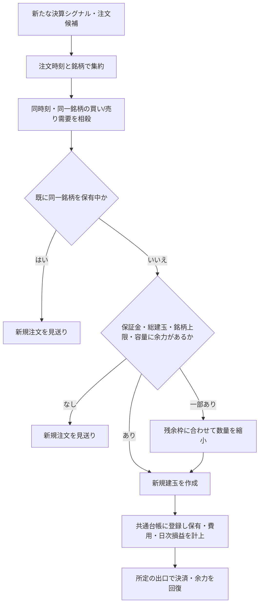

# PEAD01｜戦略の詳細と資本・ポジション管理

**対象：Phase 3〜6.1／2026年11月14日時点の公開実装**

## 1. 基本思想

PEAD01は、**①決算後の価格形成という収益源泉を経済的に説明する**ことと、**②売買ルール・保有期間・資金配分を最適化する**ことを別々に検証する。

決算イベントは日々非同期に発生し、数日〜数十営業日の保有期間は重複する。したがって、独立した取引ごとに資金1億円を使えると仮定せず、**同一の資金・ポジション台帳で後続注文を処理**する。

## 2. 基本戦略：どの値動きを売買するか

| 系統 | 日本語での意味 | 実際に検討する内容 |
| --- | --- | --- |
| A（初動追随） | 決算後の初動に沿う方向の売買 | 発表後の初動を観測し、翌営業日など、シグナル確定後の約定候補から入る |
| B（業績情報との整合性） | 初動と会社予想修正・実績情報が整合するかで条件付け | 営業利益・EPS・業績予想修正の符号と初動の一致・不一致で絞る。情報取得時刻の未確認部分は理論的な評価と区別する |
| C（初動逆張り） | 決算後の過剰反応・反転を狙う | 初動と逆方向の売買。Phase 3では翌営業日の初回約定を観測し、翌々営業日寄りを約定候補とする |
| D（時間軸・出口・配分） | 収益機会の持続時間と資金量を調整 | 分足・日足ホライゾン、損切り・トレーリング・失速・反転出口、銘柄別配分、βヘッジ等 |
| E（銘柄属性・市場局面） | どの銘柄・市場環境で成立するかを検証 | 業種、時価総額、流動性、市場トレンド・変動率、決算集中度等で条件付け |

ロング（買い）、ショート（売り）、LS（初動の符号に応じた買い・売り）、Reverse（初動と逆方向）を比較。初動を観測する前の価格で発注・約定したとは扱わない。

## 3. 戦略の選択・組み合わせ

| 名称 | 日本語の意味 | 実装上の役割 |
| --- | --- | --- |
| Fixed（固定条件） | あらかじめ定めた条件の基準戦略 | 最適化なしの比較対象 |
| Single（単独最良条件） | 過去の成績で選んだ一つの条件 | 一条件の選択を時間更新 |
| Top-K（上位K条件） | 過去上位の複数条件を組み合わせる | 複数条件への分散 |
| Neighbor（近傍条件） | 最良条件に近いパラメータも組み合わせる | 点推定された最適条件への依存を軽減 |
| Shrink（共分散縮小配分） | 戦略間の相関推定を安定化し、配分を決定 | 共分散の対角50%縮小を事前設定 |
| Dynamic（動的配分） | 過去の限られた期間で戦略選択・重みを更新 | 126・252・504営業日や拡張窓、週・月・四半期更新等 |
| Composite Equal（複合均等配分） | 複数の上位戦略へ均等に配分 | Phase 6.1ではSingle・Neighbor・Dynamicを共通台帳で統合 |
| Composite Inverse（複合逆ボラ配分） | 低変動の戦略へ大きく配分 | 上位戦略間の資金配分比較 |
| Composite Shrink（複合共分散縮小配分） | 共分散推定を縮小して資金配分 | 複数戦略の相関とリスクを考慮 |

**アンサンブルの理論損益の単純加算ではない。** 同時刻・同銘柄の売買需要を相殺し、銘柄保有・余力・約定容量を共有する。

## 4. 投下資金の基本設定

| 項目 | Phase 6 | Phase 6.1 |
| --- | --- | --- |
| 初期資本 | 1億円 | 1億円 |
| 基本銘柄上限 | 100万円 | 100万円×配分倍率（1、2、3、5、10）に連動し、シグナル強度・目標稼働率によって縮小 |
| 売買容量 | 過去に観測可能な売買代金を用いた参加率1% | Phase 6で保存した容量制約を継承 |
| 総建玉上限 | グロス原則1倍 | エクイティの1〜3倍（探索格子は1・1.5・2・2.5・3倍） |
| 初期保証金モデル | — | 原則30% |
| 維持率モデル | — | 20% |
| 信用買い金利 | — | 通常ケース年2.8% |
| 貸株料 | 通常年1%のモデル | 通常ケース年1% |

**目標稼働率**は追加注文を作る目標ではない。過去の稼働率に基づいて新規発注サイズを**縮小する上限調整**である。したがって目標5%でも、実測の平均稼働率が5%と一致するとは限らない。

## 5. 非同期シグナルと重複ポジションの扱い

実装上のポイント：

1. 注文候補は**日付・時刻・銘柄**でグループ化する。先に到着した注文が利用可能な余力を消費する。
2. 同時刻・同銘柄の売買需要を**符号付きでネット**し、相殺後の方向を採用。代表する出口ルールはその方向で需要の大きい候補が選ばれる。
3. **同一銘柄の保有中は新しい注文をスキップ**する。追加買いや既存建玉の入れ替えは行わない。
4. 他銘柄の建玉が重なっても、共通余力と総建玉上限を守る範囲で追加できる。
5. 同日中に既存ポジションが先に決済されれば、その回復した余力を後の注文に使用する。既存ポジションの決済が同一時刻の場合の優先順位はコードで別途確認が必要。
6. **Phase 6.1の保証金モデル**は発注時の余力・初期保証金と総建玉上限を制約として用いる。維持率割れは新規注文停止を基本とし、実際の追証・強制成行売却は再現していない。
7. 終値等の利用可能な観測価格で評価し、観測できない板・株数・実際の注文約定は仮定しない。

### 資本拘束の模式例

元本1億円、銘柄上限1,000万円、全銘柄ロング、信用なしという**説明用の仮想例**：

| 日 | 起きたこと | 合計保有額 | 未使用枠 |
| --- | --- | ---: | ---: |
| 1日目 | A社を1,000万円買付 | 1,000万円 | 9,000万円 |
| 3日目 | A社を保有中にB社1,000万円を追加 | 2,000万円 | 8,000万円 |
| 5日目 | C・D・E社の条件が順に成立し各1,000万円を追加 | 5,000万円 | 5,000万円 |
| 以後 | 枠が不足した場合、後から来たシグナルは縮小・見送り | 上限内 | 残余枠次第 |

実際の運用・バックテストでは、保有銘柄の値動き、信用建玉、指数ヘッジ、売買コストによって枠が日々変化する。

## 6. 現在の資本配分で実現していること・いないこと

**実装済み：** 共通の資金・建玉台帳、時刻順処理、同一銘柄の重複排除、同時刻同銘柄の売買相殺、銘柄別上限、事前売買代金ベースの容量制約、信用倍率と保証金の近似モデル、日次損益・費用計上。

**未実装／未検証：** 新旧シグナルの期待収益を比較した強制入れ替え、全候補を順位付けする機会費用ベースの資本最適化、実際の注文板・約定率・スリッページ・制度信用規制履歴・追証強制決済の完全再現。

実装済みの方式は、**後から来た高期待収益シグナルのために既存ポジションを売却する仕組みではなく、時刻順に残余余力を割り当てる方式**である。

## 7. 次に測るべき資本配分の効率

- 資金不足・同一銘柄保有・信用規制等によって、**何件の注文が見送られ、いくらの期待収益機会を失ったか**。
- 見送ったシグナルの事後リターンと、同時間帯に拘束していた既存ポジションの事後リターンの比較。
- 保有残存期間を考慮した、銘柄間の資本効率・機会費用。
- 勝ち負けを単なる日次プラス率でなく、**取引単位の費用控除後勝率・方向的中率・利益損失額**で計測。
- 最終的に、入替費用・保証金・容量を控除した動的リバランスの増益効果を未観測データで評価。

これらは追加検証テーマであり、現時点で増益効果を確認したものではない。

## 8. 実装・設定の参照先

- [Phase 6の共通台帳](../src/pead01/phase6_book.py)
- [Phase 6.1の信用・資本管理](../src/pead01/phase61.py)
- [Phase 6の候補と売買条件](../src/pead01/phase6_grid.py)
- [Phase 6.1の方法と費用仮定](../docs/phase61_methodology.md)
- [探索パラメータの設定](../phase6.json)

公開ソースコードから読み取れるルールの説明であり、実取引の約定実績を意味しない。
