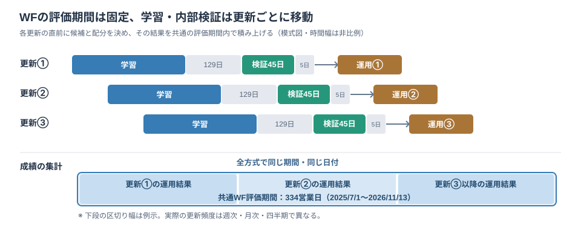

# PEAD01｜ウォークフォワードの期間設計（方式別早見表）

**2026年11月15日時点のPhase 6公開実装を確認。** このページは人が読むための研究設計資料。新規計算結果ではない。

## 先に結論

**Phase 6のWFで成績比較する評価期間は、Fixed・Single・Top-K・Neighbor・Shrink・Max-Sharpe・Dynamicの全24方式で共通の334営業日。** 方式によって変わるのは主に、**学習窓**と**選択・配分の更新頻度**であり、成績を計算する評価期間の長さではない。

「学習252営業日」「学習→内部検証の空白129営業日」「内部検証45営業日」「検証→WFの空白5営業日」「月次更新」「WF評価334営業日」はそれぞれ**別の軸**。また、売買シグナル自体の「20営業日保有」も別の軸である。

## 方式別の一覧

**学習→内部検証は129営業日、内部検証→新規発注適用は5営業日**のブランクを、Fixed以外の全選択方式に共通して設けている。Fixedはパラメータ選択のための学習・内部検証を使わないので、ブランクも「該当なし」とする。

| パラメータ選択・アンサンブル方式 | 学習窓 | **学習→内部検証のブランク** | 内部検証 | **内部検証→WFのブランク** | 更新頻度 | WF共通評価期間 | 候補とウェイト |
| --- | --- | ---: | ---: | ---: | --- | ---: | --- |
| Fixed（固定基準） | なし：事前固定ルール | — | — | — | 売買条件を更新しない | 334営業日 | 固定1件、100% |
| Single（単独最良） | 拡張窓（0） | **129営業日** | 45営業日 | **5営業日** | 四半期 | 334営業日 | 内部検証1位の1件 |
| Neighbor（近傍） | 拡張窓（0） | **129営業日** | 45営業日 | **5営業日** | 四半期 | 334営業日 | 1位の近傍候補を均等配分 |
| Top-3／5／10／20／50 | 拡張窓（0） | **129営業日** | 45営業日 | **5営業日** | 四半期 | 334営業日 | 上位K候補に均等配分 |
| Shrink | 拡張窓（0） | **129営業日** | 45営業日 | **5営業日** | 四半期 | 334営業日 | 上位10候補、縮小共分散で配分 |
| Inverse／Parity／Max-Sharpe | 拡張窓（0） | **129営業日** | 45営業日 | **5営業日** | 四半期 | 334営業日 | 上位10候補、それぞれの最適化ルール |
| Dynamic_W-FRI_{126,252,504,0} | 126／252／504日／拡張窓 | **129営業日** | 45営業日 | **5営業日** | 毎週 | 334営業日 | 上位10候補、動的配分 |
| Dynamic_M_{126,252,504,0} | 126／252／504日／拡張窓 | **129営業日** | 45営業日 | **5営業日** | 毎月 | 334営業日 | 同上 |
| Dynamic_Q_{126,252,504,0} | 126／252／504日／拡張窓 | **129営業日** | 45営業日 | **5営業日** | 四半期 | 334営業日 | 同上 |

「0」はゼロ日学習ではなく、**利用可能な最初の学習日から直近の学習終端までの拡張ウィンドウ**。通常のSingle・Shrink等の学習窓も拡張窓。Fixedは更新日を区切った出力を持ち得るが、学習に基づく条件再選択をしていない。

**334営業日は全方式を同じ評価日付で比較するための共通系列**。開始基準日は2025年7月1日、終端は2026年11月13日。各方式で選択・配分が適用された期間の切れ目は異なるが、これを「方式によってWF期間が異なる」とは呼ばない。

## 更新ごとに学習・検証期間をずらすイメージ




*上段は更新ごとの学習・検証窓の移動を表す概念図で、ブランクを省略している。下段は学習→129営業日ブランク→45営業日内部検証→5営業日ブランク→WF評価の順序を示す模式図。334営業日は各更新後の評価をつないだ共通期間であり、一回の更新で334日を評価する意味ではない。*

## 一度の更新における時間軸

```text
［学習：直近126/252/504営業日、または拡張窓］
        ↓
［学習／内部検証間のブランク：約129営業日］
        ↓
［内部検証：45営業日］
        ↓
［次期適用までのブランク：5営業日］
        ↓
［次の評価区間に新規注文を適用：週次／月次／四半期］
                 ↑
         これら全体のWF結果を同じ334営業日で集計
```

ソースのインデックス定義は次のとおり：

```python
cap = max(config["daily_holds"]) + 4  # 現行 120 + 4 = 124
val_end = start - 5
val_start = val_end - 45
train_end = val_start - cap - 5
train_start = max(0, train_end - window) if window else 0
```

半開区間で、学習は `[train_start, train_end)`、検証は `[val_start, val_end)`、WF適用は `start` 以降。**学習の末尾と検証の先頭の間に未使用129営業日、検証の末尾とWF適用の間に未使用5営業日**がある。したがって、学習期間の終端（排他的）からWF適用開始までのインデックス差は **129 + 45 + 5 = 179営業日**。学習窓の長さやDynamicの更新頻度とは独立。

**配分ウェイトは45日内部検証ではなく、学習窓の日次候補損益で推定**する。45日は候補の再順位付けに使う。新しい配分は次期の**新規注文にだけ適用**し、持越し建玉は従前の決済ルールを保持する。

## なぜ成績がばらつくか

Dynamicの学習窓×更新頻度ごとのWF Sharpe（同じ評価334営業日）：

| 学習窓 | 週次 | 月次 | 四半期 |
| --- | ---: | ---: | ---: |
| 126営業日 | −0.46 | −0.40 | +0.05 |
| 252営業日 | +1.41 | +1.68 | −0.03 |
| 504営業日 | +1.53 | −0.21 | +1.50 |
| 拡張窓（0） | +0.82 | −0.48 | +1.23 |

同じ期間を評価しても、各更新日の学習窓・45日検証窓が異なるため、候補選択と配分が変わる。**学習期間の鮮度、内部検証の選択ノイズ、更新頻度、動的なDD・市場調整**のいずれも候補要因。現在の集計だけで原因を特定しない。

## 今後の検証課題

- 現行の最大120営業日保有が決める一律ブランクは、20営業日など短期候補の**学習データ鮮度を落としている可能性**がある。60日上限／候補別purging等との比較は未実施。
- 60日超の候補を残してブランクだけ短くすると、保有期間をまたぐ情報混入が起こり得る。候補集合の統一・リーク防止テストが必要。
- 週次・月次・四半期は更新回数が違い、45日内部検証の観測日が重複する。更新回数そのものを独立した標本数とみなさない。
- 本研究のWFは**既観測期間の擬似OOS**。未観測の独立OOS・運用実績ではない。

## 関連資料

- [Phase 1〜6.1研究総括](phase1_to_phase61_summary.md)
- [Phase 6質疑の論点と残課題](phase6_qa_findings_and_open_issues_ja.md)
- [Phase 6の方法](../docs/phase6_methodology.md)
- [全方式WF集計](../reports/phase6_walkforward.md)
- [実装](../src/pead01/phase6_report.py)
